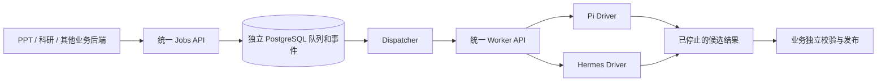

# 通用 Agent 执行服务

2026-10-29 最新状态：科研生产 API 已接入 agent-service，使用用户的 pi-cage；只开放
科研生成与固定证据修订两条 Pi 路由，全局单槽。新 Worker 精确镜像的候选、正式 Jobs
HTTP 和生产科研 HTTP 生成/修订、下载、发布及回执已通过，历史报告仍可读取。
部署与验收证据见 [科研生产接入记录](docs/SCIENTIFIC_CUTOVER_20261029.md)。
PPT 与 Hermes 尚未切换；下文保留初期实现与验证背景。

科研项目工作台另增 plan/retrieve/outline/draft 四个独立合同，输入与跨阶段来源链见
[科研分阶段合同](docs/SCIENTIFIC_WORKFLOW_CONTRACTS.md)。新合同路由默认关闭，
这次代码实现不代表新工作台已部署或已通过生产组合验收。

状态：2026-10-27，已写入通用控制接口、PPT 五阶段与科研生成/修订合同、
Pi/Hermes 独立宿主、受控模型/学术工具代理、只读输入、多文件成果、检查点，
以及两个业务的持久连接器。`9623df8` 已在服务器构建、推送并部署，三个控制服务均为
`1/1 Ready`；Linux/真实 PostgreSQL 完整回归 954 项通过，零失败、错误或跳过。
**生产执行路由仍关闭，现有 PPT/科研后端尚未切换。** Pi 真实候选已进入原生请求，
r7 已完成六次原生调用，随后下一次原生请求仍在 admission 前返回 HTTP 422；最后已完成
响应的 `reasoning` 历史支持仍在补充，不能视为执行成功。当前先完成 Pi 的全部领域验证与
业务试接，Hermes 不作为前置条件，共享网关的额外 Hermes 参数扩展暂停。
最新结果、镜像摘要和证据边界见
[RUNTIME_VALIDATION_20261027.md](docs/RUNTIME_VALIDATION_20261027.md)，
初始实现交接见 [IMPLEMENTATION_HANDOFF_20261026.md](docs/IMPLEMENTATION_HANDOFF_20261026.md)。
部署入口见 [正规部署说明](deploy/README.md)，离线目录生成见
[DEPLOYMENT_CATALOG.md](docs/DEPLOYMENT_CATALOG.md)，文件、检查点与交付协议见
[FILE_DATA_PLANE.md](docs/FILE_DATA_PLANE.md)。
独立分支 `codex/agent-execution-service` 从 `panghu_agent/origin/main`（`64a6188`）创建；
PPT／科研合入 main 后已同步 main。进程核心与低层客户端的
窄范围抽取记录见 [RUNTIME_EXTRACTION.md](docs/RUNTIME_EXTRACTION.md)。
首批历史验证见 [VALIDATION_20261026.md](docs/VALIDATION_20261026.md)；
运行层验证见 [CAPSULE_VALIDATION_20261026.md](docs/CAPSULE_VALIDATION_20261026.md)；
注册与绑定验证见 [REGISTRY_VALIDATION_20261026.md](docs/REGISTRY_VALIDATION_20261026.md)。
本轮运行层、构建与部署边界见 [CAPSULE_RUNTIME.md](docs/CAPSULE_RUNTIME.md)。
现有 PPT/科研 API 与业务能力的覆盖差距及后续服务边界见
[BUSINESS_CAPABILITY_COVERAGE.md](docs/BUSINESS_CAPABILITY_COVERAGE.md)。
用户已确认的任务合同、能力包、工具环境与 Agent 适配边界见
[CAPABILITY_ARCHITECTURE.md](docs/CAPABILITY_ARCHITECTURE.md)；能力包与引擎独立组合，
按完整组合验收后放行。领域合同及连接器代码已写入，生产组合验收仍待完成。
当前配置与 Worker 精确绑定见 [REGISTRY_BINDINGS.md](docs/REGISTRY_BINDINGS.md)。

业务调用同一个 Jobs API，由部署者将版本化任务 profile 路由到 Pi 或 Hermes。
模型、命令、镜像、凭据和引擎会话属于服务端配置，不由业务请求选择。



## 首批已实现

- 中立 Job / Attempt / Input / Artifact / Capability / StopReceipt 契约。
- 独立、不可变的任务合同、能力包、工具环境与执行绑定目录；拒绝未知实现、缺失依赖
  和旧组合验收。新 Job 固定包/环境/适配器/模型策略及验收摘要，贯通 Worker/K8s。
- 调用服务身份绑定 tenant、caller 和 profile 权限；逐任务、事件及产物鉴权。
  撤回 profile 权限后禁止读取历史结果，原调用方仍能取消原任务。
- PostgreSQL 持久状态、全局单槽、事务领取、attempt/fence/租约、取消与完成竞态处理。
  SQLite 仅在显式开发／测试配置下使用。
- 幂等键绑定原始请求。路由变更、配置禁用或丢失响应后重投，都不会改变已接受任务的
  引擎、版本和绝对截止时间。没有不确定收费任务的自动重试。
- 按合同限制输入和产物大小/数量，支持相对目录与二进制普通文件；PPT 成果最多
  2048 文件、256MiB、单文件64MiB。引用保留、主动删除、检查点和交付回执均已写入，
  没有自动 TTL 删除仍被业务引用的文件。
- 独立 Worker API，持久化执行身份后才启动原生引擎；租约失联自主停止，重启后的
  未解决执行进入 quarantine。物理执行无法证实停止时不交付产物、不释放槽。
- Pi CLI 与 Hermes Runs 驱动。Hermes 持久保存 session、admission 意图和原 run；
  丢失收费 admission 响应不重复 POST。Pi 使用显式可信 profile、空 HOME 和原有隔离逻辑。
- 结果回执认证 job、attempt、fence、完整请求、结果及资源身份。宿主实际观察到所有
  writer 停止后才可签名；`completed` 只表示执行交接，不授予业务验收或发布。
- 用量缺失保持 `null`／`unknown`。公开事件仅包含净化的状态元数据。
- 按 attempt 持久分配 K8s Pod，独立创建／原生接收 CAS、固定 Pod UID、每任务认证密钥、
  平台显式预留且永不复用的任务 UID、finalizer 保留停止观测；候选先入库，观测全部
  容器停止后交接、清理。领取时冻结静态/K8s 模式，防止部署切换误接管旧执行。
- 控制重启复用原资源与候选；隔离任务须确认原 Pod 停止并退休后才能回收槽，不交付
  隔离前候选，也不发起新的物理 attempt。
- Worker 净化事件与持久 cursor 同事务汇入业务事件，重连不重复，饱和后仍可推进游标。
- PPT 的 plan_initial/plan_options/prepare/generate/revise 与科研 generate/revise 均有
  独立 task schema、工具范围、输出 collector 和业务复验。PPT 保持两轮确认和审核稿；
  科研保留固定证据修订及原有报告版本/发布事务。
- 模型使用 attempt/request/binding/deadline 绑定的短期 Responses grant；固定上游
  key 只在代理侧。持久调用 admission 防止失联后重新付费；学术调用另有受保护观测。

## 当前边界

**内部控制面已部署，PPT／科研尚未接入新执行后端**。业务后端只有显式选择 `agent-service` 才走新连接器；
默认配置维持原入口。新目录生成器将所有路由保持关闭，操作员验收证据与宿主
实际 readiness 都满足后才能开放具体的合同/引擎组合。

当前 Worker capsule 只接受一个 attempt。完成后不再就绪，不能将一个静态 endpoint
当作可反复使用的生产资源池。新增 K8s provider 为每次任务创建独立 capsule，并核对
实际执行命令、权限和挂载；Pi 宿主候选采用私有 PID namespace、控制／Agent UID 分离
和 pidfd 停止观察。真实候选镜像、网络／挂载／模型能力仍须验收后才开放业务路由。

`workspace-task.v1` 仍只支持有界文本；领域合同独立声明只读输入能力。
输入通过专用受限宿主执行真正的 RO bind mount，没有复制/仅 chmod 的降级路径。
PPT 预览使用独立持久预留 UID，停止证明覆盖两组 writer。已在真实节点验证指定输入/
检查点挂载与 AppArmor 隔离、降权和停止，并修复权限交接顺序；完整 CNI、原生模型回合、
领域成果和业务发布验收仍未完成，具体通过范围以最新验证记录为准。

业务事件包括持久生命周期及 Worker 净化进度，使用持久 worker cursor 去重汇入。
支持明确兼容规则内的文件检查点重放；暂不提供原生 session resume/fork/steer
或任意代码／插件上传。私人 HOME 和引擎原生会话不会跨引擎迁移。

## API

除 `/healthz` 外，都必须带调用服务自己的 `Authorization: Bearer ...`。
服务 token 与模型供应商 key 分开；该内部接口无需新增业务用户登录入口。

| 接口 | 用途 |
| --- | --- |
| `GET /v1/capabilities` | 允许的 profile／pins 和接收能力；K8s 池标明冷启动后须检查原生 readiness |
| `POST /v1/inputs?name=source.txt` | 有界普通文件上传，Content-Type 为 application/octet-stream |
| `POST /v1/jobs` | 必带 Idempotency-Key，接受返回202；已存在的相同请求返回200 |
| `GET /v1/jobs/{id}` | 权威状态、执行 pins、错误码及已知用量 |
| `GET /v1/jobs/by-idempotency/{key}` | 只读恢复丢失响应的提交，取消时不重新 POST |
| `GET /v1/jobs/{id}/events?after=0&limit=100` | 持久事件分页，最多100条 |
| `POST /v1/jobs/{id}/cancel` | 请求取消，返回 cancelling 直到确实停止 |
| `GET /v1/jobs/{id}/artifacts` | 已冻结的候选文件索引 |
| `GET /v1/artifacts/{id}/content` | 每次授权的有界文件下载 |
| `GET /v1/jobs/{id}/artifact-manifest` | 服务测量的成果集合、文件摘要与 attempt 绑定 |
| `POST /v1/jobs/{id}/checkpoints` | 可信停止成果建立可保留的文件检查点 |
| `GET/DELETE /v1/checkpoints/{id}` | 所有权范围内读取/主动删除检查点 |
| `PUT/GET /v1/jobs/{id}/recovery` | 使用 revision CAS 保存业务恢复元数据 |
| `POST /v1/jobs/{id}/retention/release` | 业务显式释放引用，不自动删除仍被依赖的文件 |
| `POST/GET /v1/jobs/{id}/publication-ack` | 记录交付确认；不授予业务发布权限 |

任务请求不包含 engine、model URL、命令或凭据：

```python
from agent_service.client import AgentClient

with AgentClient(service_origin, service_token) as client:
    job = client.submit({
        "api_version": "1",
        "profile": "workspace-task.v1",
        "profile_revision": "v1",
        "business_ref": "business-project-stage-reference",
        "task": {"prompt": "根据已授权内容整理技术说明。"},
        "timeout_seconds": 600,
    }, idempotency_key="persisted-business-stage-id")
    state = client.get_job(job["job_id"])
```

业务端应先持久保存阶段引用和幂等键，丢响应后可只读按幂等键恢复原 Job；取消过程中
不通过重 POST 制造新提交。PPT 的每个阶段对应一个
服务 Job；两轮确认、大纲和版本基线、独立校验、PowerPoint验收与发布仍属于 PPT 后端。

## 如何切换引擎

在服务端登记同一任务合同可用的能力包/工具环境和新引擎 `execution_bindings`，补齐
精确组合的验收记录，再调整 `routes` 的绑定引用。业务请求无需改名。
配置生效后只影响新 Job，旧 Job 和旧幂等键继续使用原来的 pins。未就绪返回503，
不会静默切换其他引擎或导入另一引擎的原生 HOME。

如果提示词、工具或产物语义发生变化，发布新的 profile revision，再由业务明确采用。
引擎抽象不意味着每个 profile 自动支持两个引擎。

## 开发运行

需要 Python 3.11+，依赖见 [requirements.txt](requirements.txt)。公开配置模板为
[config.example.json](config.example.json)，控制配置直接使用 schema_version 2，旧版
合并式 profiles 配置会被拒绝。调用 token、receipt key 和 database URL
放在单独的受保护文件中，不提交 Git。示例中 profile 默认禁用。

CLI 的精确参数可执行 `python -m agent_service --help` 查看。典型顺序：

```bash
python -m agent_service --config /etc/agent-service/config.json --secrets /run/secrets/agent-service.json check
python -m agent_service --config /etc/agent-service/config.json --secrets /run/secrets/agent-service.json init-db
python -m agent_service --config /etc/agent-service/config.json --secrets /run/secrets/agent-service.json api
# 在独立进程启动控制循环
python -m agent_service --config /etc/agent-service/config.json --secrets /run/secrets/agent-service.json dispatch
```

`check` 只检查配置结构，不联网、不调用模型。建表仅由显式 `init-db` 执行，API不隐式
启动 Agent 或调度器。Worker API 由可信宿主调用 `create_worker_app(host, token)` 装配；
API进程不动态加载请求指定模块。K8s 候选配置见
[config.kubernetes.example.json](config.kubernetes.example.json)，两种模式不能占用同一 engine。
`bash agent_service/build.sh` 构建控制镜像，`--target pi` 构建 Pi 候选；详见运行层文档。

## 本轮交接

2026-10-28 起，Pi Worker 改为引用用户 `zmhhaha/pi-cage` 仓库的固定一次性入口和
`@earendil-works/pi-coding-agent 0.99.2`。构建输入为 `PI_CAGE_IMAGE`；来源、命令和
最新验证记录见 [pi-cage 接入](docs/PI_CAGE_INTEGRATION.md)。下方旧版本运行记录保留为历史，
不能用其验收结果替代新版本验收。

上述领域合同、文件数据面、两引擎宿主、短期模型授权、业务连接器和部署入口均已
写入代码，线上控制面仍为 `9623df8`。最新源码 `a067949` 完整离线/真实 PostgreSQL 回归为
1071 项通过、零失败或跳过、模型调用 0、临时测试资源清理完成。
真实 Pi r6 的两项 ledger 均为 HTTP 200（回显及一次原生调用），下一次原生请求因 phase
在 admission 前返回 422；r7 修复 phase 后七项 ledger 均为 HTTP 200（回显及六次原生调用），
随后第七次原生请求仍在 admission 前返回 422。两轮均 exit 2、restart 0、停写已证实、
临时资源已清理且过期 grant 返回 401；这些证明停止与清理，不证明领域执行成功。

`548fb33` 已补齐业务部署接线，`96fad52`/`5ad6c90` 补齐受限工具图片和 assistant phase，
`03b5fff` 提供七个领域 profile 的分阶段候选验证入口，均不表示七个合同已验收。
`a067949` 已补齐受限 reasoning 历史回放；当前正在做新版本完整 Linux/PG 与真实领域验证。
共享 `llm-service` 的独立分支 `codex/agent-native-responses` 已部署 `e5351c4`，保留原生
Responses 的 phase、图片工具结果及自包含 reasoning 历史，部署只改变镜像。当前没有 production
acceptance，所有生产执行路由保持关闭，PPT/科研后端未切换。后续先完成 Pi 领域验证，
再按全局单槽接入业务试用并检查独立发布与回滚；Hermes 不是前置条件。最新证据见
[原生引擎恢复验证](docs/RUNTIME_VALIDATION_20261027.md)，初次部署背景见
[服务器交接](docs/SERVER_DEPLOYMENT_20261026.md)。

完整实现及原始验证计划见
[IMPLEMENTATION_HANDOFF_20261026.md](docs/IMPLEMENTATION_HANDOFF_20261026.md)，
2026-10-28 休息收尾和最新接续边界见
[SESSION_HANDOFF_20261028.md](docs/SESSION_HANDOFF_20261028.md)。
PPT 配置见 [部署接线](../ppt_service/deploy/agent/README.md)，科研配置见
[科研接线](../scientific_agent/AGENT_SERVICE.md)。

OpenSpec 权威变更为仓库映射项目中的 `add-pi-first-agent-execution-service`；该历史 change
ID保留，2026-10-25后的用户授权已将实现目标扩展为 Pi/Hermes 双引擎。
