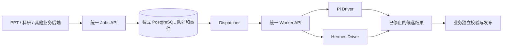

# 通用 Agent 执行服务

状态：2026-10-26，已实现控制接口、按任务分配 K8s capsule、恢复及 Pi 宿主候选。
独立分支 `codex/agent-execution-service` 从 `panghu_agent/origin/main`（`64a6188`）创建；
PPT／科研合入 main 后已同步 main，通用 runtime 仍无业务包依赖。进程核心与低层客户端的
窄范围抽取记录见 [RUNTIME_EXTRACTION.md](docs/RUNTIME_EXTRACTION.md)。
首批历史验证见 [VALIDATION_20261026.md](docs/VALIDATION_20261026.md)；
本轮验证见 [CAPSULE_VALIDATION_20261026.md](docs/CAPSULE_VALIDATION_20261026.md)。
本轮运行层、构建与部署边界见 [CAPSULE_RUNTIME.md](docs/CAPSULE_RUNTIME.md)。

业务调用同一个 Jobs API，由部署者将版本化任务 profile 路由到 Pi 或 Hermes。
模型、命令、镜像、凭据和引擎会话属于服务端配置，不由业务请求选择。



## 首批已实现

- 中立 Job / Attempt / Input / Artifact / Capability / StopReceipt 契约。
- 调用服务身份绑定 tenant、caller 和 profile 权限；逐任务、事件及产物鉴权。
  撤回 profile 权限后禁止读取历史结果，原调用方仍能取消原任务。
- PostgreSQL 持久状态、全局单槽、事务领取、attempt/fence/租约、取消与完成竞态处理。
  SQLite 仅在显式开发／测试配置下使用。
- 幂等键绑定原始请求。路由变更、配置禁用或丢失响应后重投，都不会改变已接受任务的
  引擎、版本和绝对截止时间。没有不确定收费任务的自动重试。
- 输入／产物 blob 的大小和 SHA256、所有权及不可变访问；当前每文件输入上限1MiB，
  产物总量8MiB。没有自动 TTL 删除，后续引用保留和主动删除另行接入。
- 独立 Worker API，持久化执行身份后才启动原生引擎；租约失联自主停止，重启后的
  未解决执行进入 quarantine。物理执行无法证实停止时不交付产物、不释放槽。
- Pi CLI 与 Hermes Runs 驱动。Hermes 持久保存 session、admission 意图和原 run；
  丢失收费 admission 响应不重复 POST。Pi 使用显式可信 profile、空 HOME 和原有隔离逻辑。
- 结果回执认证 job、attempt、fence、完整请求、结果及资源身份。宿主实际观察到所有
  writer 停止后才可签名；`completed` 只表示执行交接，不授予业务验收或发布。
- 用量缺失保持 `null`／`unknown`。公开事件仅包含净化的状态元数据。
- 按 attempt 持久分配 K8s Pod，独立创建／原生接收 CAS、固定 Pod UID、每任务认证密钥、
  平台显式预留且永不复用的任务 UID、finalizer 保留停止观测；候选先入库，观测全部
  容器停止后交接、清理。领取时冻结静态/K8s 模式，防止部署切换误接管旧执行。
- 控制重启复用原资源与候选；隔离任务须确认原 Pod 停止并退休后才能回收槽，不交付
  隔离前候选，也不发起新的物理 attempt。
- Worker 净化事件与持久 cursor 同事务汇入业务事件，重连不重复，饱和后仍可推进游标。

## 当前边界

这是服务基础与引擎适配的首批交付，**尚未上线或接管 PPT／科研**。现有8页 DSH PPT
仍由原 Hermes 链路提供。Pi 的 `WorkspaceTaskProfile.production_ready` 默认 `False`，
没有因通用包装而获得 PPT 五阶段生产能力。

当前 Worker capsule 只接受一个 attempt。完成后不再就绪，不能将一个静态 endpoint
当作可反复使用的生产资源池。新增 K8s provider 为每次任务创建独立 capsule，并核对
实际执行命令、权限和挂载；Pi 宿主候选采用私有 PID namespace、控制／Agent UID 分离
和 pidfd 停止观察。真实候选镜像、网络／挂载／模型能力仍须验收后才开放业务路由。

首个中立 profile 是 `workspace-task.v1`，支持有界 `prompt`。Worker API 当前明确声明
`supports_inputs=false`，领域文件的只读挂载尚未接入；上传存储接口本身已有实现。
Pi profile 的开发准备函数不等于生产只读挂载证明。

业务事件包括持久生命周期及 Worker 净化进度，使用持久 worker cursor 去重汇入。
暂不提供原生 session resume/fork/steer、跨引擎恢复、
业务连接器或任意代码／插件上传。

## API

除 `/healthz` 外，都必须带调用服务自己的 `Authorization: Bearer ...`。
服务 token 与模型供应商 key 分开；该内部接口无需新增业务用户登录入口。

| 接口 | 用途 |
| --- | --- |
| `GET /v1/capabilities` | 允许的 profile／pins 和接收能力；K8s 池标明冷启动后须检查原生 readiness |
| `POST /v1/inputs?name=source.txt` | 有界普通文件上传，Content-Type 为 application/octet-stream |
| `POST /v1/jobs` | 必带 Idempotency-Key，接受返回202；已存在的相同请求返回200 |
| `GET /v1/jobs/{id}` | 权威状态、执行 pins、错误码及已知用量 |
| `GET /v1/jobs/{id}/events?after=0&limit=100` | 持久事件分页，最多100条 |
| `POST /v1/jobs/{id}/cancel` | 请求取消，返回 cancelling 直到确实停止 |
| `GET /v1/jobs/{id}/artifacts` | 已冻结的候选文件索引 |
| `GET /v1/artifacts/{id}/content` | 每次授权的有界文件下载 |

任务请求不包含 engine、model URL、命令或凭据：

```python
from agent_service.client import AgentClient

with AgentClient(service_origin, service_token) as client:
    job = client.submit({
        "api_version": "1",
        "profile": "workspace-task.v1",
        "profile_revision": "v1",
        "business_ref": "business-project-stage-reference",
        "task": {"prompt": "根据已授权内容整理技术说明。"},
        "timeout_seconds": 600,
    }, idempotency_key="persisted-business-stage-id")
    state = client.get_job(job["job_id"])
```

业务端应先持久保存阶段引用和幂等键，丢响应后重投同一个键。PPT 的每个阶段对应一个
服务 Job；两轮确认、大纲和版本基线、独立校验、PowerPoint验收与发布仍属于 PPT 后端。

## 如何切换引擎

在服务端的 `profiles` 中，将同一个 `name + revision` 的 `engine` 路由改到另一个已经
完成能力验收的 Worker，同时填写该 Worker 的固定 runtime/image pins。业务请求无需改名。
配置生效后只影响新 Job，旧 Job 和旧幂等键继续使用原来的 pins。未就绪返回503，
不会静默切换其他引擎或导入另一引擎的原生 HOME。

如果提示词、工具或产物语义发生变化，发布新的 profile revision，再由业务明确采用。
引擎抽象不意味着每个 profile 自动支持两个引擎。

## 开发运行

需要 Python 3.11+，依赖见 [requirements.txt](requirements.txt)。公开配置模板为
[config.example.json](config.example.json)；调用 token、receipt key 和 database URL
放在单独的受保护文件中，不提交 Git。示例中 profile 默认禁用。

CLI 的精确参数可执行 `python -m agent_service --help` 查看。典型顺序：

```bash
python -m agent_service --config /etc/agent-service/config.json --secrets /run/secrets/agent-service.json check
python -m agent_service --config /etc/agent-service/config.json --secrets /run/secrets/agent-service.json init-db
python -m agent_service --config /etc/agent-service/config.json --secrets /run/secrets/agent-service.json api
# 在独立进程启动控制循环
python -m agent_service --config /etc/agent-service/config.json --secrets /run/secrets/agent-service.json dispatch
```

`check` 只检查配置结构，不联网、不调用模型。建表仅由显式 `init-db` 执行，API不隐式
启动 Agent 或调度器。Worker API 由可信宿主调用 `create_worker_app(host, token)` 装配；
API进程不动态加载请求指定模块。K8s 候选配置见
[config.kubernetes.example.json](config.kubernetes.example.json)，两种模式不能占用同一 engine。
`bash agent_service/build.sh` 构建控制镜像，`--target pi` 构建 Pi 候选；详见运行层文档。

## 后续实施顺序

1. 接通短期任务模型代理授权的签发／注入，补齐 Hermes 独立宿主。当前 provider 只签发
   Worker 控制认证，未签发模型授权；默认示例和原生生产 readiness 保持关闭。
2. 构建候选镜像，完成真实 K8s、网络、模型／工具／取消验收，再按 profile 开放可用性。
3. PPT 后端 outbox 连接器，保留现有网页与两轮确认，先迁移新阶段任务。
4. 领域文件挂载、产物引用／删除与业务额度／计量对接。
5. 科研及其他业务按各自 profile 迁入，保留独立验收与回滚。

OpenSpec 权威变更为仓库映射项目中的 `add-pi-first-agent-execution-service`；该历史 change
ID保留，2026-10-25后的用户授权已将实现目标扩展为 Pi/Hermes 双引擎。
