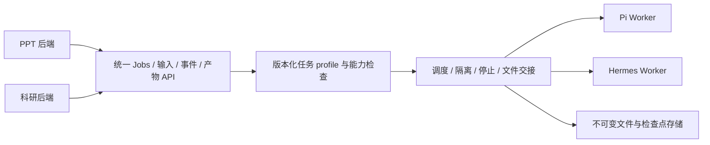

# PPT 与科研的通用 Agent 服务覆盖情况

2026-10-26，基于 `codex/agent-execution-service` 的 `cf35db2` 只读核对。
本文件区分代码已经实现的接口与尚待实现的业务能力。没有上线通用服务、调用模型或
修改现有 PPT/科研服务。权威规格仍为映射项目中的 OpenSpec change
`add-pi-first-agent-execution-service`。

## 当前结论

通用服务已实现任务控制底座与 Pi/Hermes 驱动合同，但**尚不能替换现有 PPT 或科研
完整执行链**。现阶段配置加载器把全部 profile 绑定到文本任务校验器，Worker 仅接
prompt、只输出文本 JSON。不能只改引擎名称或提供 API Key 就获得现有业务能力。

## PPT 实际使用的 Hermes 接口

| Hermes HTTP | 当前 PPT 用途 | 通用服务中的对应能力 |
| --- | --- | --- |
| `GET /v1/capabilities` | 专用 Gateway 启动探测 | `/v1/capabilities` 与 HermesDriver 原生探测已实现；生产 Hermes 宿主未装配 |
| `POST /api/sessions` | 创建隔离阶段会话 | HermesDriver 内部创建；业务端改用 Job，无需创建 Hermes session |
| `GET /api/sessions/{id}` | 创建409后核验原会话 | HermesDriver 已实现同一原会话核验 |
| `POST /v1/runs` | 幂等接收一次执行 | 对外 `POST /v1/jobs`；驱动持久 admission CAS 后调用原生接口 |
| `GET /v1/runs/{id}` | 状态、结果文本及用量 | `GET /v1/jobs/{id}` 和结果产物；驱动轮询原 run |
| `POST /v1/runs/{id}/stop` | 请求取消/超时停止 | `POST /v1/jobs/{id}/cancel`，还须宿主证明全部 writer 停止 |
| `GET /v1/runs/{id}/events` | 客户端有 SSE，PPT execute 当前未实际消费 | 通用持久事件分页已实现；HermesDriver 未消费原生 SSE，不声称流式内容等价 |

代码位置：`ppt_service/worker/hermes_client.py:126`、`worker/execute.py:294`，
`agent_service/engines.py:275`。这些是执行控制协议，PPTX 生成、预览和发布不由这些
HTTP 路由本身提供。

## 通用业务 API 已实现的部分

| 接口 | 代码现状 |
| --- | --- |
| `GET /v1/capabilities` | 允许的 profile/pins、接收能力；冷池不等于原生模型已验收 |
| `POST /v1/jobs` | 幂等提交、固定执行身份和绝对时限、排队 |
| `GET /v1/jobs/{id}` | 权威执行状态、错误码及已知用量 |
| `GET /v1/jobs/{id}/events` | 有界持久分页事件、游标重连；当前为净化状态元数据 |
| `POST /v1/jobs/{id}/cancel` | 请求停止，确认全部 writer 停止后收尾 |
| `POST /v1/inputs?name=...` | 输入存储接口；执行侧仍声明 `supports_inputs=false`，未接通挂载 |
| `GET /v1/jobs/{id}/artifacts` | 候选产物索引；当前 Worker 只导出文本 JSON |
| `GET /v1/artifacts/{id}/content` | 有鉴权的不可变文件下载，尚非完整业务项目交接 |

实现见 `agent_service/api.py:237`，当前文本输出限制见 `worker_api.py:284`、`:342`，
profile 校验器固定绑定见 `config.py:386`。服务没有新增原生 session resume/fork/steer
接口，不接受业务请求指定命令、镜像、模型凭据或宿主路径。

## 完整业务能力缺口

| 能力 | 现有业务已有 | 通用服务仍需完成 |
| --- | --- | --- |
| PPT 五阶段 | plan_initial、plan_options、prepare、generate、revise | 每阶段的任务/输出 schema、可信 profile 和工具资源包 |
| PPT 素材与产物 | 项目目录、资料、SVG、PNG、PPTX、质量报告 | 只读输入物化、多文件/目录清单、二进制传输与停止后可信冻结 |
| PPT 跨阶段与修改 | 恢复项目及 Hermes HOME/session，指定版本修订 | 业务版本绑定的中立 artifact checkpoint 和明确兼容规则 |
| PPT 预览与图像审查 | 官方预览、逐页渲染/审查、导出与独立校验 | 受管 preview helper、独立 UID/全部 writer 停止证明及能力验收 |
| 科研生成 | 学术检索、证据、引用、报告及校验成果 | 研究 profile、受限检索工具桥和多文件 collector |
| 科研修订 | 固定证据、指定版本/章节、差异比较与采用 | 修订 profile、证据快照/lineage、保持未修改部分的合同 |
| 科研发布恢复 | 持久提交映射、待发布重放、publication ack | 通用连接器的 outbox/映射、独立校验和幂等发布恢复 |
| 生产执行 | 现有业务各自具备部署链 | 短期模型授权签发/注入、Hermes 宿主、实际候选镜像及模型/K8s 验收 |

传输规模也尚不等价：通用输入每文件1MiB、产物总8MiB；当前 PPT 可信清单允许最多
2048文件/256MiB，科研产物总50MiB、报告2MiB、修订材料16MiB。后续按 profile 制定
有界额度和传输方式，不能沿用文本默认额度降低既有业务能力，也不能简单解除所有上限。

科研当前通过 `scientific_agent/pi_client.py` 调用 `/v1/tasks`、`/v1/revisions`、结果、
产物、取消、pending-publication 与 publication-ack；`pi_projection.py` 拥有持久交接
及发布事务。这些内部接口不必逐字复制，但其恢复和业务一致性必须保留。

## 目标服务边界

用户已确认以“任务合同 + 版本化能力包”为主要边界，能力包与 Agent 独立组合。
任务 schema/collector、skills/资源、工具依赖环境与 Agent 适配分别固定版本，服务端
执行绑定决定经过验收的组合。详细责任、注册/解析和验收规则见
[CAPABILITY_ARCHITECTURE.md](CAPABILITY_ARCHITECTURE.md)。以下为目标结构，尚未完成领域实现。

业务后端继续拥有用户/项目权限、额度、PPT 两轮确认与方案选择、权威版本及发布，
以及科研证据规则、章节修订采用与报告发布。通用执行器拥有执行状态与资源，交付
候选结果；`completed` 不自动成为业务 accepted/published。

拟增加以下 profile，**当前尚未注册或可用**：

- PPT：`ppt.plan_initial.v1`、`ppt.plan_options.v1`、`ppt.prepare.v1`、
  `ppt.generate.v1`、`ppt.revise.v1`。
- 科研：`research.generate.v1`、`research.revise.v1`。

profile 定义任务 schema、输入/输出合同、预算、能力要求和 checkpoint 兼容规则；
能力包提供固定 skill/指令/资源，工具环境提供依赖与稳定工具接口，适配器处理引擎差异。
核心任务协议保持中立，不从业务请求加载任意模块。服务端执行绑定把这些版本与
Pi/Hermes 组合并逐项验收，包括实际工具、模型图像能力和输出合同。

创建新任务时固定引擎/runtime/image/profile 及能力包/工具环境摘要；改路由仅影响
新的逻辑任务，旧任务继续原执行身份。新引擎读取已授权的资料和项目文件，不能
导入另一个引擎的私人 HOME。
跨阶段/跨引擎 artifact replay 须显式通过 profile、格式、版本来源及兼容验收；不支持
的组合明确拒绝。旧 Hermes 项目的迁移/排空路径须独立验证，不能直接改 URL 接管。

用户已确认生命周期：每个阶段的一次执行对应一个 Job/attempt Pod；候选先持久保存，
立即进入停止清理，可信观察全部 writer 和原 Pod 容器停止后才向业务交接。
没有等待用户的额外保留期。用户确认、阅读或准备修改时不占
执行 Pod；下一次修改创建新任务，从持久业务版本恢复所需材料。当前全局并发为1。

## 接下来按什么顺序完成

1. 实现实际 profile 注册/任务 schema 和多文件 collector，解除仅文本的结构限制。
2. 实现只读输入、目录/二进制成果、profile 配额与中立 artifact checkpoint。
3. 装配模型授权、Pi/Hermes 生产宿主及固定工具镜像，完成真实模型与停止验收。
4. 按五阶段接 PPT outbox/结果映射，保留现有网页、确认、版本、校验与发布。
5. 接科研生成和固定证据修订，保留发布事务、重放/ack 与原公开 API。
6. 以相同业务任务分别验收 Pi/Hermes 支持的 profile 后开放新任务路由，演练排空与回滚。

“整套可用”的验收是既有 PPT/科研业务结果和恢复流程保持完整，同时业务调用不再
包含 Pi/Hermes 原生接口或 session 依赖；不是只核对新服务列出了多少条 HTTP 路由。
