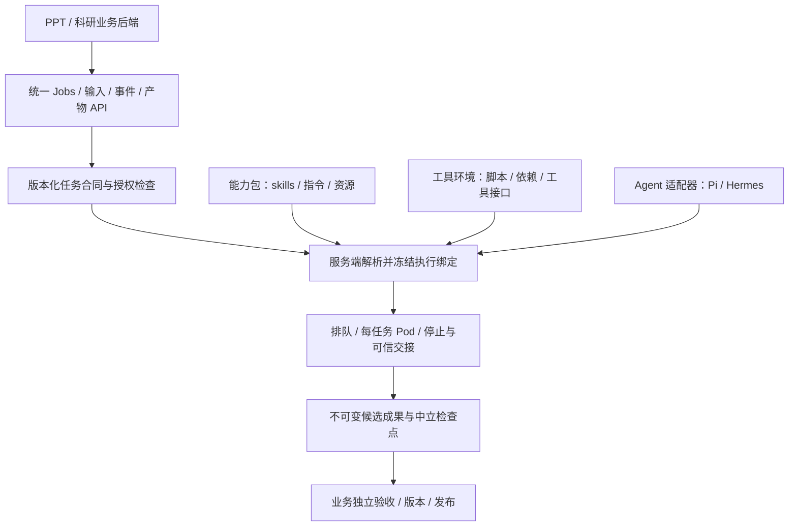

# 任务合同、能力包与 Agent 适配的架构

2026-10-26，用户已确认的目标架构。本文描述后续实现边界；当前控制底座、业务覆盖
缺口分别见 [README](../README.md) 和 [覆盖矩阵](BUSINESS_CAPABILITY_COVERAGE.md)。
本文中的领域 profile 和生产组合验收尚未完成。独立能力包注册、不可变绑定及控制到
Worker 的精确身份核对现已实现，实际配置见 [注册说明](REGISTRY_BINDINGS.md)。
权威规格为仓库映射项目的 OpenSpec change `add-pi-first-agent-execution-service`。

## 核心决定

业务通过版本化任务合同调用能力，例如 `ppt.generate.v1`，不调用 Pi/Hermes 原生
接口。**能力包与 Agent 是两个独立维度**：同一份经过审查的 PPT Master 资源和工具，
可由通过相同任务合同验收的 Hermes 或 Pi 使用。增加 Agent 时补齐适配和组合验收，
不复制 PPT/科研业务流程。

图中的能力包、工具环境和适配器是独立版本边界，可以装配在同一个固定 Worker 镜像
中。无需为每个 skill 单独部署 HTTP 服务；已有脚本优先复用稳定 CLI/工具桥，确有
共享调用需求时再采用 MCP/HTTP。Agent 能读同一份 `SKILL.md` 只是装载条件，还须满足
工具、Python/渲染依赖、模型图像能力、权限、输入输出及停止合同。

## 责任分配

| 部分 | 拥有的责任 |
| --- | --- |
| 业务后端 | 用户/项目权限、业务授权快照、PPT 两轮确认与阶段推进、版本/修订采用、科研证据政策、独立验收和最终发布 |
| 任务合同（profile） | 任务 schema、输入角色、输出角色/格式、结构校验与 collector、恢复兼容规则、预算及能力要求 |
| 能力包 | 固定版本的 skills、任务指令、模板、参考资源、来源/许可/文件摘要、依赖和工具需求；不含 Agent 私人会话 |
| 工具环境 | 固定脚本和依赖、解释器/渲染器、检索或预览工具的稳定接口；权限由平台限制，不由模型扩大 |
| 通用执行服务 | 服务鉴权、Job/attempt、幂等、排队、工作区与文件交接、任务模型授权、配额、取消、停止观察和资源清理 |
| Agent 适配器 | 显式 skill 装载、工具名/参数映射、模型及视觉接口适配、启动/事件/停止协议、私有原生状态处理 |
| 经验收的执行绑定 | 为一个任务合同选定能力包、工具环境、适配器、runtime/image 与模型协议能力，记录组合验收证据 |

领域合同、collector 和校验器作为受审查的独立资源注册，不要求通用执行内核导入
PPT/科研的后端应用或数据库。业务仍须独立核对语义和发布条件；执行服务的结构
校验通过及 `completed` 只表示候选交接，不能替代业务 accepted/published。

## 注册与解析

服务端维护三个逻辑目录：版本化任务合同、能力包/工具环境、已验收执行绑定。它们
可由同一份受控部署配置装配，暂不需要新增管理 UI 或独立注册中心。

以 `ppt.generate.v1` 为例，逻辑上可以有以下组合；这不是当前可用性声明：

| 任务合同 | 能力包及工具环境 | Agent | 放行条件 |
| --- | --- | --- | --- |
| 同一 PPT 生成合同 | 固定 PPT Master 资源、Python/渲染/预览工具 | Hermes | 该完整组合通过 PPT 合同和停止验收 |
| 同一 PPT 生成合同 | 同一能力包和等价工具接口 | Pi | 独立通过同一合同，不能沿用 Hermes 验收结论 |
| 同一科研生成合同 | 已选科研包、受限学术检索/证据工具 | Hermes 或 Pi | 分别验证证据、引用、成果与工具权限 |

业务提交授权的 profile/revision、任务、输入和业务版本快照；不提交 Agent 名称、
任意上游仓库、代码路径或命令。服务端依次验证合同与调用权限、输入/检查点兼容、
包完整性、工具与模型能力、执行绑定证据以及池容量，再冻结解析结果。

首次接受 Job 时固定 profile/revision、能力包版本/内容摘要、工具环境版本/摘要、
适配器/runtime 版本、镜像 digest 和已批准模型策略。任务授权在启动时按冻结策略
签发；凭据不成为公开元数据。原幂等键返回原 Job；更改路由只影响新逻辑任务。
queued Job 也不因稍后修改配置被重新解析，未就绪组合明确拒绝，不静默换 Agent。

模型协议、图像输入和工具调用能力属于组合验收条件；仅证明 HTTP 能连通或设置
`ready=true` 不算验收。能力目录区分：合同已注册、组合已验收、当前池可接收，以及
冷启动后的原生 Worker readiness。DSH 只作为未来适配目标，当前没有 DSH 驱动。

能力包发布固定上游 commit/资源摘要、许可和审查记录。更新先审查和验收，再切新
任务；不在运行时 clone 或自动追随上游。指令、工具或输出语义变化发布新的合同
revision；仅替换等价运行环境也须重新验收该绑定，不能覆盖旧任务的执行来源。

## PPT 与科研的落地范围

PPT 合同按已有阶段划分：`ppt.plan_initial.v1`、`ppt.plan_options.v1`、
`ppt.prepare.v1`、`ppt.generate.v1`、`ppt.revise.v1`。每个合同只负责一次已授权执行；
五阶段由 PPT 后端推进，不新增一个替业务等待确认的常驻 Agent 流程。

PPT 先提取引擎中立指令、项目工具和输入输出合同，再将 Hermes 的解释器路径、
Pi/Hermes 工具名称差异放进工具环境和适配器。保留官方预览、图像审查、PPTX 导出、
独立校验，以及 preview helper 独立 UID 和所有 writer 的停止证明。

科研先提供 `research.generate.v1`、`research.revise.v1`。后者固定证据和修订基线，
不能因复用生成能力包而自动获得新检索权限。保留多文件证据/引用成果、未修改章节
约束、修订 lineage、发布事务与投递/ack 恢复。

当前实际科研包为本地 `local-procedures-v2`。K-Dense 五项候选已在 2026-10-22
审阅，固定上游 commit `593377bb048752abb0152deab9fbb1083a6087df`，但未选入、未
vendored。见 [科研包审计说明](../../docs/scientific-pi-skills.md)。新架构不改变此
选择，也不把包来源的可复用性当作已有生产接入证明。

输入与产物按合同制定文件数、大小、类型和传输上限，保留既有业务规模；当前文本
profile 的1MiB单文件输入/8MiB成果额度不能直接作为完整 PPT/科研的统一上限。

## 检查点与 Pod 生命周期

中立检查点是有版本的文件集合及可信清单，绑定所有权、业务来源/权威版本与确认
快照、任务合同、能力包来源、格式版本、文件角色/摘要和兼容记录。来源引擎保留为 provenance，
跨引擎重放通过显式文件合同兼容验收决定，不凭引擎名相同或不同直接接受/拒绝。
不得把 Hermes HOME/session 交给 Pi；不兼容旧项目独立转换或排空。

每个阶段的一次实际执行分配一个 Pod，当前全局并发1，其余排队。候选结果先持久
保存，立即进入停止/清理流程；只有全部 writer 和原 Pod 容器停止被可信观察后，
才能完成资源退休和对业务的可信交接。当前 K8s 终止宽限30秒，是退出宽限，不是
等待用户的保留期；清理受停止证明约束，不承诺固定秒数内对象必定消失。

用户阅读、确认或准备修改期间不占执行 Pod。修改创建新 Job/Pod，从已授权的持久
资料与业务版本重建环境。取消、超时或停止未知遵循既有 quarantine 规则，不能为
缩短保留时间绕过 writer 停止检查。

## 实施顺序和验收

1. 注册真实任务 schema、能力包及工具接口要求；拆开合同、包与执行绑定，保留文本测试合同。
2. 接通只读领域输入、多文件/二进制 collector、合同额度与中立检查点。
3. 装配任务模型授权、Pi/Hermes 生产宿主和固定工具镜像，逐组合完成真实环境验收。
4. 接 PPT 五阶段，再接科研生成/修订；保留各业务的 outbox、确认、版本、验收与发布。
5. 使用同一套任务/输入/预期规则验证不同 Agent 的合同符合性，逐合同开放新任务路由并演练回滚。

合同测试检查输入输出、工具权限、文件格式、恢复、停止、用量及业务门；不要求
不同模型生成逐字相同的文本或相同私人会话。测试还须覆盖缺依赖/包摘要变化拒绝、
未验收组合拒绝、路由变更后旧 Job 不变、检查点不兼容拒绝，以及等待确认不占 Pod。

本设计已进入实现：注册机制、包/环境/适配器/模型策略的绑定摘要，以及持久任务到
Worker/K8s 的身份核对已完成。当前 Worker 仍只执行有界文本合同，
`supports_inputs=false`，Hermes 生产宿主及领域连接器未装配；不据此开启生产路由。
