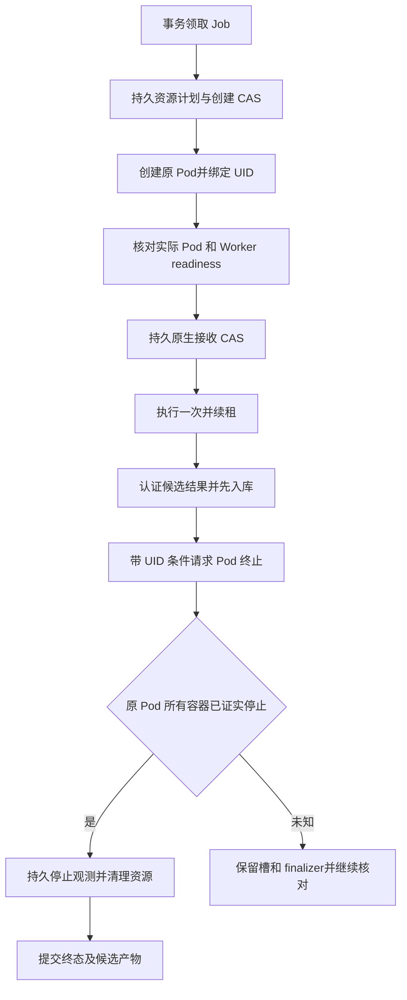

# 按任务运行 Agent Worker

> 历史运行层快照：后续领域输入、多文件成果、双 UID、模型授权和 Hermes 宿主的
> 代码进展见 [实现交接](IMPLEMENTATION_HANDOFF_20261026.md)。下文的早期实现及
> 验证边界仍按原提交保留，不代表新增代码已经通过测试或部署验收。

2026-10-26，`codex/agent-execution-service`。本轮增加按任务分配的 K8s 执行层、持久
事件汇入、停止恢复和 Pi 宿主候选。已有 PPT/Hermes 及科研服务继续使用现有执行链。

## 业务调用

业务仍使用同一套 Jobs API，提交 `workspace-task.v1`、revision、prompt、业务引用和
时限。引擎、镜像、命令、UID、网络及凭据由服务端配置。配置中的同一个版本化 profile
可以路由到 Pi 或 Hermes；已接收 Job 和重复幂等键始终使用原执行 pins。

外部静态 Worker 保留为显式配置的单 capsule 模式。新增 `kubernetes_workers` 与它在
同一 engine 上互斥。K8s 能力声明的 `ready` 表示池可以接收和准备新任务，额外标记
`readiness_basis=pool_admission`、`requires_native_readiness_check=true`；冷启动后仍须
取得精确匹配 profile/runtime/image 的原生 Worker readiness 才会发送唯一一次 PUT。
它不宣称尚未创建的 Agent 已经通过模型或工具检查。

## 执行和恢复



资源绑定与事件游标使用新增表；显式 `init-db` 以 `create_all` 建立，未改变旧 Job 表的
列。领取事务冻结使用静态 Worker 还是 K8s provider；切换部署模式不能接管旧 attempt。
领取后、资源计划写入前崩溃，可以在有效租约内为同一 attempt 完成第一次资源分配。
取消、超时或 UID 耗尽时，只有同一事务证实 K8s attempt 尚未领取 Pod 创建权才可
安全收尾并释放槽；已有计划先退休，保留烧掉的 UID，再拒绝迟到的创建请求。
该路径不伪造停止回执。已领取创建权的任何计划都不能使用这个捷径。
若只创建了控制凭据 Secret，收尾会按身份尝试删除；API 故障或迟到写入留下的孤立
Secret 须由运维清理，它不会构成 Pod 启动权或恢复执行的依据。
创建前与原生 PUT 前分别使用持久 CAS。创建或接收响应丢失后只查询原对象／执行，
不重放创建或付费请求。同名 Pod 的新 UID 被拒绝，不当作恢复实例。

控制器核对观测到的 command、args、环境、权限、capabilities、挂载、固定镜像、资源
限额及无 host namespace/SA token，兼容 Kubernetes 的无害默认值和资源数量格式。
Pod 上的 intent 注解不是执行计划的测量证据。

候选结果包含有界文件和认证停止回执，先持久保存，之后才请求删除 Pod。finalizer
保留对象，直到控制器看见原 UID 的全部容器具备有效终止信息；`404`、删除已接收、
`Ready=false`、Pod phase 或失联节点的未知终止状态均不能单独证明停止。持久停止
观察之后才移除本服务的 finalizer、删除对应凭据 Secret 并退休资源。

清理响应丢失或控制进程重启可继续使用已存候选、UID 和停止记录。quarantine 的任务
只有原资源已证实停止且退休后才自动回收槽，状态变为取消、超时或失败，**不导出原
候选文件，不启动替代 attempt**。没有正面停止证据的隔离任务仍保持占槽，须核对原
节点／资源事实，不能手工删 finalizer 后把对象消失当作证明。

Worker 事件仅携带允许的状态元数据。最多500项、每页100项，精确绑定 attempt 和请求
摘要，连续序号与持久 cursor 同事务提交。重复页不重复写入，事件空间饱和仍消费游标，
为终态保留空间。候选交接前先消费已生成事件，浏览器断线不取消执行。

## Pi 宿主候选与模型授权

`worker_entry.py` 固定运行镜像内的 Pi CLI，不接受业务传入的命令或模块。可信控制器
以 root/PID1 运行在私有 PID namespace，Agent 使用每任务分配的 UID，清空 capabilities
并设置 no_new_privs。启用池必须显式填写平台预留的 `uid_start` / `uid_count`，平台须在
全部可调度节点及其他服务中保留这段 UID/GID。服务按 `uid_start + 全局 fence - 1`
分配并持久冻结 UID；数据库唯一约束禁止跨池或资源退休后的复用。可信 Pod 环境的
`AGENT_RUNTIME_UID` 不能由业务请求指定。UID 归属还绑定 Pod UID、attempt、请求摘要
和 kernel scope；根控制目录与 Agent 工作目录分离。

私有 PID namespace 不会隔离宿主的 UID 进程计数，`RLIMIT_NPROC` 因而不能与其他
容器共用固定 UID。UID 范围耗尽后池停止接收新任务，已排队但尚未分配资源的任务
确定性失败，不会永久占槽。容量检查仅为提前提示，实际分配仍在事务中校验。
全局 fence 也会被其他执行池消耗；不能重置 fence、删除分配历史或回滚数据库后
复用 UID。扩容范围前须核对全部节点及历史分配，活动任务保留原配置。

停止控制器使用真实 UID 进程清单和 pidfd，覆盖离开主进程组的 writer；内层证据后还
需外层 Pod 全容器停止观察。领域文件只读挂载仍未开放，当前 profile 只接 prompt。

模型协议固定为 `openai-responses`，配置仅接受专用内网任务代理。Agent 不取得上游
长期 API key。宿主只有在以下条件均成立时才可运行：

- image/profile/runtime 精确匹配的独立验收文件及其证据文件已提供；
- 任务代理令牌绑定 attempt、请求摘要及短期截止时间，并覆盖任务 deadline；
- Pi 版本、固定资源、隔离和原生 readiness 检查通过。

本轮 provider 生成的 `worker.json` **仅包含 Worker 控制认证与每任务 receipt key**。
模型代理授权的签发／注入还未接通，因此不能通过打开配置中的 enabled 就开始真实
模型执行。验收文件也不会由程序或测试自动生成。Hermes 的公共驱动和 Worker 协议已
存在，独立生产宿主尚待装配；当前候选入口对此明确返回未就绪。

## 配置和构建

控制配置见 [config.kubernetes.example.json](../config.kubernetes.example.json)，宿主公开
配置见 [worker.config.example.json](../worker.config.example.json)。模板均默认关闭。
宿主 ConfigMap 应使用版本化名称，设 `immutable: true`，`data.config.json` 精确匹配
profile/image/runtime；已有执行恢复不依赖源 ConfigMap 仍然存在。更新路由前先排空
旧池，保留旧配置和 master key 到原 attempt 均已结束；不对活动任务原地换密钥。

调用 token、池 master token/receipt key 和数据库 URL 放在独立受保护文件，由平台
Vault 提供，禁止写入公开配置或 Git。控制进程的配置读取器拒绝符号链接；如使用
Kubernetes projected volume，先由受信 init/Vault 阶段复制到私有普通文件再启动。
不要把 Worker Secret 或模型凭据放入业务 Job。

在服务器 checkout 的 `panghu_agent` 根目录运行：

```bash
bash agent_service/build.sh
# 使用已评审、已缓存或可拉取的 Pi donor 镜像的不可变身份：
PI_DONOR_IMAGE='registry/reviewed-pi@sha256:<64位实际摘要>' bash agent_service/build.sh --target pi
# 只构建本地候选，省略推送和可部署摘要记录：
bash agent_service/build.sh --target control --no-push
```

默认使用 `arm-cluster-master:5000` 和 `linux/arm64`；显式环境变量可覆盖 registry、tag、
platform 和已评审 Python base。构建上下文只含中立代码、固定资源及依赖，不含配置、
密钥、业务包或运行数据。成功推送并核对 registry manifest 后才写
`rendered/control-image.txt` 或 `rendered/pi-image.txt`；失败或 `--no-push` 不留下旧部署
摘要。当前 Dockerfile 是候选定义，本轮未实际构建或推送新服务镜像。

控制镜像使用普通 UID10000，分别以 `api`、`dispatch` 命令启动；API 不运行 Agent。
Pi 候选只从固定 donor 复制 Node 和 `/opt/pi`，不依赖科研 Python 包或私人 Agent HOME。
运行时固定资源使用 LF，避免 Windows checkout 改变文件摘要。

## 平台配置与部署边界

[deploy/rbac.yaml](../deploy/rbac.yaml) 定义 `agent-service` 控制命名空间及
`agent-workers` 执行命名空间：API 只读池状态，dispatcher 可管理该执行命名空间内的
Pod/Secret 并读取宿主 ConfigMap，无 exec、日志或跨命名空间权限。Worker 自身不挂
ServiceAccount token。

[deploy/worker-network-policy.yaml](../deploy/worker-network-policy.yaml) 只允许 dispatcher
访问 Worker 8090，Worker 只可访问集群 DNS 和位于独立 Pod 的任务模型代理。不得把
持有上游 key 的代理与 Agent 放同一 Pod，再假设 NetworkPolicy 能区分容器。
CNI、实际 CIDR、资源限额和网络阻断须在候选环境实测，应用 YAML 本身不构成验收。

这些是待部署的服务自有配置。OAuth、Cloudflare、Vault 等公用服务仍由平台相应目录
管理；这是内部 API，没有新增用户登录页或公网域名。此轮没有应用上述资源，也未
新增生产数据库、迁移 PPT/科研或改变现有 Agent 网络策略。

离线测试和真实 Linux 内核探针的范围与证据见
[CAPSULE_VALIDATION_20261026.md](CAPSULE_VALIDATION_20261026.md)。内核探针不是候选镜像
或生产 K8s 的验收文件。

下一步是任务模型代理授权、Hermes 宿主以及候选镜像的实际 K8s/模型验收，之后才接入
PPT outbox 和业务 profile；两次确认、版本基线、独立验收和发布仍由业务后端负责。
