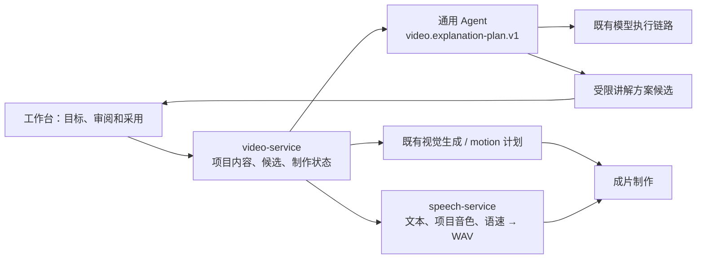

# 项目级讲解方案

video-service 负责把整片的讲解思路整理成可审阅、可采用的方案。通用 Agent 提出内容建议，speech-service 继续只负责把给定文字合成为声音。此功能不要求配音、画面按固定顺序制作。

## 工作流程

1. 在已有镜头的项目中填写受众、讲解目标、讲述方式和本轮要求。
2. 提交一次讲解方案任务。输入冻结总文稿、当前全部镜头及项目音色/镜头语速/读音规则。
3. 通用 Agent 返回整体说明和逐镜建议：旁白、画面说明、关键词、语义变化步骤、读音、估计时长及讲述建议。
4. 对照当前镜头审阅候选，核对事实和术语，再明确采用整套方案。
5. 按原有入口生成画面和配音。讲解方案不会自动发起这些任务或渲染。

方案采用是全镜头事务。总文稿、镜头身份/顺序、画面格式、项目音色、镜头语速不由模型改动。原方案、音频、画面和冻结成片保留历史。镜头画面语义变化后取消原画面采用，防止误把旧图当作新内容导出；旁白/读音变化后，原音频仍可试听，现有内容摘要会标记其过期。未变化的声音可以复用。

## 服务边界

`explanation_store.py` 保存输入、单次任务、不可变候选和采用指针；`explanation_workflow.py` 协调持久任务；`explanation_gateway.py` 复用现有 AgentClient。模型输出经过独立 schema 和输入摘要校验后才能成为候选。一次意图只提交一次通用 Agent 任务；提交结果不明确时查询原任务，重启不重复提交。一个 Agent 任务内部可能有多轮模型调用。取消有界重试，不把“已申请取消”伪装成已停止上游。

逐镜关键点和变化步骤在采用时成为镜头的视觉生成说明，送入原有视觉任务；它们是语义建议，不是可执行脚本或最终动画时间轴。已有 HyperFrames 底座仍通过独立 motion 契约编译与真实音频绑定，生产动态渲染接线、代表样片及有限整片批量协调继续单独验收。

## 语音能改善到哪一步

本轮改善口语化表达、句子长短、解释顺序和读音规则。`delivery_note` 是供审阅的讲述建议，不能直接控制 Kokoro 的情绪、重音或逐字时序。方案的时长是估计值，最终时间轴仍以实际 WAV 为准，不裁断或拉伸旁白。没有新增 SSML、情绪接口、新模型或隐含的 TTS 调用。

输出旁白及读音替换后的实际合成文本均限制为 2000 字符，与现有配音入口一致。原输入仍允许读取历史的 10000 字符镜头；若无法在限制内保持事实，需要用户拆镜，不能默删事实或先采用一段无法配音的文稿。

原文摘录用于追溯输入，不能证明全部改写正确；事实、数字、因果和技术术语仍需要人工核对。候选生成成功不等于整片表现力或声音自然度已通过主观验收。

## API 和启用

| 操作 | 接口 |
| --- | --- |
| 读取候选/当前任务 | `GET /api/projects/{id}/explanation` |
| 生成一次方案 | `POST /api/projects/{id}/explanation` |
| 明确采用整套方案 | `POST /api/projects/{id}/explanation/adopt` |
| 取消任务 | `POST /api/explanation-operations/{id}/cancel` |

所有接口沿用 owner 隔离、Host 验证和同源会话；修改接口要求 CSRF，生成接口还要求幂等键。采用请求必须带项目 revision 和预期的方案 head；内容已变化、head 已变化或有冲突制作任务时整笔拒绝。

功能默认关闭。工作台配置 `VIDEO_EXPLANATION_ENABLED=1`、独立 `VIDEO_EXPLANATION_PROFILE_REVISION=1`，部署渲染器提供对应 `--explanation-enabled` / `--explanation-profile-revision` 参数。通用 Agent 需要另行显式发布匹配的新 profile 并授予原调用方相应 scope；仅设置工作台开关不能让未发布的模型能力变为可用，远端预检不通过就不会提交模型任务。

关闭开关只停止新生成/采用。已提交的任务继续恢复、查询和取消，未提交的排队任务在本地取消；已有历史和在途任务仍可在页面读取。最近提交的讲解要求可在刷新后恢复，当前尚未提交的编辑不会被轮询覆盖。

代码位于 `codex/video-hyperframes-motion`，不自动合并主线或改变现网配置。具体检查证据见本轮关闭记录。
