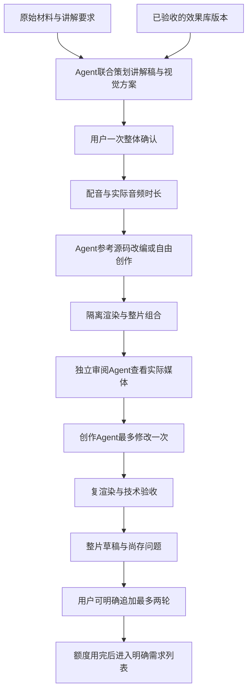

# Agent 主导创作与参考动画效果库：现状和实施方案

2026-11-10。用户已授权继续按目标实施并直接替换线上服务，不以兼容旧服务为实施约束。新制作入口采用一套当前流程；历史项目、媒体、失败和已消费轮次仍保留，历史运行身份可追溯不等于维护两套产品。当前开发者实验室已发布“制作并打磨一轮”，配置修复后真实初作和8秒隔离渲染已通过，独立审阅超时，尚未进入修订及技术复验，阶段1整体仍未完成。当前正实现批量读图审阅并核对固定Pi运行时；新方案尚未部署，不能把离线回归记为线上验收。详见[制作链发布与验收](agent-creation-product-validation.md)。普通视频工作台的整片新流程仍待实施，分支未合主线。

此前阶段1首轮（p1）与第二轮 `sequence-review-r2` 均已收尾。首轮16＋24帧实际模型图片传输、一次Agent修订及8秒隔离渲染技术复验通过，预定短时空间问题漏检的结论保留。第二轮23帧实际传输、一次修订、192帧／3130项数值检查和账本重放通过；审阅新增发现C状态被D短时遮挡，修订后抽查改善，但仍漏检预定E靠近说明问题，修订片2.5秒的固定说明仍不可见。真实loopback准入探针与真实候选链分别留证，不能拼成完整正式提交链。两轮预算已结束；实际边界见[阶段1验证记录](agent-creation-phase1-validation.md)。

最初源码核对基线：`5ba71a78297a07f2de5ba758fe99bf301d395ec1`，分支 `codex/video-capability-experiment-redesign`。OpenSpec 变更：`evolve-video-agent-creation-and-effect-library`。阶段0只做方案和规格；其后的实施按下文分阶段验收，代码保留开发分支、不合主线。

## 1. 已经确认的目标

提升的是 Agent 的创作、参考学习、编排和修改能力。Agent 可以自行编写 HTML、SVG、Canvas、Three.js 等动画源码；开发者不通过预先写死构图和动作模板来限定表现。基础设施负责执行、隔离、时间定位、媒体交付和真实记录。

正式制作由 Agent 统筹讲解与视觉：默认把总文稿当作创作材料，可以改写为更适合讲解的稿件、重新组织分镜、选择表达方式与衔接。事实、数字、原意及来源需要核对；用户明确要求原文不改时遵从原稿。

实验室主要建设完整表达片段的效果库，保留铺垫、动作配合、注意力引导和收尾。它不是按引擎排列基础运动函数，也不靠同一模板换文案增加样例数量。引擎属于实现与运行条件。

入库的效果保存动态演示、Agent 生成源码、实现说明、适用条件、限制及验收证据。正式 Agent 可以检索、阅读、改编和组合源码；库没有覆盖的内容允许自由创作。正式项目的新效果先属于项目，不自动发布为通用效果。

## 2. 代码现状：可以复用什么，还缺什么

本节保留阶段0基线的代码与既有验收文档核对，不是当前线上版本的重新验收。阶段1新增实现和实测进展单独见验证记录，不能用下表的历史缺口描述覆盖后续状态。

| 范围 | 当前实际情况 | 与新目标的差距及源码依据 |
| --- | --- | --- |
| 自由源码创作 | 已接通通用 Agent 生成 HTML/CSS/JS、单镜预览、明确采用和正式交付，不是所有路径都只能填模板 | `motion_store.py:251`、`creative_contract.py:84`；已有17秒真实交付见 `animation-capability-production.md`。目前主要按单镜录音绑定，没有整片自主创作流程 |
| 初始分镜与讲解方案 | 能从原稿建立分镜，也能在已有镜头上改写旁白、画面说明和重点 | `store.py:169`、`explanation_store.py:187`；`video_explanation_contract.py:111` 固定原镜头数、ID和顺序，不能作为自由拆镜导演协议 |
| 当前批量制作 | 有持久任务、恢复、取消、复用和集中审阅 | `batch_store.py:21` 仍为 `motion → audio → draft`，调用默认 diagram，没有按真实音频先创作自由源码；不能直接当成新流程 |
| 实际音频时钟 | 已能绑定 WAV 摘要、实测时长、旁白和节拍，复用项目统一音色 | `motion_store.py:313`、`creative_contract.py:134`、`speech.py:293`。当前输入仍可含 estimated 时序，不代表精确字词对齐 |
| 实验目录 | 身份追踪、群体统计、参数几何、多轨延迟四项有真实 Agent 作品和技术检查 | `animation_experiments.py:119`、`animation_experiment_definitions.py:98`。固定题目、输入和8秒约束，不是用户参考视频形成的任意完整片段库 |
| 实验反馈与来源 | 支持媒体播放、定位、时间段意见、完整源码和不可改写来源 | `animation_experiments.py:348`、`:390`。缺参考候选选择、原片认可、异结构改编验收和正式入库状态 |
| 现有发布桥 | `explanatory-motion-v1` 能把文字创作规则交给实验端和正式端 | `animation_capabilities.py:18`、`:138`。缺效果索引、已验收源码读取、选择与改编版本引用；`base_result` 仅是本镜原源码 |
| 实际看片与审阅 | 旧实验评测能向 llm-service 发送抽样图片，有几何／数值观察 | `animation_lab_review.py:25` 最多48帧，旧 `animation_lab_evaluate.py:267` 明记不是通用 Agent。当前创作 profile `video_animation_experiment.py:199` 只有 read/write，`:234` 禁止渲染与浏览；没有独立审阅 Agent 闭环 |
| 多模态基础 | 通用 Agent 和 llm-service 已有文本／图像传输基础 | `agent_service/model_proxy.py:179`、`../llm-service/chat_adapter.py:35`。实际模型绑定和新角色尚未验证；没有据此确认原生 MP4／音频模型输入 |
| 引擎与渲染 | 生成源码已有隔离 Chromium 截帧＋FFmpeg；旧编译式动画使用 HyperFrames | `motion_renderer/creative.mjs:38`、`creative_renderer.py:25`。当前正式源码仅准 HTML/SVG，禁 Canvas；Canvas/Three 固定演示不等于自由创作生产准入 |
| 自由跨镜 | 普通整片可组合不同来源镜头；旧图解有独立连续编译器 | `continuity_store.py:128` 明确拒绝 creative 连续计划；不能把多镜拼接称为自由源码连续运动已完成 |
| 修改额度与需求列表 | 有任务／候选容量上限、单镜改稿和人工意见 | 尚无整片级一次自动打磨、两次用户追加额度与后续需求任务账本；存储容量不是修改额度 |
| 固定组件回归 | 仍在开发者界面作为并列入口，来源是手写编译配方和有限参数 | `animation_lab_samples.py:255`、`animation_lab_scenarios.py:39`、`animation_lab_web/index.html:14`。新设计中归为内部技术保障，不再充当 Agent 表现力优化主线 |

已有技术检查、三条首作和旧发布记录保留其原完成含义；本方案不把它们改记为“参考效果库／整片 Agent 创作已完成”。

## 3. 实验室的目标流程

默认先分析参考，再由用户选定要学的片段；用户给出确切时间段和目标时可以跳过候选筛选。候选记录实际观察范围、学习理由及核心编排／节奏，长视频先连续理解相关片段，必要时观察更大范围。不把链接保留、字幕读取或几张截图说成看过完整动画。

参考来源须有实际可访问的媒体或用户提供的片段。登录、媒体缺失、仅试看等限制应如实展示；不能假定用户在浏览器登录后服务器自然就能取得同一媒体。观察合同须支持连续时间信息、覆盖记录与必要的局部提高时间采样密度。

首作应接近参考的核心编排、动作节奏和注意力引导，证明理解了用户选中的效果；颜色、文字和装饰不要求完全复制。新需求验证则改变真正影响编排的条件，例如对象数量、关系结构、解释任务或讲解时长。原实现认可与改编通过分别保存，不能以助手工程意见代替用户验收。

效果条目不是固定8秒，也不等同于一个镜头；它可以包含多个相互配合的镜头或阶段。旧四题可作为历史证据、迁移测试材料或待整理候选，不能直接批量标为成熟效果。

### 效果版本至少包含

- 表达目的、参考来源和时间范围、实际观察证据、不可丢失的核心效果特点。
- 可播放演示、完整 Agent 源码、依赖／运行环境、创作说明和适用限制。
- 原参考实现及用户认可、结构不同的新需求、改编结果及用户验收。
- 技术检查与独立视觉审阅的不同结果，实际模型／提示词／输入和媒体版本来源。
- 正式可用状态、唯一版本ID与内容摘要；正式候选保存实际检索、阅读和改编的效果版本。

先复用业务内索引与按需读取，不把全库塞入提示词，也不把新建向量平台作为前提。索引命中和提供过链接不算完成复用；需要记录实际传入的源码、说明和证据引用。新版本发布保留旧版本，已启动项目继续使用冻结引用。

## 4. 正式视频的目标流程

整体方案展示讲解稿、分段理解目标、视觉表达方式、库中动态演示、统一风格与对象／衔接思路。未覆盖的表达明确说明自由创作计划。默认不新增代表性试片或逐镜静态草图确认环节，第一份新动画直接服务整片草稿；用户明确需要时再单独提出试片。

策划和镜头创作都保留整片上下文；允许按表达片段拆分执行任务，但风格、重要对象身份、相邻段落起止状态和衔接不能在拆任务时丢失。复用效果的源码可以重写构图、时长与内容，不受原片参数填空模式限制。库中没有匹配项时仍允许创作，完成结果先归当前项目。

确认方案后生成配音，并以实测音频时长编排动画；estimated／forced／人工时序保持真实来源。默认一个项目一个音色、画面融入重点、不叠加字幕。没有时序或模型能力依据时不能宣称准确同步、真实重音或声音自然度已改善。

为了减少逐镜操作，新编排需要冻结“用于草稿组合的音频／画面候选选择”，不要求用户逐镜点击采用。该内部选择不等于用户正式采用、审美认可或人工时序核准；复用现有最终明确采用、原声与历史冻结机制。

### 独立审阅与一轮打磨

创作者与审阅者使用不同角色和执行来源，复用同一通用 Agent 服务。审阅者必须接收实际渲染媒体的可观察证据，问题绑定版本、时间段、可见依据和修改目标；不能仅读源码、数值自报或创作者解释来判断好坏。

当前通路有图像基础但未确认原生视频／音频输入。第一阶段应验证有序帧序列和时间窗口是否足以观察目标运动，记录采样、覆盖和不确定性；必要时通过共享框架补适用的视频能力。没有观察到的片段不称完整观看，没有实际听到的音频不评价听感。独立模型意见也不等于用户同意。

一次打磨包含一次独立问题收集和最多一次创作者修订，随后只复渲染、技术复验并记录尚存问题，不自动再发下一轮创作。模型可能一次改坏别处，因此保留初稿和修订稿供回看，不自动循环挑选直至满意。

## 5. 用户修订与资源边界

| 阶段 | 已确认规则 |
| --- | --- |
| 首次制作 | 首版生成后最多一次自动打磨，输出可观看整片草稿及尚存问题 |
| 用户整片反馈 | 用户明确发起，可以再打磨一到两轮，最多两轮；按同一制作序列整片累计，不给每个片段另发两轮 |
| 追加额度用完 | 后续修改写入需求列表，绑定不满意的片段／时间段／版本、问题和期望结果；全局问题也须形成有范围的任务 |
| 默认修改范围 | 画面、动画、构图与衔接；保留已确认文稿和配音。已确认叙事语义、顺序或声音的实质变化需要用户明确需求并重新核对依赖；保留原义原声的视觉拆镜、合镜和编排仍由 Agent 统筹 |
| 修改方式 | 优先仅重制受影响片段，重组整片时检查相邻衔接，保留无关有效资产与历史 |

工程落实需建立持久轮次账本，而不是靠提示词自律：项目制作序列、源版本、轮次类型、问题集合、范围、任务幂等键和消费状态明确绑定。刷新、重启、取消、任务失败、另存候选或新增需求都不能默默重置整片额度。一轮可以包含多个受影响片段任务，但共享同一个整片轮次。

提交前原子预占；已启动的修订任务不因失败伪装为未尝试。未知提交先查原任务，不能重复生成来“恢复”。未发生提交的预占如何释放需有明确凭据，沿用共享执行器的停止、恢复和限额边界。最小持久账本与幂等预占从阶段1首次自动修订就生效，阶段3复用它，阶段4再扩展用户追加轮次和需求任务；不能等整片自动生成跑完才补防重限制。

后续需求按明确批次和执行范围设有界预算；不自动重新启动“整片自动一轮＋用户两轮”。这属于业务修改权限，不建设可信用量／金额／计费平台。用户可继续提出明确需求，不提供无条件无限“再优化”按钮。

表现力仍不满意但技术合格时，保留草稿并呈现问题供用户整片判断。无法渲染、已发现的内容错误等明确失败单独标记并阻止其冒充可交付成片，不通过无限自动重试掩盖失败。

## 6. 服务分工与保留范围

| 模块 | 目标职责 |
| --- | --- |
| video-service | 整体策划、效果库业务、方案确认、创作编排、项目上下文、轮次与需求、候选和交付版本 |
| 动画实验室 | 参考观察、候选选择、完整片段实现、标注、改编验证和效果发布；与正式制作共用效果资产／创作方法 |
| 通用 Agent / Pi | 执行参考观察、导演策划、创作及独立审阅角色；新增版本化协议与准入，不原地改写冻结v1 |
| llm-service | 沿用共享模型路由和实际支持的多模态能力；不在视频业务内另建模型调用平台 |
| speech-service | 既有语音合成、项目音色、真实音频结果及支持能力；本轮不要求替换引擎 |
| 渲染底座 | 在 video-service 内复用 Chromium／FFmpeg、HyperFrames与既有执行隔离、音频组合、取消和输出验证 |
| 固定组件回归 | 内部运行与代码正确性检查，不再与效果库并列为动画表现力主入口 |

不新增 Canvas／Three.js 公共微服务，不迁移 panghu-tool，不进行跨服务整体清理。原组件、编译器和历史数据保留必要复验能力，但新创作不依赖固定模板作为表达边界。

Canvas／Three.js 必须分别补自由源码运行、时间定位、固定随机性、依赖和资源验证。仅去掉 Canvas 禁用检查或放开引擎枚举不能算准入；它们是明确规划的后续运行能力，不被描述为当前已实现。HTML/SVG可先走通闭环，相关引擎门禁通过后再将依赖该引擎的效果发布为正式可用。

## 7. 分阶段实施与验收

| 阶段 | 待做工作 | 过关依据 |
| --- | --- | --- |
| 0：本次方案 | 核实代码／既有证据，记录已确认原则、差距与任务归属 | 仅文档与 OpenSpec 更新、校验；没有服务改动 |
| 1：观察与审阅基础 | 新版本参考观察、创作／改稿、独立审阅协议；真实多模态输入、观察覆盖、一次修订合同与最小持久轮次／幂等预占 | 实际模型收到绑定的画面序列，能指出已知可见问题；无法观察时明确报缺，不挂名完成审阅；重启／重复请求不重复修订 |
| 2：一个效果的完整闭环 | 从参考选择到实现、原片认可、异结构改编、用户验收、发布；正式单镜真实检索源码并改编 | 同一效果版本在实验室和正式候选中可追溯，真实用过源码；不是只添加文字规则或复制样片 |
| 3：整片 Agent 创作 | 原稿联合策划、一次整体确认、配音先行、上下文编排、独立审阅及一次修订、整片草稿 | 新建真实项目一次确认后完成多段成片；库效果与未覆盖的自由创作同时存在，原声、风格及边界衔接核对 |
| 4：有界用户优化 | 扩展持久账本以支持两次用户追加、需求列表、局部修改和依赖失效 | 并发／重启／失败不重置额度；超额转明确需求；视觉修改复用声音且不改无关片段 |
| 5：引擎扩大与最终验收 | 分别准入 Canvas／Three，自由跨镜编排、真实浏览器和用户效果验收 | 引擎各有运行／定位／资源／编码证据；用户分别评价参考接近度、改编、整片表现和操作负担 |

阶段1先验证“真的能观察”的技术前提。阶段2即验证实验成果能进入正式制作，避免长期只建实验页。Canvas／Three运行适配可与HTML/SVG闭环并行准备，但未准入时不把对应效果标为正式可用。

每阶段使用有界真实任务并记录失败。阶段1首次候选预算为参考观察1次、独立审阅1次、有问题时创作者修订最多1次；每个候选最多一次连通探测，不自动重试或再发第二次审阅。发布使用 `latest`，通过标签、注解和镜像摘要记录身份；代码留开发分支，合主线另按用户指示。

两轮预算均已收尾，不能恢复使用。第二轮 `sequence-review-r2` 按独立预登记预算实际执行参考观察0次、审阅1次、创作者修订1次、隔离渲染1次，没有第二次审阅或自动重试；本轮不再提交模型或渲染。新增 `video.animation-review.v2` 通过独立资源包显式选择，最多24帧，保留v1提示词／资源及默认目录。新操作冻结审阅角色与版本，旧未标角色账本仅按v1／revision1恢复，不能借版本切换重新消费同一制作序列额度。

隔离HTTP探针已验证唯一claim后才POST、实际202响应丢失后的原键GET恢复、取消仍消费额度以及终态重放不发请求；其ready门禁为合成条件，真实排队1任务但Worker尝试／模型／渲染均为0，不能视为完整工作台或实际付费链路通过。第二轮绑定实际解码PTS的23帧全部进入成功模型请求；独立审阅确实发现C状态短时遮挡，但仍未提出预先登记的E问题，不能用新增发现替代既定验收。这是已知案例回归，不能将抽样外运动、音频或用户审美列为已验收。

第二轮单次修订后，已编码MP4的1.75／2.0／2.25／2.5秒抽查中C状态可读、A显示排除，2.5秒的固定说明不可见仍作为画面问题保留。8秒静音MP4实读192帧、完整解码及3130项数值检查通过；账本重开后3个operation和事件不变，无新Agent或渲染，候选资源／Secret／渲染容器已清理，共享目录与事前快照一致。候选导入路径仍为 `isolated_candidate_import`、`live_http_verified=false`。目录映射检查72项通过、1项Windows符号链接检查跳过，后者已在Linux实际补验通过；这与正式产品链、600秒自由源码或Canvas／Three准入分别验收。

## 8. 与现有 OpenSpec 的关系

- `redesign-video-animation-capability-experiments`、`add-semantic-animation-capability-experiments`、`connect-animation-capabilities-to-video-production` 已有完成证据保留，不重开或抹去历史。新目标是后续演进，不把旧规则包说成源码效果库。
- `improve-video-audio-clock-and-expression` 的5.1／6.1（导演策划）、6.2（方案审阅）、6.3（独立审阅）、6.4（真实效果与局部修改验收）与本方案共用实施和证据，不重复排期。6.2 的新流程默认改为展示方案与已有动态演示，不再强制新试片；旧关键帧仍可作内部证据或用户主动要求。
- 真实字词对齐、声音自然度与提供者适配仍由原音频变更跟踪；本方案使用真实总时长并如实显示时序来源，不假定旧音频任务已经完成。
- 旧批量／草稿变更中尚缺的用户试听、时序和表现力验收继续保留；新编排复用其候选、历史和采用边界，不因新计划登记而勾选旧任务。
- 可信用量与费用属于平台整体能力；生产存储、恢复和全服务清理由已有共享框架任务负责，不新增为视频业务待办。

阶段0已经完成，阶段1两轮真实候选及技术复验已收尾，预定E问题识别仍未通过，1.3保持未完成；实际Worker／模型／修订／渲染正式提交链及业务入口未完成，1.4也未勾选。下一步改进通用的运动对象与固定说明关系审阅，并补正式提交闭环，不能以隔离探针和候选证据代替。本轮OpenSpec同步只补实证与边界，不新增任务勾选，状态保持5／29完成、24项待办；同步revision及精确回读结果见阶段1验证文档。完整效果库、新导演流程、用户追加轮次、需求列表及新引擎准入仍待后续实施；阶段1基础代码存在不代表这些产品流程已上线。
