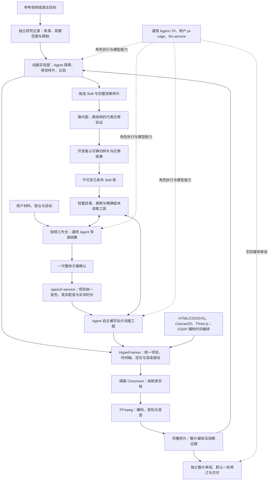

# Agent 动画效果库、视频工作台与 HyperFrames：统一设计

## 适用范围与现状（2026-11-13）

本文件是 `evolve-video-agent-creation-and-effect-library` 的当前设计，与该 OpenSpec 变更的 `design.md` 保持一致。它替换旧方案中不符合最新确认的默认流程；历史任务、冻结合同和验证结果保留原来的适用范围。此次同步只修改文档与规格，不表示以下目标已经实现，也不执行构建、部署、生成或数据迁移。

目标是让 Agent 自主创作动画，并通过可复用的 Skill 持续提升正式制作能力。工程提供项目、时间、资源、隔离与验证合同，不用开发者手写的固定构图或动作配方代替 Agent 创作。“内化”指形成独立可用的知识与操作指导，不指训练了模型权重。

| 范围 | 已有实现与证据 | 本次确认的目标／剩余差距 |
| --- | --- | --- |
| 自由创作与渲染 | HTML/SVG、Canvas、Three.js 已分别在自定义运行链验证；`__animationExperiment.seek(t)` → Playwright Chromium 截帧 → FFmpeg 编码／组合 | 实验室和正式制作统一采用 HyperFrames 项目、时间轴、定位与渲染；旧引擎验证不能替代新链路验收 |
| HyperFrames | 渲染环境保留 0.8.149，旧固定计划编译路径调用其运行时／CLI | 新自由创作路径尚未调用其核心运行时／渲染 CLI；安装包或身份字段出现 HyperFrames 不等于已经使用 |
| 方法消费 | 已有方法版本对象和正式读取接线，宿主保守词法筛选最多三条 | 改为 Agent 在轻量目录上自主搜索、读取、选择和组合版本化 `SKILL.md`；完整发布与正式采用闭环仍需证据 |
| 整片统筹 | 一次整体确认、配音先行编排和三段上下文／相邻候选交接已有实际验证 | 统一整片 HyperFrames 项目、实际整片独立审阅及默认一轮修订仍需完成 |
| 质量与发布 | 技术结果、模型发现、人工观看和发布分别留证 | 不替开发者认可代表／迁移结果，不把代码、媒体生成或部署成功记为发布完成 |

不维护容易过期的任务总数或完成百分比；当前状态以服务端 `tasks.md` 的复选框及对应真实证据为准。已完成 3.4、5.1、5.2 的原验证范围不扩写为 HyperFrames 迁移完成；新增架构要求使用新的待办。

## 1. 总体结构

效果库改善的是可复用创作知识；正式制作按实际需求借鉴知识，自主生成新的工程。样片是验证和观看对象，源码是辅助材料，不要求复制样片源码。无匹配 Skill 时仍可在已准入环境内自由创作。

## 2. HyperFrames 与各项绘制能力

HyperFrames 是两端共同的动画工程、时间轴、预览定位和渲染基础，不只是在末端接收另一套自定义动画格式的转换器。HTML/CSS/SVG、Canvas2D 和 Three.js/WebGL 是可组合的绘制能力；GSAP 是可用的时间轴／补间工具。它们不各自形成公共微服务或互不相干的导出合同。

正式交付由一个整片 HyperFrames 项目描述：全片时钟、场景／子合成、对象关系、转场、资源、旁白和音效排程统一。内部可以拆成多文件、多 Agent 任务、多个场景或渲染分块；不要求一份巨型 HTML、一次巨型模型调用或一次性渲染全部帧。分块必须服从同一项目和全局时间，不能仅拼接独立 MP4 后宣称已实现统一项目。

允许开发通用的时间、资源就绪、安全和引擎桥接适配器；不将这些适配器变成固定视觉布局／动作模板。渲染留在 video-service，暂不拆公共渲染服务，也不迁到 panghu-tool。

### 2.1 已核实的支持与尚未验证的边界

已核实安装版本 0.8.149 的实际打包运行时：GSAP 按帧定位；Three 适配派发 `hf-seek`、等待 `waitUntil` 和资源加载；运行时有虚拟时间／RAF 驱动。Canvas2D 可通过绝对时间 `draw(t)`、状态重绘或适用的 FrameAdapter 接入。现有自定义 `__animationExperiment.seek` 必须显式桥接或改造，不能直接当成 HyperFrames 协议。

上游 FrameAdapter 接口仍属 experimental v0。适配须支持正向、反向、乱序和重复同帧定位；相同时间得到相同画面，异步工作在截帧前完成。累积状态、无种子随机、真实墙钟或自主 RAF 不能靠“浏览器能播放”证明导出可靠。Three.js/WebGL 可以采用环境支持的硬件或软件绘制，具体资源与性能必须实测，不预设 ARM NPU 能执行 WebGL。

核对来源：npm `hyperframes@0.8.149` 的 `gitHead` 为 `bf881bf79d68cc78b52624f6431644ac152b2723`，见上游 [Frame adapters](https://github.com/heygen-com/hyperframes/blob/bf881bf79d68cc78b52624f6431644ac152b2723/docs/concepts/frame-adapters.mdx) 和 [Three 适配器](https://github.com/heygen-com/hyperframes/blob/bf881bf79d68cc78b52624f6431644ac152b2723/packages/core/src/runtime/adapters/three.ts)。既有资源身份另记的 `hyperframes_source=2905162d925fc87fb8242e24ed0bbf025d307ea1` 是另一条来源记录，不与 npm gitHead 混称。

上述源码／安装包核查不等于我方服务器真实导出验收。本次未执行新的 HyperFrames Canvas／Three 渲染，也未升级依赖。后续必须对三类自由源码分别完成真实编码、时间定位、音轨、边界、资源和清理检查。编辑器的 “canvas integration”、CSS 类名 `.canvas` 和实验性 DOM 纹理接口均不能冒充普通 Canvas2D 导出证据。

## 3. 可复用 Skill、效果样片与研究记录

### 3.1 Skill 包与版本

创作方法以版本化 `SKILL.md` 包提供，分为可组合的两类：

- 基础 Skill：HyperFrames 工程、时间、资源和各绘制能力的创作约定，帮助 Agent 生成可运行、可定位的工程。
- 表达 Skill：身份追踪、群体筛选、因果关系、公式推导、空间揭示、转场等方法，描述何时用、如何判断与组织，允许 Agent 自主改变构图和动作。

正文包括适用／不适用条件、独立可理解的原理、操作步骤与判断、组合方式、取舍、常见失败和检查标准。必要附件可以是自行创作并验证的示意图、示例源码或辅助脚本；不以可复制固定模板作为成功前提。发布清单冻结包版本、正文／附件摘要、引擎和资源要求、适用证据与限制。正文、附件或适用范围变化形成新候选版本，不原地改已发布包。

一个 Skill 可由多条样片验证，一条样片也可验证多个 Skill。完整样片保留铺垫、发展、注意力引导和结果；无统一八秒或单镜限制。默认无讲解旁白，但有表现价值的音效应保留，不能把无旁白实现为强制静音。

### 3.2 参考资料先研究，再内化

原视频网址、来源身份、实际观察起止、访问限制、截图／连续观察覆盖、原始观察和溯源保存在独立研究记录，以 ID 和版本关联实验／方法。网址与逐片观看笔记属于研究资料，不写进运行 Skill 来代替能力说明。

Agent 必须将观察转化为自足的原理、适用判断、实现步骤与检查方法，不直接搬运原视频文稿、分镜或源码来充当可复用能力，也不要求正式制作重新打开原视频。Skill 的演示附件应自行创作并验证。Skill 不依赖原视频仍可理解和使用；来源记录保留溯源，但不成为生产必需资源。

发布前验证：撤去原网址和原片观察材料，Agent 仍能仅凭 Skill 完成创作；在实质不同的内容和结构中验证方法。只换标签、数字或领域名不算迁移。没有实际观察的部分如实保留未知，不能从几张截图推断看过完整视频或听过声音。

### 3.3 Agent 主动检索与使用

平台提供轻量目录、搜索、精确版本读取及必要附件读取工具，附可用范围和执行预算。导演和创作者根据表达问题自行决定搜索什么、读哪些完整 Skill、如何选择／组合／适配，或不用。宿主可校验权限、资源和冻结版本，但不能以固定关键词命中的少量候选替代 Agent 的最终创作选择。

每次任务冻结可发现的已发布版本集合或等价稳定目录快照；实际搜索、读取正文／附件、版本与内容摘要、Agent 选择理由及输入回执留证。只搜索命中不算读过，成功读取不算在画面中成功应用；后者要看实际结果。新发布不静默改变已有项目／任务的冻结输入。候选 Skill 不进入正式发现集合；项目中新发明也不自动共享发布。

## 4. 开发者实验室闭环

参考或表达目标 → 独立研究与可观察标准 → 预算内创作／渲染／比较／修改 → 完整最佳样片 → 候选 Skill 提炼 → 代表性迁移验证 → 开发者认可代表与迁移结果 → 发布确切版本。

长参考先提出有实际观察依据的完整片段和学习目标供选择；开发者已经指定范围与目标时不重复选择。没有外部参考也可按目标开展实验。主界面以完整可播放效果库为入口，名称／目标、状态及 HTML/SVG、Canvas2D、Three.js 技术筛选组合使用；技术标签以确切样片的源码、运行和媒体一致证据为准，不按名称或允许引擎猜测。

Agent 可直接修改当前样片源码以探索和比较。有效变化必须提炼进候选 Skill，并在里程碑通过重新生成和／或实质不同的内容与结构验证。不能只修好一条样片就宣称可复用能力提升。迁移失败回流 Skill，回归代表片、失败和受影响案例；每轮不必重跑全库，发布前覆盖与改动相称。

每次委托有明确的任务／时间／资源预算，可自主多轮，不要求逐轮确认。目标达成、预算耗尽、取消／失败或多种尝试无明显收益时停止，保留最佳、剩余问题、实际尝试和停止原因。开发者可以继续发起委托，没有效果或方法的累计轮数上限。表单“默认一轮”只是预算初值，不是终身限制；停止、刷新或重跑均不抹掉已消耗工作。

效果详情保留前后比较、自然语言反馈、继续优化与迁移；Skill 正文、源码、技术回归和日志按需展开。技术通过、模型判断、人工认可和业务发布分开。开发者认可确切代表与迁移结果后才发布对应版本，不另设提示词文字审签，不由助手补签。旧测试数据无需迁移，无用旧产品入口退场；运行正确性检查可以留在内部工具。

已有失败重跑、用户明确归组、无样片失败记录隐藏与成功重跑保留等已验证行为保持各自证据范围；业务可见性变化不删除执行账本、冻结谱系或已用预算。本次不执行任何记录删除或迁移。

## 5. 正式视频工作台闭环

总材料、受众与目标 → 通用 Agent 导演联合策划叙述／视觉／Skill／风格／衔接 → 一次整体确认 → speech-service 生成或选择真实配音 → 实测音频驱动动画 → 一个整片 HyperFrames 工程 → 渲染 → 独立整片审阅及默认最多一轮修订 → 用户观看。

导演保留事实、数字、原意和来源约束，可口语化与重新组织；明确原文不改时遵从。方案展示理解目标、讲解稿、视觉意图、已有适用效果演示和未覆盖部分的自由创作计划。默认不新增试片或逐镜确认。一个项目选择一个音色，关键点融入画面，默认不叠加字幕。

实际配音是全片时间依据。绑定真实音频摘要、实测时长及 spoken-text；estimated、forced、native 和人工修正按真实来源标注，不把估算时间说成真实对齐，不截断／拉伸旁白掩盖差异。声音自然度、读音和对齐继续由原音频规格承接。

导演统筹全片叙述、主题／对象身份、风格、绝对排程、相邻起止状态和衔接意图，再分配创作。场景可以选择不同绘制技术，仍进入同一个项目与时钟。内部草稿候选选择与自动组合不伪装用户采用、审美或人工时序认可。旧三段交接成果是可复用基础，不等于新的统一工程已经落地。

| 修改范围 | 规则 |
| --- | --- |
| 首次正片交付 | 最多一次独立整片审阅和一次创作者修订，随后技术复验、呈现结果及未解决问题，不继续自动循环 |
| 用户追加 | 用户看完整片后主动请求，同一制作序列最多两轮；一轮可包含多段修改，不给每镜重新发额度 |
| 更后续优化 | 使用绑定版本、范围／片段、问题及期望的明确需求列表，每批有预算，不重开一套 1+2 |
| 纯视觉修改 | 复用确认文稿、原声及无关有效资源，局部重制并核对相邻衔接 |
| 语义、顺序或声音实质变化 | 需要明确需求，失效受影响音频／时长／对齐／视觉／认可依赖，历史仍留存 |

正片制作序列和持久额度身份必须在首次自动修订提交前存在。原子预占、幂等提交、未知提交找回及失败留痕贯穿全程；刷新、重启、取消、失败、另存和新增需求不重置额度。正片 1+2 与实验室预算分开。

## 6. 服务分工与观察边界

| 组件 | 职责 |
| --- | --- |
| video-service | 效果库／Skill 业务、研究记录、实验委托、认可发布、全片导演编排、制作序列／需求、历史与交付；当前渲染所属服务 |
| 通用 Agent / Pi | 观察、提炼、导演、创作者和独立审阅角色；沿用用户 pi-cage 来源与共享执行服务，不另建一套长期通用 Agent |
| llm-service | 模型路由及实际核实的图像／视频／声音输入能力，不凭角色名称假设具备视听能力 |
| speech-service | 旁白／TTS、项目音色、读音及真实音频身份、时长；沿用原自然度与对齐任务 |
| HyperFrames | 统一工程、全局时间、场景／子合成、定位与渲染驱动 |
| Chromium 与 FFmpeg | 隔离绘制、媒体编码及声音组合，不承担创作决策 |

音效通过可追溯资产或有界合成产物、事件时刻、增益与声部进入共享时间表；预览与编码使用相同声音排程，不能截断旁白。不要求任意外链、实时 WebAudio 或付费语音引擎作为前提。

独立评审必须收到确切渲染媒体、目标标准、原版／候选及观察覆盖。连续动作、遮挡、节奏、音效和声画配合要有相应实际观察；静帧或未听声音不能判全片视听合格。报告绑定版本、时间、依据、修改建议及未知项；人工看片／试听另记，不能倒填为 Agent 观察。原 E 卡片漏检、迁移失败和声音未观察等记录保留。

可信用量与费用、生产存储回收、跨服务目录整体清理由共享框架原任务负责；本业务只落实当前可执行预算与内容依赖，不重复建设或登记这些平台待办。

## 7. 实施顺序与验收

本轮只完成方案和规格整理；下列新增实施条目保持待办，不扩写旧勾选。

| 阶段 | 工作 | 验收依据 |
| --- | --- | --- |
| H1：统一合同与引擎小样 | 定义 HyperFrames 项目／时钟／资源合同，验证 SVG、Canvas2D、Three 各自真实导出 | 同环境实际调用核心运行时，正／反／乱序／重复定位、异步就绪、固定随机和媒体一致；记录性能、资源与清理，不能只检查安装版本 |
| H2：两端统一运行 | 实验室和正式自由创作路由采用共同 HyperFrames 工程，整片可分任务／场景／渲染块 | 确切项目、全局时间、音轨、对象与跨段边界贯通预览与 MP4；允许移除无用旧入口，不为旧产品兼容限制目标 |
| S1：Skill 内化与主动读取 | 版本化 `SKILL.md` 包、独立研究记录、目录／搜索／读取工具及调用留证 | 撤去原参考仍可用；Agent 自主发现／读取／组合／拒绝，无匹配自由创作；冻结版本，候选不可见，来源不冒充读取 |
| S2：真实能力发布闭环 | 样片探索回写 Skill、换内容换结构迁移、失败回流、开发者认可与发布 | 开发者实际认可确切结果后，新正式内容读取并体现所发布方法，不能以未发布接线代替闭环 |
| P：正片统筹与使用体验 | 承接现有 3.x／4.x／5.x，整片媒体审阅、默认一轮、用户两轮与明确需求 | 持久制作序列、局部重制／音频复用、取消恢复、真实浏览器与交付；观察、技术和人工认可分别记录 |

引擎准入和 Skill 包／检索合同可以并行；统一整片和真实正式采用在共同合同上汇合。适配器只处理工程通用能力，表达改进由 Agent 与 Skill 完成。每次真实运行另冻结有限预算，不重开历史已耗尽委托。

## 8. 旧规格归属与有效证据

本变更是当前方法库与正片新流程的唯一主设计。旧变更在其开头标注适用范围与承接，不把已退场的固定题库、静态规则包或逐镜确认步骤继续要求为新默认，也不把历史固定编译器结果解释成自由创作能力。

| 工作 | 归属与边界 |
| --- | --- |
| 方法、实验、迁移与发布 | 本变更 1.x／2.x 及新增 Skill 任务；旧 `connect-animation-capabilities-to-video-production` 仅保留静态规则包／单镜桥的完成证据 |
| HyperFrames 统一项目与主动读取 | 本变更新增 H.x；旧 `add-hyperframes-motion-video` 只证明受限计划路径使用过该引擎 |
| 联合策划、音频驱动与整片修订 | 本变更 3.x／4.x／5.x，承接 `improve-video-audio-clock-and-expression` 5.1／6.1–6.4，不重复计为独立产品工作 |
| 字词对齐、语义锚点、自然度与提供者 | 保持 `improve-video-audio-clock-and-expression` 原音频待办；本次不扩大为完成 |
| 可选背景音乐 | `add-video-workbench-audio-production` 原 5.1–5.3，保留音量、ducking、响度与混音验收 |
| 用户反馈与原生 OOM 证据 | 原 `fix-video-user-feedback-reliability`、`harden-video-render-lifecycle` 继续按对应实际缺口核查，不凭新文档勾选 |
| 可信用量／费用与生产清理 | `add-pi-first-agent-execution-service`、`harden-shared-platform-production-readiness`、`consolidate-service-workspaces-and-execution-artifacts`，不列为视频业务重复任务 |

本次核对的应用 HEAD 为 `48cdac5`；已有实现见[整片编排验证](production-run-validation.md)、[相邻状态验证](film-continuity-validation.md)、[方法实验验证](animation-method-lab-validation.md)。这些文件是具体版本证据，不是当前目标的替代规格。任务完成、发布认可、上线和主线合入各自留证。

后续构建从完整 Git 源码同步，镜像使用 `latest`，以标签、部署注解和 digest 记录身份；不拼接增量应用镜像。当前开发分支不因文档同步而合入主线。多图层专门交互／分层导出仍只记录为后续讨论，不新增到本期验收。

## 附录 A：实施前代码复核（历史基线）

本节是最初规划时的源码快照，不用于判断当前服务状态或剩余代码量。原始开篇记录保留在文末，最新进展查 tasks.md 与实际验证回执。

本表针对最初规划 HEAD `720c2dbcf8dc3feb9834a399a2a8af4919194c00` 的代码和已归档证据，不等同于本轮重新运行生产验收。未提交的 animation_effect_library.py 仅为本地数据层草案，不是线上产品。当前未提交的旧批量审阅操作器和测试不纳入本轮文档工作。

| 范围 | 已有基础 | 与本次目标的差距及源码依据 |
| --- | --- | --- |
| 任意参考与目标 | 有实验定义、输入冻结和幂等请求 | animation_creation_service.py:218 只收固定题目／输入组；:240–243 从题库构造输入，assets为空、base_source为空；没有参考、可调整标准、关联方法或上一版反馈 |
| 表达范围 | 已有真实 HTML/SVG Agent 作品 | animation_experiment_definitions.py:15 要求语义标记从首帧可见，:170 固定8秒／HTML-SVG；这是旧技术约束，不是完整片段的创作边界 |
| 开发者持续优化 | 已有持久任务和单次审阅修订 | animation_creation_service.py:30 固定初作1／审阅1／修订1／渲染2；creation-runs.mjs:55 要求没有已有record才能开始；缺多轮委托、继续优化、最佳结果与提前停 |
| 方法与样片 | 未接线库草案有不可变版本、人认可和幂等思想 | animation_effect_library.py:169 将参考、实现和一次改编聚合，:458 读源码、:485记源码使用；没有独立方法实体／多对多，未被运行模块引用，不能按原source-first模型直接接线 |
| 实验反馈 | 旧区有时间意见、版本比较 | animation_lab.py:750／915代理新creation-runs，:933反馈仍走旧experiment；新上区作品与旧下区标注不相通，需统一绑定当前样片 |
| 主界面 | 已有播放、定位和来源详情 | animation_lab_web/index.html:14 仍为能力实验／组件回归并列，:35为单轮制作，:43–56旧作品标注，:82–100工程矩阵／任务包；需按样片库与单实验详情重组 |
| 正式方法应用 | animation_capabilities.py:54有共享静态规则版本 | creative_contract.py:85／98绑定整体固定规则与HTML/SVG，没有按表达问题检索和组合方法；base_result只是本镜原源码，不是方法读取 |
| 音频时钟 | motion_store.py:158／313的creative单镜已经要求有效录音并绑定实测时长 | 不应把当前所有路径说成先画面后配音；batch_store.py:21仍motion→audio→draft，:470默认motion路径，缺新的整片统筹执行 |
| 策划和跨镜 | 旧讲解改写、图解跨镜、采用与历史可复用 | video_explanation_contract.py:111固定镜头数和顺序；continuity_store.py:127拒绝creative连续计划；旧编译器连续不等于自由源码跨镜连续 |
| 独立评审 | 已有独立角色、24图真实输入和时间证据 | video_animation_review.py:36／89／228限制静帧及visual_only，:181–198没有标准／前后比较／方法迁移结论；animation_observation.py:418如实不宣称完整视听 |
| 审阅已知失败 | r4真实初作→审阅→修订→复验及浏览器播放成功 | agent-creation-phase1-validation.md:29／97／151中的预登记E问题仍漏检；新网页案例通过不补签旧1.3，也不证明方法质量提升 |
| 音效 | 已有单旁白和整片原声组合 | motion_renderer/creative.mjs:61／67禁audio，run.mjs:65–68只混单份audio.wav；缺音效事件、真实音效产物、多轨混音、声音观察和试听，不能把无旁白实现成强制静音 |
| 正片修订 | animation_revision_store.py有原子预占、幂等和重放 | 文件:9明确用户追加和需求任务未实现，:200固定automatic round0；这个单次基础不能直接作为实验室终身上限，也不是正片1+2已完成 |
| 自由引擎 | 有隔离Chromium／FFmpeg、旧HyperFrames及固定Canvas/Three演示 | creative_contract.py:98／111、animation_creation_renderer.py:151只准HTML/SVG，creative.mjs:61禁canvas；分别缺自由源码运行准入，不能通过放开枚举冒称支持 |

已有单镜自由源码、项目统一音色、录音绑定、无字幕动态输出、候选／采用／冻结历史、旧图解连续和取消恢复仍有用。本次纠正方法和实验架构，不将此前工作清零或转记为新目标完成。

## 附录 B：最初规划开篇留档

以下只保存实施前的基线、阶段授权和路径记载，不作为当前部署或授权状态：

# Agent 动画创作方法、效果库与正式制作：目标和实施计划

2026-11-11，讨论确认后完成现状复核、规格更新和实施计划。用户随后批准实施并要求使用子 Agent 并行推进。实现按下述阶段进行；真实运行、人工验收、发布和合入主线分别保留实际状态，不因代码或单元测试通过而自动完成。

应用仓库：panghu_agent；核对分支：codex/video-capability-experiment-redesign；核对 HEAD：720c2dbcf8dc3feb9834a399a2a8af4919194c00。当前运行源码基线为7cf5f2a3865f5ef1a0068832f833ee811c5eb9f1，运行证据见[阶段1验证](agent-creation-phase1-validation.md)。本轮未重新检查服务器部署状态。

OpenSpec 项目：ec663f5a-53d3-4a0e-9037-933eb788d183；服务：https://openspec.panghuer.top/mcp ；当前变更：evolve-video-agent-creation-and-effect-library。本文件与该变更的 design.md 保持一致；后续实现按服务端 tasks.md 跟踪。
