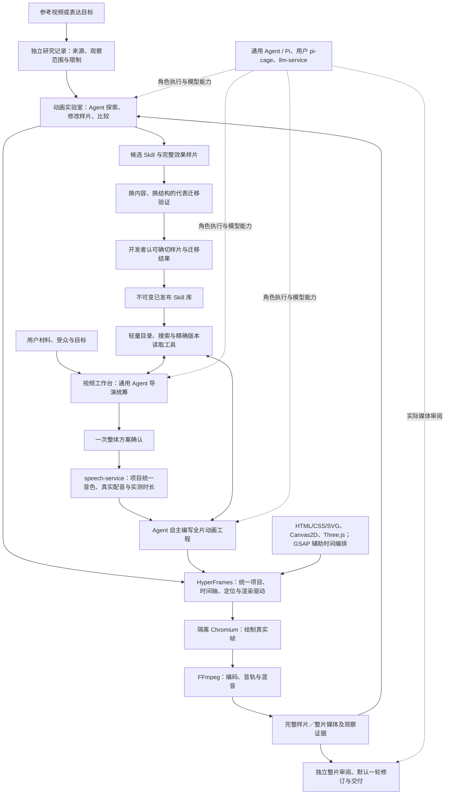

# Agent 动画效果库、视频工作台与 HyperFrames：统一设计

## 适用范围与现状（2026-11-14）

本文件是 `evolve-video-agent-creation-and-effect-library` 的当前设计，与该 OpenSpec 变更的 `design.md` 保持一致。它替换旧方案中不符合最新确认的默认流程；历史任务、冻结合同和验证结果保留原来的适用范围。设计同步本身不表示以下目标已经实现；用户随后已批准多 Agent 分工实施，代码、实际验证、部署与发布仍分别记录。

目标是让 Agent 自主创作动画，并通过可复用的 Skill 持续提升正式制作能力。工程提供项目、时间、资源、隔离与验证合同，不用开发者手写的固定构图或动作配方代替 Agent 创作。“内化”指形成独立可用的知识与操作指导，不指训练了模型权重。

| 范围 | 已有实现与证据 | 本次确认的目标／剩余差距 |
| --- | --- | --- |
| 自由创作与渲染 | 三种 Agent 原源码已通过实验室 HyperFrames 核心桥接重编码；正反／非顺序／重复定位和隔离清理已有实测 | 仍为显式旧源码桥接；随机状态专项及带必要音效的样片尚需验证，不将无声音轨相等当作声音通过 |
| HyperFrames | 0.8.149 core 的三引擎原始 Agent 源码重编码通过；实验室已完成新镜像独立准入并切换到 `hyperframes-core-bridge`，服务回读通过 | 实验室仍如实记录旧源码桥接；正式制作尚未接通新的可组合整片工程，不能用桥接部署代替整片验收 |
| 方法消费 | 标准 Skill 包、冻结目录、原生搜索／读取及新正式角色已实现；实际隔离候选已留下工具读取证据 | 开发者认可和真实业务发布、正式新内容采用仍需完成；operator-only fixture 不代表业务已发布 Skill |
| 整片统筹 | 一次整体确认、配音先行编排和三段交接已实测；同一三引擎 HyperFrames 工程已完成 3 秒离线导出及原技术音轨核对 | 新模块 Agent、执行运输和正式制作尚未接统一工程；整片独立视听审阅、默认一轮修订及用户追加流程仍需完成 |
| 质量与发布 | 技术结果、模型发现、人工观看和发布分别留证 | 不替开发者认可代表／迁移结果，不把代码、媒体生成或部署成功记为发布完成 |

不维护容易过期的任务总数或完成百分比；当前状态以服务端 `tasks.md` 的复选框及对应真实证据为准。已完成 3.4、5.1、5.2 的原验证范围不扩写为 HyperFrames 迁移完成；新增架构要求使用新的待办。

## 1. 总体结构

效果库改善的是可复用创作知识；正式制作按实际需求借鉴知识，自主生成新的工程。样片是验证和观看对象，源码是辅助材料，不要求复制样片源码。无匹配 Skill 时仍可在已准入环境内自由创作。

动画创作、独立评审和正式制作经通用 Agent 使用 llm-service 的 `llm-trusted` 路由，不启用 Guard 的提示词改写或拦截；检测仅记录日志。模型请求次数、输出长度、执行时间和产物合同校验分别管理，不能将这些限制或校验失败归因于 Guard。

## 2. HyperFrames 与各项绘制能力

HyperFrames 是两端共同的动画工程、时间轴、预览定位和渲染基础，不只是在末端接收另一套自定义动画格式的转换器。HTML/CSS/SVG、Canvas2D 和 Three.js/WebGL 是可组合的绘制能力；GSAP 是可用的时间轴／补间工具。它们不各自形成公共微服务或互不相干的导出合同。

正式交付由一个整片 HyperFrames 项目描述：全片时钟、场景／子合成、对象关系、转场、资源、旁白和音效排程统一。内部可以拆成多文件、多 Agent 任务、多个场景或渲染分块；不要求一份巨型 HTML、一次巨型模型调用或一次性渲染全部帧。分块必须服从同一项目和全局时间，不能仅拼接独立 MP4 后宣称已实现统一项目。

允许开发通用的时间、资源就绪、安全和引擎桥接适配器；不将这些适配器变成固定视觉布局／动作模板。渲染留在 video-service，暂不拆公共渲染服务，也不迁到 panghu-tool。

### 2.1 已核实的支持与尚未验证的边界

已核实安装版本 0.8.149 的实际打包运行时：GSAP 按帧定位；Three 适配派发 `hf-seek`、等待 `waitUntil` 和资源加载；运行时有虚拟时间／RAF 驱动。Canvas2D 可通过绝对时间 `draw(t)`、状态重绘或适用的 FrameAdapter 接入。现有自定义 `__animationExperiment.seek` 必须显式桥接或改造，不能直接当成 HyperFrames 协议。

上游 FrameAdapter 接口仍属 experimental v0。适配须支持正向、反向、乱序和重复同帧定位；相同时间得到相同画面，异步工作在截帧前完成。累积状态、无种子随机、真实墙钟或自主 RAF 不能靠“浏览器能播放”证明导出可靠。Three.js/WebGL 可以采用环境支持的硬件或软件绘制，具体资源与性能必须实测，不预设 ARM NPU 能执行 WebGL。

核对来源：npm `hyperframes@0.8.149` 的 `gitHead` 为 `bf881bf79d68cc78b52624f6431644ac152b2723`，见上游 [Frame adapters](https://github.com/heygen-com/hyperframes/blob/bf881bf79d68cc78b52624f6431644ac152b2723/docs/concepts/frame-adapters.mdx) 和 [Three 适配器](https://github.com/heygen-com/hyperframes/blob/bf881bf79d68cc78b52624f6431644ac152b2723/packages/core/src/runtime/adapters/three.ts)。既有资源身份另记的 `hyperframes_source=2905162d925fc87fb8242e24ed0bbf025d307ea1` 是另一条来源记录，不与 npm gitHead 混称。

随后服务器已完成三引擎核心探针、正式单场景捕获，以及 SVG、Canvas、Three.js 的真实 Agent 原源码重编码，检查严格定位、独立捕获和完整解码，未升级依赖。三条 Agent 重编码样片实际均无音轨；正式协议夹具与整片技术 WAV 的声音检查另记，不能把空音轨相等当成真实音效保持。详细来源和失败保留见 [HyperFrames 运行验证](hyperframes-project-runtime-20261114.md)。这些验证使用既有依赖镜像和只读新宿主源码，不能替代新构建镜像准入、线上默认切换或全片共享工程验收。编辑器的 “canvas integration”、CSS 类名 `.canvas` 和实验性 DOM 纹理接口也不能冒充普通 Canvas2D 导出证据。

## 3. 可复用 Skill、效果样片与研究记录

### 3.1 Skill 包与版本

创作方法以版本化 `SKILL.md` 包提供，分为可组合的两类：

- 基础 Skill：HyperFrames 工程、时间、资源和各绘制能力的创作约定，帮助 Agent 生成可运行、可定位的工程。
- 表达 Skill：身份追踪、群体筛选、因果关系、公式推导、空间揭示、转场等方法，描述何时用、如何判断与组织，允许 Agent 自主改变构图和动作。

正文包括适用／不适用条件、独立可理解的原理、操作步骤与判断、组合方式、取舍、常见失败和检查标准。必要附件可以是自行创作并验证的示意图、示例源码或辅助脚本；不以可复制固定模板作为成功前提。发布清单冻结包版本、正文／附件摘要、引擎和资源要求、适用证据与限制。正文、附件或适用范围变化形成新候选版本，不原地改已发布包。

一个 Skill 可由多条样片验证，一条样片也可验证多个 Skill。完整样片保留铺垫、发展、注意力引导和结果；无统一八秒或单镜限制。默认无讲解旁白，但有表现价值的音效应保留，不能把无旁白实现为强制静音。

### 3.2 参考资料先研究，再内化

原视频网址、来源身份、实际观察起止、访问限制、截图／连续观察覆盖、原始观察和溯源保存在独立研究记录，以 ID 和版本关联实验／方法。网址与逐片观看笔记属于研究资料，不写进运行 Skill 来代替能力说明。

Agent 必须将观察转化为自足的原理、适用判断、实现步骤与检查方法，不直接搬运原视频文稿、分镜或源码来充当可复用能力，也不要求正式制作重新打开原视频。Skill 的演示附件应自行创作并验证。Skill 不依赖原视频仍可理解和使用；来源记录保留溯源，但不成为生产必需资源。

发布前验证：撤去原网址和原片观察材料，Agent 仍能仅凭 Skill 完成创作；在实质不同的内容和结构中验证方法。只换标签、数字或领域名不算迁移。没有实际观察的部分如实保留未知，不能从几张截图推断看过完整视频或听过声音。

### 3.3 Agent 主动检索与使用

平台提供轻量目录、搜索、精确版本读取及必要附件读取工具，附可用范围和执行预算。导演和创作者根据表达问题自行决定搜索什么、读哪些完整 Skill、如何选择／组合／适配，或不用。宿主可校验权限、资源和冻结版本，但不能以固定关键词命中的少量候选替代 Agent 的最终创作选择。

每次任务冻结可发现的已发布版本集合或等价稳定目录快照；实际搜索、读取正文／附件、版本与内容摘要、Agent 选择理由及输入回执留证。只搜索命中不算读过，成功读取不算在画面中成功应用；后者要看实际结果。新发布不静默改变已有项目／任务的冻结输入。候选 Skill 不进入正式发现集合；项目中新发明也不自动共享发布。

### 3.4 WikiSkill 组织方式的可行性

采用 WikiSkill 的三层组织：原始经验 → 持续维护的知识 Wiki → 候选与已发布 Skill。它补充本设计的知识积累过程，不改变 HyperFrames 渲染合同、通用 Agent 执行服务或开发者发布权限。用户在可行性讨论后已批准并行实施；阶段状态见 7.1／7.2，不以此设计声明代替知识层、维护角色或实际调度已完成的证据。

| 层次 | 保存内容 | 使用范围与边界 |
| --- | --- | --- |
| 原始经验 | 独立参考研究、确切任务输入、源码／媒体、工具调用、审阅覆盖、开发者原话和失败回执 | 作为证据；不能把某次模型解释当成已验证的普遍规律，不能改写历史失败 |
| 知识 Wiki | 从经验归纳的表达原理、适用条件、反例、失败成因、改进假设、组合关系与未解决矛盾 | 为实验室维护者和 Skill 提炼者按需检索；每项判断关联证据 ID／摘要与验证范围，可修正或标记被替代，不向正片自动注入全部笔记 |
| Skill | 自足、简洁、可执行的创作指导，以及必要的包内附件 | 候选在实验室验证，已发布的不可变版本由正式制作主动搜索／读取；原始参考不成为运行依赖 |

Wiki 不是把长视频网址和观看笔记换个目录，也不是把所有经验塞进一份 SKILL.md。一个表达 Skill 可综合多条 Wiki 结论，一个结论也可支持多个 Skill；内部知识链接用于追溯和组合，发布时所需知识必须写进 Skill 或随包冻结的附件。正式任务不能沿着可变 Wiki 链接悄悄获得未发布内容。已有网页仍以完整效果样片为主，Wiki 不成为普通用户必须操作的新步骤。

建议演进过程：实验委托内产生真实记录 → Agent 归纳／修正 Wiki（保留反例与不确定性）→ 提议一个有明确改进目标的 Skill 新版本 → 用固定输入对比当前版本与候选，并做未参与优化的新内容／新结构迁移 → 展示样片、分项结果与剩余问题 → 开发者认可后发布。候选被拒绝，保留它的结果和教训，但不覆盖当前已发布 Skill；Wiki 中错误结论仍须纠正，不解释为“知识永不回滚所以结论永远有效”。

评价按理解目标、对象身份、构图可读性、运动／连续性、声音与动作配合、迁移能力分别给出证据。可自动检查运行、资源、时钟和媒体完整性；视觉／声音判断须匹配实际观察范围。暂不照搬“总分严格上升即自动采用”：技术正确可能同时造成表达退化。实验有有限预算与提前停止条件，效果库可继续委托优化；正片的 1+2 修订额度不适用于 Wiki 或效果库的累计改进。

调研依据（2026-11-13）：[WikiSkill 论文](https://arxiv.org/abs/2608.27454)提出经验、知识 Wiki 与 Skill 的协同演进，不训练模型权重；[ashutoshsinghpr7/wikiskill](https://github.com/ashutoshsinghpr7/wikiskill)与[Stahl-G/wikiskill](https://github.com/Stahl-G/wikiskill)是不同的社区实现。前者公开的验证门禁案例包含拒绝和无改动，后者演示的任务也不等于动画质量验证。当前借鉴机制并复用通用 Agent / Pi，不引入其完整 CLI、另一套 Agent 服务或对共享工作树执行 Git 回滚的流程。这些链接是架构研究来源，不进入运行 Skill。

## 4. 开发者实验室闭环

参考或表达目标 → 独立研究与可观察标准 → 预算内创作／渲染／比较／修改 → 完整最佳样片 → 候选 Skill 提炼 → 代表性迁移验证 → 开发者认可代表与迁移结果 → 发布确切版本。

长参考先提出有实际观察依据的完整片段和学习目标供选择；开发者已经指定范围与目标时不重复选择。没有外部参考也可按目标开展实验。主界面以完整可播放效果库为入口，名称／目标、状态及 HTML/SVG、Canvas2D、Three.js 技术筛选组合使用；技术标签以确切样片的源码、运行和媒体一致证据为准，不按名称或允许引擎猜测。

Agent 可直接修改当前样片源码以探索和比较。有效变化必须提炼进候选 Skill，并在里程碑通过重新生成和／或实质不同的内容与结构验证。不能只修好一条样片就宣称可复用能力提升。迁移失败回流 Skill，回归代表片、失败和受影响案例；每轮不必重跑全库，发布前覆盖与改动相称。

每次委托有明确的任务／时间／资源预算，可自主多轮，不要求逐轮确认。目标达成、预算耗尽、取消／失败或多种尝试无明显收益时停止，保留最佳、剩余问题、实际尝试和停止原因。开发者可以继续发起委托，没有效果或方法的累计轮数上限。表单“默认一轮”只是预算初值，不是终身限制；停止、刷新或重跑均不抹掉已消耗工作。

效果详情保留前后比较、自然语言反馈、继续优化与迁移；Skill 正文、源码、技术回归和日志按需展开。技术通过、模型判断、人工认可和业务发布分开。开发者认可确切代表与迁移结果后才发布对应版本，不另设提示词文字审签，不由助手补签。旧测试数据无需迁移，无用旧产品入口退场；运行正确性检查可以留在内部工具。

已有失败重跑、用户明确归组、无样片失败记录隐藏与成功重跑保留等已验证行为保持各自证据范围；业务可见性变化不删除执行账本、冻结谱系或已用预算。本次不执行任何记录删除或迁移。

## 5. 正式视频工作台闭环

总材料、受众与目标 → 通用 Agent 导演联合策划叙述／视觉／Skill／风格／衔接 → 一次整体确认 → speech-service 生成或选择真实配音 → 实测音频驱动动画 → 一个整片 HyperFrames 工程 → 渲染 → 独立整片审阅及默认最多一轮修订 → 用户观看。

导演保留事实、数字、原意和来源约束，可口语化与重新组织；明确原文不改时遵从。方案展示理解目标、讲解稿、视觉意图、已有适用效果演示和未覆盖部分的自由创作计划。默认不新增试片或逐镜确认。一个项目选择一个音色，关键点融入画面，默认不叠加字幕。

实际配音是全片时间依据。绑定真实音频摘要、实测时长及 spoken-text；estimated、forced、native 和人工修正按真实来源标注，不把估算时间说成真实对齐，不截断／拉伸旁白掩盖差异。声音自然度、读音和对齐继续由原音频规格承接。

导演统筹全片叙述、主题／对象身份、风格、绝对排程、相邻起止状态和衔接意图，再分配创作。场景可以选择不同绘制技术，仍进入同一个项目与时钟。内部草稿候选选择与自动组合不伪装用户采用、审美或人工时序认可。旧三段交接成果是可复用基础，不等于新的统一工程已经落地。

| 修改范围 | 规则 |
| --- | --- |
| 首次正片交付 | 最多一次独立整片审阅和一次创作者修订，随后技术复验、呈现结果及未解决问题，不继续自动循环 |
| 用户追加 | 用户看完整片后主动请求，同一制作序列最多两轮；一轮可包含多段修改，不给每镜重新发额度 |
| 更后续优化 | 使用绑定版本、范围／片段、问题及期望的明确需求列表，每批有预算，不重开一套 1+2 |
| 纯视觉修改 | 复用确认文稿、原声及无关有效资源，局部重制并核对相邻衔接 |
| 语义、顺序或声音实质变化 | 需要明确需求，失效受影响音频／时长／对齐／视觉／认可依赖，历史仍留存 |

正片制作序列和持久额度身份必须在首次自动修订提交前存在。原子预占、幂等提交、未知提交找回及失败留痕贯穿全程；刷新、重启、取消、失败、另存和新增需求不重置额度。正片 1+2 与实验室预算分开。

## 6. 服务分工与观察边界

| 组件 | 职责 |
| --- | --- |
| video-service | 效果库／Skill 业务、研究记录、实验委托、认可发布、全片导演编排、制作序列／需求、历史与交付；当前渲染所属服务 |
| 通用 Agent / Pi | 观察、提炼、导演、创作者和独立审阅角色；沿用用户 pi-cage 来源与共享执行服务，不另建一套长期通用 Agent |
| llm-service | 模型路由及实际核实的图像／视频／声音输入能力，不凭角色名称假设具备视听能力 |
| speech-service | 旁白／TTS、项目音色、读音及真实音频身份、时长；沿用原自然度与对齐任务 |
| HyperFrames | 统一工程、全局时间、场景／子合成、定位与渲染驱动 |
| Chromium 与 FFmpeg | 隔离绘制、媒体编码及声音组合，不承担创作决策 |

音效通过可追溯资产或有界合成产物、事件时刻、增益与声部进入共享时间表；预览与编码使用相同声音排程，不能截断旁白。不要求任意外链、实时 WebAudio 或付费语音引擎作为前提。

独立评审必须收到确切渲染媒体、目标标准、原版／候选及观察覆盖。连续动作、遮挡、节奏、音效和声画配合要有相应实际观察；静帧或未听声音不能判全片视听合格。报告绑定版本、时间、依据、修改建议及未知项；人工看片／试听另记，不能倒填为 Agent 观察。原 E 卡片漏检、迁移失败和声音未观察等记录保留。

可信用量与费用、生产存储回收、跨服务目录整体清理由共享框架原任务负责；本业务只落实当前可执行预算与内容依赖，不重复建设或登记这些平台待办。

## 7. 实施顺序与验收

下列是已批准的实施顺序；代码实现、实际运行与业务验收按对应证据推进，不因设计同步或单元测试扩写旧勾选。3.4 的 WikiSkill 知识层从小规模、有限委托内的真实积累开始，不建设另一套执行服务或无限自动演进框架。

| 阶段 | 工作 | 验收依据 |
| --- | --- | --- |
| H1：统一合同与引擎小样 | 定义 HyperFrames 项目／时钟／资源合同，验证 SVG、Canvas2D、Three 各自真实导出 | 同环境实际调用核心运行时，正／反／乱序／重复定位、异步就绪、固定随机和媒体一致；记录性能、资源与清理，不能只检查安装版本 |
| H2：实验室统一运行 | 实验室创作、预览定位与渲染接入共同 HyperFrames 工程 | 实际样片证明核心被调用，保留自由源码、必要音效、运行隔离和确定性定位 |
| H3：正式整片工程 | 正式制作输出统一 HyperFrames 工程，可分任务／场景／渲染块 | 全局时间、音轨、对象与跨段边界贯通预览和 MP4，不以独立 MP4 拼接代替工程集成 |
| S1：Skill 内化与主动读取 | 版本化 `SKILL.md` 包、独立研究记录、目录／搜索／读取工具及调用留证 | 撤去原参考仍可用；Agent 自主发现／读取／组合／拒绝，无匹配自由创作；冻结版本，候选不可见，来源不冒充读取 |
| S2：真实能力发布闭环 | 样片探索回写 Skill、换内容换结构迁移、失败回流、开发者认可与发布 | 开发者实际认可确切结果后，新正式内容读取并体现所发布方法，不能以未发布接线代替闭环 |
| P：正片统筹与使用体验 | 承接现有 3.x／4.x／5.x，整片媒体审阅、默认一轮、用户两轮与明确需求 | 持久制作序列、局部重制／音频复用、取消恢复、真实浏览器与交付；观察、技术和人工认可分别记录 |

引擎准入和 Skill 包／检索合同可以并行；统一整片和真实正式采用在共同合同上汇合。适配器只处理工程通用能力，表达改进由 Agent 与 Skill 完成。每次真实运行另冻结有限预算，不重开历史已耗尽委托。

### 7.1 基础实现进展（2026-11-13，历史阶段 `cc7b1a2`）

本节仅记载 `cc7b1a2` 阶段的代码与未执行边界，文中的“当前”“未完成”均指该历史时点。后续实现见 7.2，实际角色准入、部署与目录恢复见 7.3；不得用本节覆盖后续事实。

本阶段已实现版本化 Skill 包／冻结目录、原生搜索与读取工具、控制器独立采集的读取证据，以及独立的正式创作角色、业务冻结适配器、双产物网关和 creative v5 合同。研究资料与运行 Skill 分开保存，发布准备检查绑定确切样片、迁移及去参考输入。共同 HyperFrames 模块已定义项目资源与全局时间接口，实验渲染器提供显式启用的新请求；核心字节、宿主与引擎身份分别绑定。

这些是可组合的基础模块。当前业务工作流／界面尚未调度新的 Skill 创作链；既有创作者仍输出录音时间回调，新渲染器只在显式启用桥接时接收该回调。整片 HyperFrames 工程组装、真实三引擎导出、共享 Pi 新角色准入及真实 Skill 发布到正式采用仍未完成。运行身份 v3 与旧 creative 路由的 v2 要求也尚未联合迁移，本阶段不替换线上镜像。

具体代码范围、离线检查及未执行边界见[方法实验验证记录](animation-method-lab-validation.md)。H.1–H.5、2.4 等任务仍按完整验收条件保留未完成；3.4 的 WikiSkill 知识层只完成设计调研，未建立知识库或自动演进服务。

### 7.2 WikiSkill 与正式按需加载接线（2026-11-13，代码集成阶段）

本节记录已批准实施后的代码与离线集成结果，不代表该时点已完成业务实测。实际运行和上线状态见 7.3，真实 Wiki CAS、跨委托消费与发布采用继续按独立证据核对。

本轮在 `cc7b1a2` 基础上分三路并行推进，再由主 Agent 集成：

1. 知识层独立持久存储 owner 隔离的不可变经验、知识页版本、证据和冻结快照；支持比较后修正、反例及弃用。Agent 的知识候选通过确切证据与 CAS 回写为可修正知识，不需要开发者逐条批准 Wiki；不会自动发布 Skill。
2. 实验室使用新版本的通用 Agent 创作／评审合同，冻结知识与研究输入，实际产生标准 Skill 候选并落库。记录真实输出、渲染、失败和反馈；去参考迁移只能带确切 Skill 与新任务，不夹带原始材料或未发布 Wiki。人工认可绑定确切结果后才发布。
3. 正式制作接入已有 Skill 冻结适配器、保护输入树、主动搜索／读取与控制器独立证据，结果进入新的 creative 合同和当前录音时间渲染通路；没有匹配仍可自由创作。未准入的新角色必须显示不可用，不能静默退回宿主词法前三选配。

这三路分别验证数据／协议、真实业务调度和共享 Agent 的实际准入。既有 2.4、H.4 等沿用原任务，不重复登记；新增知识积累工作单独登记 W.x。整片 HyperFrames 和真实核心三引擎导出继续由 H.x 承接，不能把当前回调接线或离线测试记为其完成。联合验证、发布、部署与主线合入继续各自留证。

本轮代码接线结果：独立 Wiki SQLite、经验／版本／证据／CAS／快照与双层 HTTP 已实现；实验室新 author/review v2 冻结知识，生成标准 Skill 候选，重放归档真实操作记录并回写有证据的知识候选。反馈撤回保留历史，新快照排除撤回意见及直接依赖它的页面；迟到候选不能再用撤回意见回写知识。无参考迁移不读取实时 Wiki，只使用确切 Skill 与新需求。新发布必须通过精确 validation／media 认可接口，不沿用旧页面的泛化确认来补签。

正式制作的新整片 coordinator 路径已接通冻结目录、受保护资源上传、提交前准备检查、双产物交付和 creative v5；主输入不内联所有 Skill 正文。新版本可使用完整 runtime v3 身份的原生录音时间回调，这仍不是 HyperFrames 核心实际渲染。发布来源可由服务端 `VIDEO_METHOD_LAB_PUBLISHER_OWNER` 固定为开发者，只有已发布包进入新正式路径；最终用户的任务／目录冻结、读取消费身份与归属仍独立。未配置时保持各 owner 的发布库，不自动扩大可见范围。

本节记录代码与离线业务集成阶段，后续准入和部署进展见 7.3。原单镜生成入口尚未从冻结整片派生上下文，新模式明确要求使用整片草稿入口；不拼凑当前最新录音来伪造整片身份。

### 7.3 新角色实际准入与部署（2026-11-13 至 2026-11-14）

本节保存前轮准入、故障定位与发布状态；后续 v5 升级和真实业务结果以 7.4 为准。

实验 author/review v2 在修复后的独立完整源码和镜像上分别实际运行 4 次模型请求，完成唯一一次 4 秒原始源码渲染和真实帧评审；两个角色均通过独立技术准入。正式 production v3 以 6 次模型请求完成标准 Skill 双产物和原生 search/read 证据，原录音驱动的 13 秒原始源码渲染通过，独立准入通过。所有新 attempt 均有有限预算，失败保留；文件保管修正和工具顺序误判的修复没有重复生成或渲染。

正式角色、workbench 与 motion executor 已完成实际接线及开放前后检查，专用 caller 只允许 production v3；旧调用者、宿主和业务数据保留。实验室 author/review v2 和带迁移修复的新前端也已实际部署，Pod Ready；方法部署后的 production capabilities 回验仍通过。精确发布 UI 和迁移内容／结构绑定已有回归，部署和真人认可仍分别记录。

浏览器真实回验曾发现实验 catalog 返回 HTTP 409：新 executor 宿主字节已变化，原 engine-admission 仍绑定旧宿主。拒绝期间界面禁提交，没有为此产生业务模型任务。随后以原始、来源已核验的 Canvas／Three.js 作品分别完成一次 14 秒、336 帧技术重渲染，源码与音效不变，历史账本保全，零模型调用／构建；严格回读后建立新宿主准入，并以 CAS 仅更换准入文件参数。rollout、Pod 内 lookup 和真实 lab caller 目录 GET 均通过，三引擎 `html-svg`、`canvas`、`three` 已恢复可用，浏览器表单可提交。

首个有界真实业务委托“筛选发生时统计一起变化”已从登录页面提交，ID 为 `e73879f3-ad27-4dd8-abc6-f47424edff7c`，预算 12 秒／1 轮／15 分钟，最终 failed，没有渲染或样片。原始输出只读重放确定 `animation_skill_method_lineage_mismatch`：策划提供的 version 1 Skill 包尚无持久版本 ID，创作输出却将同一 Skill 改为 version 2，且缺少父版本 ID，服务正确拒绝。创作的 3 次模型请求均 HTTP 200 complete；实际使用 `llm-trusted`／`gpt-6.1-sol` 的 trusted Responses 路由，Guard 没有改写或拦截本次输出。未自动重试，后续优化 B／迁移 C 未执行；尚未据此确认 Wiki CAS、后续冻结快照消费、样片质量或业务发布。

随后 `a6098e58f25ffb33c7fd57a5e3a2ff3f61719b1f` 新增 `animation-method-v4`，保留 v3 原字节，明确未持久策划草稿保持 version 1、持久父版本须确切引用后才能递增。离线升级准备只更换两个现有 Skill 路由并保留旧绑定、认可、池、宿主与 UID，以及调用者凭据；新池禁用、未分配 UID。三个普通完整源码镜像已构建并推送。author-s3 因启动封装提前写入 launch 文件，在 runner 的 fresh 目录验证处被阻断，模型调用为零；只读核对无候选 UID 保留、无两命名空间候选 Pod、无输出目录。

s4 修正启动封装后实际完成 4 次模型请求，均 HTTP 200 complete。原始 Skill 输出保持 version 1、无持久父版本，谱系修复生效；但 `knowledge_proposals[0].expected_revision` 为 `null`，新 Wiki 页要求整数 `0`，因此仍为 `worker_output_invalid`／`invalid_animation_knowledge`，没有渲染、reviewer 任务或独立准入。只在内存 deepcopy 中改这一处 `null` 为 `0` 的完整 `validate_result` 通过，仅用于定位，不改原始产物、不触发模型／渲染或认可，也不证明真实 Wiki CAS 已成功。v4 的 r3 镜像未部署，旧 A 与 s4 原产物仍为失败。

`93e7626a9a27200927210de724f85d1d5c02b78a` 已仅以明确的 10 个文件提交并推送 v5 完整知识字段说明及接线，manifest SHA256 为 `3e17c8b9766568021b9fbca2ace6cc31f588c966266e169bf229cdbafb69cce0`；v3／v4／validator 保持原字节。profile／lineage／knowledge／build 检查为 174 passed、2 skipped，独立 catalog／upgrade／acceptance 检查为 15 passed。服务器 `skill-method-source-r4`／`skill-method-release-r4` 的完整 Git 源码构建已完成，三个 `latest` 镜像已推送；源码清单为 `d513471058edb07edefb9fce0b8287a9c06e7bacafbef25686ad090361579c8e`，构建回执均为零模型调用／部署。未启动 v5 新模型候选、未部署 v5，本轮实际失败后不追加付费尝试。下一阶段是 v5 author／reviewer 新独立技术验证及确切升级，不以代码或构建代替准入；旧 upgrade v1／v2、prepare_upgrade_v2 和 s4 执行器固定 r3／v4 及旧 UID，不能直接复用于 r4／v5，需新 release 固定脚本、新 candidate 目录和未保留 UID，不能把失败 s4 用作成功准入。后续真实业务链继续分别验证，W.2 所需的真实知识 CAS 与跨委托消费尚未完成，详见接通验证记录。

这里的真实候选只证明新协议、工具和媒体技术链；正式候选采用的是 operator-only Skill，不能冒充开发者认可或业务发布。真实委托的 Wiki 回写与后续快照消费、异内容异结构迁移、确切样片认可及发布到正式新内容的采用仍按独立证据验收。HyperFrames 核心三引擎导出及统一整片工程继续待办。本轮不合主线。完整来源、失败和验证收据见[WikiSkill 接通验证记录](wikiskill-rollout-validation.md)。

### 7.4 v5 修复上线、知识维护与 HyperFrames 实测（2026-11-14）

v5 author／reviewer 在独立 s5 候选中各完成 4 次真实模型调用，原始产物、唯一一次 4 秒 Canvas 渲染及六张实际评审图通过严格独立准入。v5 的 control、method worker 和 executor 已实际接线，真实 lab caller 目录回验通过，三引擎可用；保留既有身份、凭据及历史记录。技术 fixture 不替代业务作品，原失败 A 未被改写。

原筛选统计目标在同一效果下显式重跑 A，12 秒 Canvas 原始作品完成完整链路并通过技术检查；评审仍发现归集与统计标签遮挡，1 轮预算到达后停止。A 的三个 Agent 操作未提出知识更新；后续有界优化 B 已由 Agent 提案并 CAS 创建真实 Wiki revision 1，同一委托 create 的冻结输入读取该版本。独立普通委托 D 没有继承 B，其 plan／create 冻结输入仍实际纳入 B 的经验与 revision 1；D create 又通过 CAS 修正为 revision 2，review 冻结输入读取新版本，先前输入保持原样。W.2 已结合真实回写、跨委托输入、知识查询修正入口及 GET 不启动预算的代码与浏览器检查完成验证，不将其表述为模型注意力、效果保证或 Skill 发布。

B／D 均完成 12 秒 Canvas 技术链，按 1 轮预算停止；B 的 improved 仅为所供静态图片比较，D 为 inconclusive，仍需改善遮挡及核对完整运动。去参考迁移 C 已移除原参考、原源码、Wiki 和研究材料，但严格定位报 `reverse_seek_mismatch`，没有可采用候选、reviewer 或补充重试，迁移验收继续未完成。精确委托、冻结输入和 revision 1→2 SHA 链见接通验证记录，不以普通 D 的知识消费替代 C 的去参考迁移。

开发者知识页提供经验／Wiki 正文／历史版本查询及显式 CAS 修正，冲突保留草稿，未知结果冻结原请求；知识维护不会触发 Agent 或发布 Skill。界面已独立提交并从干净源码构建部署 lab/executor；浏览器已只读核对 D 完成状态、revision 1／2 正文及历史条目，修订表单打开后取消。诊断三字段归档修复 `0e0eb0e` 的 21 项检查通过但尚未部署；超限时明确保存摘要和原结果引用，后续 Agent 按需读取完整诊断仍未实现。精确证据见接通验证记录。

HyperFrames 新单场景正式适配、实验室显式核心桥接及严格证据校验已单独提交；真实三引擎探针与原 Agent 三引擎无声源码重编码通过。此前“音效保持”不构成带声证据，详见 7.6 的原始回执复核。H.2 尚未部署为线上默认；H.3 的整片合同、可组合模块、全局时钟与场景生命周期宿主已独立提交为 `887b9a8`、通过 39 项离线检查，尚未实际执行整片捕获或接通业务全片验收，不以逐镜 HF 后拼接替代。现有来源、失败与真实验收边界见 [WikiSkill 接通验证](wikiskill-rollout-validation.md) 及 [HyperFrames 技术记录](hyperframes-project-runtime-20261114.md)。本轮不代替开发者认可／发布，不合主线。

### 7.5 实验室核心部署与整片离线导出（2026-11-14）

本节更新 7.4 中 H.2 尚未部署的历史时点。基于干净完整 Git 源码 `0e0eb0e` 构建的 executor／renderer 已实际启用，三个旧 Agent 作品分别以真实 HF 核心重渲染通过，总计三次渲染、零模型调用，原源码及历史保持；三条原作品与重渲染均无音轨，不能据此宣称 PCM／音效已验证；Pod、原 Service 与真实调用方目录独立回验通过。实际选择为 `hyperframes-core-bridge`，不是将旧产物重标为新的可组合模块；详见[运行验证](hyperframes-project-runtime-20261114.md)。

`86b0cc0` 新增 opaque realm 资源加载、根工程、生命周期通信及独立 guard。修后实际浏览器矩阵共十次定位，三引擎／转场／重复 PNG 一致，import、mount、render、dispose 原始错误立即返回，无真实上下文的原型污染伪造被拒绝；清理和资源回读通过。这是受限技术夹具，尚未赋予新发布镜像或 Agent 任意自由产物运行准入，见[宿主验证](hyperframes-film-browser-realms-20261114.md)。

`aa01950` 增加冻结整片包的离线完整导出入口，首次目标环境实测因 FFmpeg 5.1 输出帧数限制提前结束音轨而被严格拒绝；失败保留。`5864ede` 改用有限 PNG 清单自然 EOF，本地 14 项检查及目标环境三组独立编码诊断通过。随后同一个三引擎／转场／三种原 WAV 采样率的技术工程完整导出 72 帧、3 秒、75 次定位通过，并对取回的实际 MP4 独立复核时长、完整解码、三段纯音位置与静音窗；累计两次整片尝试，零业务模型调用。具体摘要、AAC 填充和资源／清理范围见[离线导出](hyperframes-film-offline-export.md)。这是技术夹具的整片底座，正式新 Agent 模块合同、执行快照／运输、业务调度和整片实际审阅仍未接通，H.3 保持未完成，后续见[正式接入次序](hyperframes-film-production-integration.md)。

H.4 复用已有 foundation／expression Skill 包及冻结检索，不再新建一套 Skill 系统；业务认可发布和主动读取仍分别按 2.3／2.4 验收。既有 C 迁移失败、未发布 Skill 和声音／完整运动未观察边界保留，不因实验室渲染部署补签。

### 7.6 完成条件复核与证据纠正（2026-11-14）

本次只读核对代码、既有目标环境回执和关联 OpenSpec，未启动模型、测试、渲染、构建或部署。任务勾选区分“合同及接口已实现”与“真实效果认可和正式采用闭环已完成”，不因部分进展将整个架构任务勾完。

| 任务 | 本次状态 | 依据与剩余条件 |
| --- | --- | --- |
| 2.3 权限与认可／发布绑定 | 完成 | 已实现并验证候选、代表／迁移精确认可和最终发布的独立动作；绑定方法、Skill、媒体和验证版本；未发布包不进正式目录。合成 HTTP fixture 不等于真人认可，真实业务闭环仍归 2.5。 |
| H.4 版本化 Skill 包 | 完成 | foundation／expression、标准 SKILL.md、正文与附件摘要、运行要求、冻结目录和不可变发布已有合同及验证；修改另建候选。新整片模块的具体基础 Skill 内容与实测仍需随 H.3 接线，不冒充已发布能力。 |
| H.1 共同底座 | 部分完成 | 核心三引擎、定位、异步、编码、实际耗时和清理已有实测；未找到实际随机状态专项证据，实验室带声样片也未验证。 |
| H.2 实验室共同运行 | 已上线，整项未完成 | 实际运行为 hyperframes-core-bridge，三条 Agent 无声样片通过；必要音效的真实样片与声音链尚须验证。允许显式桥接，不将桥接本身误判为不合设计。 |
| H.3 正式统一整片 | 离线底座通过，业务未完成 | 同一工程 72 帧／3 秒及技术 WAV 混合已通过；正式新 Agent 模块、快照／多文件运输、业务制作和完整媒体审阅仍未接通。 |
| 2.4／2.5／H.5／2.8 | 保留待办 | 主动搜索读取机制已有真实技术准入，尚无开发者发布 Skill 的正式新内容采用；C 去参考迁移失败，未认可或发布，不以 Wiki 回写替代迁移成功。 |

原三引擎准入摘要的 `audio_pcm_unchanged=true` 实际来自原／新摘要均为 null。原输入及 HF 输入均 `sound_events=[]`，不存在 sound-effects.wav，实际 MP4 只有视频流。因此纠正“原 PCM／音效保持已验证”的表述，原始回执不改写。三个新运行耗时约 SVG 9.03 秒、Canvas 45.86 秒、Three.js 280.03 秒，各自输出和容器移除已有原始记录；不据短片推断长片性能。紧凑只读证据为既有 D 盘研究目录 `hyperframes-task-completion-audit-20261114.json`。整片 3 秒技术 WAV 的有声检查是另一条独立证据，不因此失效，也不替代实验室音效验收。

关联旧任务复核：旧 Canvas／Three 开发者能力和旧静态策略接生产各 8 项均已完成，但验证范围不扩写为新 Skill／HF 整片。原音频变更仍保留字词对齐、时间真值、节奏／自然度／提供者及局部校正；可选 BGM 的上传、ducking 和混音验收也未完成。整体策划、确认、整片审阅及浏览器体验按第 8 节交叉引用共用证据，不重复报为两份业务工作。

### 7.7 随机状态与必要音效补验、正式模块接线（2026-11-14）

独立冻结的 H.1／H.2 专项已在目标 ARM 环境完成：固定种子 Canvas 的正反、乱序、重复、空闲和重载帧一致；未冻结随机状态被真实核心检查拒绝且没有编码。原 Agent SVG 视觉源码逐字节保留，仅用现有事件合同加入两个技术音效，真实 HyperFrames 核心完成一次 4 秒／96 帧编码。独立重建的 192000 个 PCM 样本与原 WAV 完全相同；实际 MP4 经独立探测及完整解码，440／660Hz 音效位置和静音窗通过，AAC 的 512 个填充样本及有损误差分别记录。实际消耗为一次短编码、两个定位 fixture，零模型／TTS／下载／构建／部署，容器均已清理；没有借用此前整片 2/2 预算。首次准入预检失败、宿主缺 ffprobe 的独立分析失败及补验均保留，没有重复生成或改写旧失败。

结合此前三引擎、异步、原声、实际耗时与清理证据，H.1／H.2 的技术验收现已完成；现有实验室仍显式使用 `hyperframes-core-bridge`。旧无声回执中 null==null 的纠正保持原义，本次是新增非空音轨证据。技术通过不等于人耳试听、美学认可、Skill 发布或正式整片完成。冻结输入、实际脚本身份、原始媒体摘要和独立分析见[随机与音效验证](hyperframes-random-sound-validation-20261114.md)。

H.3 正在并行实现新 Agent 可组合模块合同与自足基础 Skill、独立网关／禁用候选目录、多文件冻结快照／PVC 运输及完整源码 renderer 打包。新模块原生提供 `mount/renderAt/dispose`，按同一录音时钟和精确前任状态创作，不把旧单镜源码改名。正在接既有执行 journal 的提交、找回、取消与整片回读，并独立审查可信身份和镜像实际入口。离线合同及资源生成不记为真实集群或模型准入；正式业务尚未切换，完整工程业务验收、实际边界及整片审阅仍待完成，H.3 保持未勾选。

### 7.8 整片组装、执行 journal 与真实 Job（2026-11-14）

H.3 新模块合同、独立网关、禁用候选目录、整片组装、受限多文件快照、PVC staging、现有执行 journal 的新 schema 分派与独立 HTTP 客户端均已实现。原声以同一工程输出 48kHz 双声道，保留精确前任、模块源码与录音身份；未由 `ProductionRunStore` 调度，也未部署启用新的执行 API。根任务最终联合检查 185 passed、1 Windows 符号链接权限 skipped；合成调度检查不当成真实业务验收。

普通完整 Git `642fe32` 构建的 renderer `latest@sha256:701fea4765af8808647ac9f2defc63d0f3cf89a74279a0bf6455b4b30045aef8` 已通过镜像内依赖及断网／只读／非 root 启动检查。随后在既有 Kubernetes／PVC 实际执行一个三引擎、转场及三份技术原 WAV 的冻结工程，完成 3 秒／72 帧、75 次定位和一次编码。恢复入口对实际结果严格回读且禁止 exporter 再运行；第二个 Job 在 Running 时取消，确认 Job／Pod 不存在、无完成产物。RWO PVC 的同节点约束在任何导出 Job 提交前重新冻结，预算与输入录音未重开；先前冻结、清理检查待终止及 API 空数组比较失败记录均保留。技术 Job／helper／本批策略已清理，业务部署及数据指针未改。

实际 MP4 取回后独立验证外部身份、完整解码、音画零起点／3 秒、48kHz 双声道、三段音调位置和静音窗，AAC 填充 384 样本另记。MP4 SHA 为 `5071e2047dc1d48ad9d6d263188e1d490178832dd3ca9705e424476c0c6772e5`，独立检查回执 SHA 为 `4e3160fcd894570485ac9dca32ddf21eb75af0f7e782d4584aea32c8fe47d259`。这是复用技术图形与纯音的 Job 验证，没有调用模型／TTS，没有代替新模块真实准入、完整内容体验或人工认可，统一 mixer 的音效混合也仍未实现。

H.3 保持待办：下一步完成新 Agent 模块真实产物准入、执行 API 配置发布和正式制作持久编排，随后验证一个工程的预览／草稿／下载、真实边界及整片审阅。完整构建身份、来源、预算、失败与媒体证据见[整片 Job 验证](hyperframes-film-job-validation-20261114.md)，配置及恢复合同见[Kubernetes 接线](hyperframes-film-kubernetes-dispatch.md)。本轮不发布 Skill、不代签人工认可、不合主线。

## 8. 旧规格归属与有效证据

本变更是当前方法库与正片新流程的唯一主设计。旧变更在其开头标注适用范围与承接，不把已退场的固定题库、静态规则包或逐镜确认步骤继续要求为新默认，也不把历史固定编译器结果解释成自由创作能力。

| 工作 | 归属与边界 |
| --- | --- |
| 方法、实验、迁移与发布 | 本变更 1.x／2.x 及新增 Skill 任务；旧 `connect-animation-capabilities-to-video-production` 仅保留静态规则包／单镜桥的完成证据 |
| HyperFrames 统一项目与主动读取 | 本变更新增 H.x；旧 `add-hyperframes-motion-video` 只证明受限计划路径使用过该引擎 |
| 联合策划、音频驱动与整片修订 | 本变更 3.x／4.x／5.x，承接 `improve-video-audio-clock-and-expression` 5.1／6.1–6.4，不重复计为独立产品工作 |
| 字词对齐、语义锚点、自然度与提供者 | 保持 `improve-video-audio-clock-and-expression` 原音频待办；本次不扩大为完成 |
| 可选背景音乐 | `add-video-workbench-audio-production` 原 5.1–5.3，保留音量、ducking、响度与混音验收 |
| 用户反馈与原生 OOM 证据 | 原 `fix-video-user-feedback-reliability`、`harden-video-render-lifecycle` 继续按对应实际缺口核查，不凭新文档勾选 |
| 可信用量／费用与生产清理 | `add-pi-first-agent-execution-service`、`harden-shared-platform-production-readiness`、`consolidate-service-workspaces-and-execution-artifacts`，不列为视频业务重复任务 |

架构讨论时核对的应用基线为 `48cdac5`；已有实现见[整片编排验证](production-run-validation.md)、[相邻状态验证](film-continuity-validation.md)、[方法实验验证](animation-method-lab-validation.md)。这些文件是具体版本证据，不是当前目标的替代规格。任务完成、发布认可、上线和主线合入各自留证。

后续构建从完整 Git 源码同步，镜像使用 `latest`，以标签、部署注解和 digest 记录身份；不拼接增量应用镜像。当前开发分支不因文档同步而合入主线。多图层专门交互／分层导出仍只记录为后续讨论，不新增到本期验收。

## 附录 A：实施前代码复核（历史基线）

本节是最初规划时的源码快照，不用于判断当前服务状态或剩余代码量。原始开篇记录保留在文末，最新进展查 tasks.md 与实际验证回执。

本表针对最初规划 HEAD `720c2dbcf8dc3feb9834a399a2a8af4919194c00` 的代码和已归档证据，不等同于本轮重新运行生产验收。未提交的 animation_effect_library.py 仅为本地数据层草案，不是线上产品。当前未提交的旧批量审阅操作器和测试不纳入本轮文档工作。

| 范围 | 已有基础 | 与本次目标的差距及源码依据 |
| --- | --- | --- |
| 任意参考与目标 | 有实验定义、输入冻结和幂等请求 | animation_creation_service.py:218 只收固定题目／输入组；:240–243 从题库构造输入，assets为空、base_source为空；没有参考、可调整标准、关联方法或上一版反馈 |
| 表达范围 | 已有真实 HTML/SVG Agent 作品 | animation_experiment_definitions.py:15 要求语义标记从首帧可见，:170 固定8秒／HTML-SVG；这是旧技术约束，不是完整片段的创作边界 |
| 开发者持续优化 | 已有持久任务和单次审阅修订 | animation_creation_service.py:30 固定初作1／审阅1／修订1／渲染2；creation-runs.mjs:55 要求没有已有record才能开始；缺多轮委托、继续优化、最佳结果与提前停 |
| 方法与样片 | 未接线库草案有不可变版本、人认可和幂等思想 | animation_effect_library.py:169 将参考、实现和一次改编聚合，:458 读源码、:485记源码使用；没有独立方法实体／多对多，未被运行模块引用，不能按原source-first模型直接接线 |
| 实验反馈 | 旧区有时间意见、版本比较 | animation_lab.py:750／915代理新creation-runs，:933反馈仍走旧experiment；新上区作品与旧下区标注不相通，需统一绑定当前样片 |
| 主界面 | 已有播放、定位和来源详情 | animation_lab_web/index.html:14 仍为能力实验／组件回归并列，:35为单轮制作，:43–56旧作品标注，:82–100工程矩阵／任务包；需按样片库与单实验详情重组 |
| 正式方法应用 | animation_capabilities.py:54有共享静态规则版本 | creative_contract.py:85／98绑定整体固定规则与HTML/SVG，没有按表达问题检索和组合方法；base_result只是本镜原源码，不是方法读取 |
| 音频时钟 | motion_store.py:158／313的creative单镜已经要求有效录音并绑定实测时长 | 不应把当前所有路径说成先画面后配音；batch_store.py:21仍motion→audio→draft，:470默认motion路径，缺新的整片统筹执行 |
| 策划和跨镜 | 旧讲解改写、图解跨镜、采用与历史可复用 | video_explanation_contract.py:111固定镜头数和顺序；continuity_store.py:127拒绝creative连续计划；旧编译器连续不等于自由源码跨镜连续 |
| 独立评审 | 已有独立角色、24图真实输入和时间证据 | video_animation_review.py:36／89／228限制静帧及visual_only，:181–198没有标准／前后比较／方法迁移结论；animation_observation.py:418如实不宣称完整视听 |
| 审阅已知失败 | r4真实初作→审阅→修订→复验及浏览器播放成功 | agent-creation-phase1-validation.md:29／97／151中的预登记E问题仍漏检；新网页案例通过不补签旧1.3，也不证明方法质量提升 |
| 音效 | 已有单旁白和整片原声组合 | motion_renderer/creative.mjs:61／67禁audio，run.mjs:65–68只混单份audio.wav；缺音效事件、真实音效产物、多轨混音、声音观察和试听，不能把无旁白实现成强制静音 |
| 正片修订 | animation_revision_store.py有原子预占、幂等和重放 | 文件:9明确用户追加和需求任务未实现，:200固定automatic round0；这个单次基础不能直接作为实验室终身上限，也不是正片1+2已完成 |
| 自由引擎 | 有隔离Chromium／FFmpeg、旧HyperFrames及固定Canvas/Three演示 | creative_contract.py:98／111、animation_creation_renderer.py:151只准HTML/SVG，creative.mjs:61禁canvas；分别缺自由源码运行准入，不能通过放开枚举冒称支持 |

已有单镜自由源码、项目统一音色、录音绑定、无字幕动态输出、候选／采用／冻结历史、旧图解连续和取消恢复仍有用。本次纠正方法和实验架构，不将此前工作清零或转记为新目标完成。

## 附录 B：最初规划开篇留档

以下只保存实施前的基线、阶段授权和路径记载，不作为当前部署或授权状态：

# Agent 动画创作方法、效果库与正式制作：目标和实施计划

2026-11-11，讨论确认后完成现状复核、规格更新和实施计划。用户随后批准实施并要求使用子 Agent 并行推进。实现按下述阶段进行；真实运行、人工验收、发布和合入主线分别保留实际状态，不因代码或单元测试通过而自动完成。

应用仓库：panghu_agent；核对分支：codex/video-capability-experiment-redesign；核对 HEAD：720c2dbcf8dc3feb9834a399a2a8af4919194c00。当前运行源码基线为7cf5f2a3865f5ef1a0068832f833ee811c5eb9f1，运行证据见[阶段1验证](agent-creation-phase1-validation.md)。本轮未重新检查服务器部署状态。

OpenSpec 项目：ec663f5a-53d3-4a0e-9037-933eb788d183；服务：https://openspec.panghuer.top/mcp ；当前变更：evolve-video-agent-creation-and-effect-library。本文件与该变更的 design.md 保持一致；后续实现按服务端 tasks.md 跟踪。
