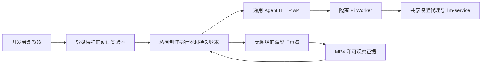

# 动画实验室：制作并打磨一轮

本阶段把通用 Agent 创作、独立审阅和最多一次修改接成一个开发者操作流程。作品由 Agent 编写，工作台负责保存、隔离渲染、收集真实画面证据和限制调用次数。普通视频工作台的制作流程不在这次切换范围内。

## 使用与验收

1. 打开 `/dev/animations/` 的“能力实验”，选择实验目标及开发／独立验证输入。
2. 点击“制作并打磨一轮”。页面先保存请求编号，再提交一次制作请求。
3. 查看阶段进度：初作、初作渲染、独立审阅、有问题时修改一次、修订后渲染与技术复验。
4. 离开页面或刷新后重新打开同一目标，读取原任务进度；不会因此再发一次制作请求。
5. 播放原作和可用的修订版，结合审阅列出的时间段检查变化。下载源码只得到 JSON 文件，页面不执行其中的动画代码。
6. 如需停止，明确点击取消。已经提交的操作仍保留额度和记录；已生成作品可继续查看。结果未知时先核对原操作，不重复提交。
7. “本轮流程已结束”表示流程完成。技术检查、模型意见、开发者效果评价和正式采用仍是不同的结论；本轮不自动发布效果或采用到业务项目。

执行器未配置时，页面明确显示制作链尚未启用，已有案例和标注仍可使用。接口不通、源文件变化或证据不完整时显示错误，不展示虚构的成功作品。

## 单轮边界

每个 run 冻结实验定义、输入角色、约束和创作要求。最多初作 1 次、独立审阅 1 次、创作者修订 1 次、渲染 2 次；无审阅问题时不消耗修订。修订后只做技术复验，不自动再次审阅、反复改稿。

制作与审阅共同要求：运动路径和固定说明区域一起安排，重要标签、对象身份和状态在中间过程保持可辨。该要求不指定动画模板，也不向审阅模型提供预先登记问题的答案。抽样帧只能支持实际可见范围的判断，不能证明全时段无遮挡或用户满意。

当前实际运行范围沿用已隔离验证的 HTML/SVG、24fps、最多 10 秒。实验输入当前是已登记的能力目标；任意参考视频分析、完整效果库、正式整片 Agent 创作以及 Canvas／Three.js 自由源码准入继续分别实施。

## 服务分工

浏览器和实验室不持有 Agent 密钥或 Docker socket。实验室使用独立内部凭据向固定执行器服务转发已认证开发者身份，保留原有同源、CSRF、身份隔离和媒体 Range 下载行为。

执行器负责 Agent 调用、每次提交前落账、恢复和渲染。初作、审阅、修订和复验使用不同 operation ID；结果未知时只查同一 ID。GET 请求不会推进制作。取消和失败不重置额度，原作和已产生的媒体保留。

可信执行器通过主节点 Docker 创建既有受限渲染子容器，因此它与无凭据、无网络的渲染容器属于不同信任范围。执行器只挂专用数据根和两种不同的调用凭据，不把它们挂入生成代码的运行环境。主节点数据根以相同绝对路径挂载，避免 Docker bind mount 指向另一份目录。

## 配置入口

私有进程：`python -m video_workbench.animation_creation_executor`。必须显式提供数据根、固定 Agent 地址、Agent 调用凭据文件、另一份 Lab 调用凭据文件、固定摘要的渲染镜像，以及 `--enable-isolated-rendering`。启动和健康检查不会提交任务。

`video_workbench.deploy.animation_creation_executor` 仅生成专用 Deployment、ClusterIP Service 和最小网络策略，不包含 Secret 值，不自动部署。镜像由独立 `Dockerfile.animation-creation-executor` 构建，普通工作台镜像不因此获得 Docker 权限。

Lab 通过 `video_workbench.deploy.animation_lab` 的 `creation_namespace/name/port/labels/token_secret` 完整配置派生内部地址；默认全部省略，保持原只读实验室行为。Lab 只增加执行器专用 token 的单键只读挂载及目标服务、DNS 出站权限。

共享 Agent 新角色仍须经独立技术准入、不可变资源、真实 Worker 及完整 HTTP 制作链验证。`agent_service.deploy.animation_creation_acceptance` 只能从原地保存的真实候选证据生成仍禁用的技术准入记录，不启用路由、不分配 UID，也不把历史候选写成已完成的正式 HTTP 任务。

## 当前验证状态

新增流程、渲染持久性、HTTP 两跳、界面恢复、凭据隔离和部署生成分别有定向测试。模拟执行器测试不代表模型调用或实际渲染通过。实际发布、浏览器验收及新制作任务的身份和结果另记录在阶段验证文档；以该实证记录判断服务是否已启用。
