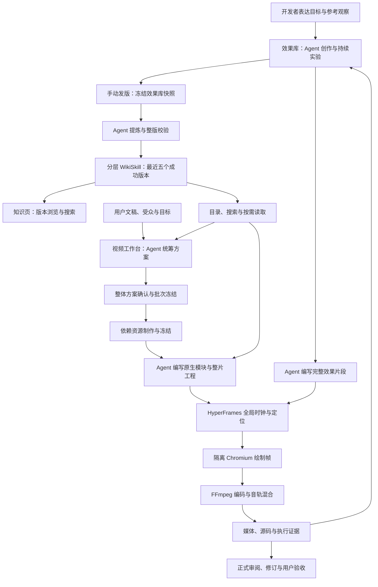

# 当前架构与实施边界

更新于 2026-11-16。本文概括当前代码和已有验证；完整目标见[统一设计](agent-creation-effect-library-plan.md)，未完成项以 OpenSpec 原任务及其证据为准。主线合并、部署成功、技术检查、实际视听与开发者认可分别记录，不能互相替代。

## 两个工作台与同一套技能

普通用户使用[动态视频工作台](https://video-service.panghuer.top/)制作完整视频；开发者使用[动画效果库](https://video-service.panghuer.top/dev/animations/)研究完整表达片段。实验室由 Agent 根据目标、标准、参考观察和意见自主生成源码；开发者改进的是表达方法和创作上下文，不是维护一组固定绘图模板。

效果库里的作品、失败、评价和源码是实验事实。开发者明确点击知识库发版，冻结当时效果库快照；编译 Agent 从快照提炼自包含、分层的 WikiSkill，整版校验通过后原子发布。知识页浏览和搜索的就是正式制作使用的同一产物，没有另一套人工知识字段或独立浏览发版链。保留最近五个成功版本，正式批次固定其中一版；仍被旧任务引用的确切产物不因退出新制作选择窗口而直接删除。

这套发布及消费机制已有代码和上线记录，**最近一次真实整库业务编译仍因 900 秒超时失败，未产生新 release**。不能把技术候选准入、源码中存在检索工具或 API 可读取，当作整库已成功发布、正式新视频已采用或效果已经提升。实际结果见[WikiSkill 读取验证](wikiskill-reader-validation-20261116.md)。

图中的发布和审阅节点表示已有机制及其职责，不表示每个业务闭环已经完整验收。实验室桥接既有绝对 `seek` 源码；正式新链路形成共享全局时钟的 HyperFrames 整片工程。Chromium 负责实际绘制、FFmpeg 负责编码，二者不是绕过 HyperFrames 的另一套目标架构。旧受限计划及恢复协议仍可存在，不能用旧代码路径概括当前默认制作。

## 画面创作、动作编排与预制资源

| 角色 | 能力 | 与整片的关系 |
| --- | --- | --- |
| 浏览器画面创作 | HTML/CSS/SVG、Canvas 2D、Three.js | Agent 输出相应源码，按绝对时间定位，在 Chromium 中绘制 |
| 浏览器动作编排 | 原生 JavaScript、GSAP、Anime.js | 驱动对象、样式、绘制参数或相机；都服从 HyperFrames 时钟，不是独立微服务 |
| 预制动画创作 | Manim Community | Agent 输出 Python；隔离生产者提前生成透明帧，按局部时间和整片 placement 消费 |
| 声音资源 | speech-service、已准入的音效资源 | 旁白使用项目统一音色和实测时间；有表达作用的音效可独立存在 |
| 工程、渲染与编码 | HyperFrames、Playwright/Chromium、FFmpeg | 项目与时间统一、可重复定位、等待资源、捕获、编码和混音 |

Manim 与 SVG/Canvas/Three.js 都是画面创作能力，接入时机不同；GSAP 与 Anime.js 属于同一动作编排层。页面标签依据确切源码、媒体和渲染回执派生，不因表单声明、加载库或没有库记录就推断实际使用。最近三条协作作品已补齐“原生 JavaScript”标签；这不是艺术质量认可。

资源制作层已有资源账本、依赖执行、音频采用、Manim 生产及局部时间与 placement 分离。统筹补做、替代、跨镜失效与完整正式修改闭环仍须按原任务完成。当前不额外拆公共渲染微服务，也不将这些能力搬入 panghu-tool。

## Agent 与公共服务

`video-service` 负责业务身份、项目、方案、预算、候选、采用、制作状态、资源依赖及交付。通用 `agent-service` / Pi 负责独立角色执行，复用用户的 pi-cage 工具运行时，通过 llm-service 的 trusted 路由调用模型；speech-service 独立承担语音合成。模型输出不是可信执行证据，仍须核验原任务身份、摘要、实际产物和停止状态。

协作核心 `creative_collaboration.py` 管理职责 DAG、依赖、并发、预算与停止，不依赖 Canvas；视频适配层检查当前任务实际冻结的引擎、源码和 Skill 一致性。`creative_direction.py` 提供有界、冻结的表达目标与反馈上下文；`animation_quality_policy.py` 将模型原始评审与宿主选片依据分开。多 Agent 并不自动意味着更好的画面。

## 用户流程与优化规则

正式制作以总文稿和整体方案为起点，方案确认后制作依赖资源；讲解段按实际旁白安排时长与动作，无旁白段由统筹安排。Agent 根据冻结方案和技能编写模块，再在同一整片时间轴中渲染。项目统一音色，默认不叠加逐句字幕，画面承载关键表达。

正片有一个稳定制作序列：默认一次自动审阅与修订，用户可主动追加最多两轮；之后继续优化须有明确问题、范围、预期和有限预算。失败、重启、重新编码或复用原声不刷新额度。完成只产生新草稿，不伪造用户采用或试听确认。实验室是开发者持续打磨效果的工具，不受正片 1+2 限制，每次委托仍有预算与截止时间。

## 明确保留的缺口

- 整库 WikiSkill 超时修复，以及真实成功发布后正式新内容检索、读取和采用的业务验证。
- 协作制作前的实际关键画面预览与检查门控（P.6）；目前 `keyframe_times` 只是规划，成片抽帧不替代前置检查。
- 正片自动轮次、用户追加及明确需求的真实执行闭环；代码与上线记录不能代替该验收。
- 完整连续运动、旁白自然度、声音及声画配合的实际观察。当前 v4 审阅是至多 24 张抽帧，不能声称看完或听完整片。
- 资源定向补做与依赖失效等剩余业务链路，以及复杂材质和氛围表现的艺术质量改进；协作水墨没有因此达标。

可信用量、费用和全平台生产存储生命周期由共享框架任务承接，不重新列成 video-service 独立业务待办。具体有效任务及拆分归属见映射项目的 OpenSpec；不从历史文档中的复选框总数重新排期。

## 2026-11-21 文档整理补充：历史证据与待实施设计

> 本节来源：文档提交 `03369402067c5cc7fcd9571d3af7d9c81e4a39b2`（`codex/organize-video-design-docs`），其运行及交付事实对应视频分支 `faaa09affca3205ecfa46b2204f8d6aa2a017362` 的历史证据；不表示该分支新增实现已并入当前主线，也不表示当前部署状态。原主线正文按原记录日期保留。

2026-11-21 的新增证据包括 WikiSkill 第 2 版的实际发布和消费，以及《雨霁江渚》300 秒、7200 帧静音试片的完整解码技术交付，见[交付说明](../../docs/codex-work/operations/ink-long-video-20261120/formal/attempt8/DELIVERY.md)。原正文中 2026-11-18 及更早的编译失败、未发布和局部产品结论保留其当时范围；不再据此推断后续没有成功发布或长片交付，也不能反过来用这次交付补签所有旧任务。

试片的山水艺术质量尚未获认可，完整连续五分钟的人工审美播放审查仍未完成。这些是有来源的历史执行事实，不代表当前集群部署、所有视频学习或声音能力的实时状态。

后续共同空间描述、分层、网格、全自动镜头编排及图片／视频渐进学习见[新设计](scene-space-layer-camera-design.md)，目前尚未实现或部署。其他设计、运行准备和评审按版本留存在[本仓库设计档案](../../docs/codex-work/README.md)。
