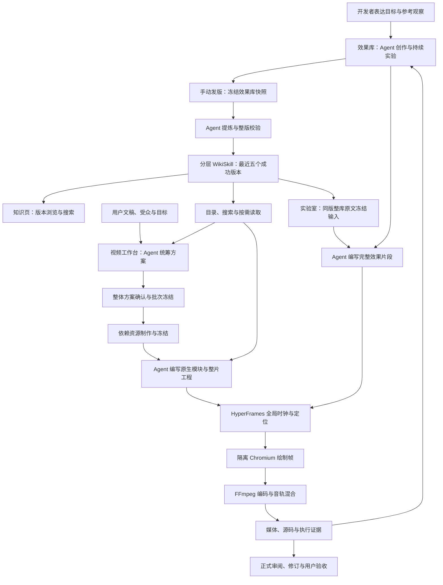

# 当前架构与实施边界

## 2026-11-25 用户认可后再验证

图片、视频学习的默认流程改为复现、真实渲染、独立评审和有界优化；复现结束不再自动调度换内容规划或创作。用户选定认可的已生成复现版本后，通过独立操作和预算发起验证。AI评分、内部最佳、采用默认作品与知识发布分别记录，不能互相替代。接口与输入隔离见[用户认可后再验证](user-approved-learning-transfer.md)。

以下旧日期章节保留对应时点的自动验证流程及真实运行记录；本次不改写旧冻结实验或把旧失败补签为成功。

## 2026-11-24 主线合并检查点

本次合并纳入视频学习、按需远程参考、WikiSkill消费、一小时/一轮默认，以及
[场景空间公共框架](scene-space-framework.md)、[制作与学习接入](scene-space-integration.md)
和[共享三维网格/绘画API3](scene-shared-geometry.md)。这些是源代码已接入的范围；
后文2026-11-21及更早的“待实施/未合主线”保留原历史含义，不再作为最新源码状态。

共享几何与固定视角研究有[2026-11-23学习执行器记录](scene-shared-geometry-validation-20261123.md)，
本次Git合并不构建或部署镜像，不修改运行参数、冻结任务、效果采用或WikiSkill发布。
正式制作新场景队列、完整时间学习及真实长片艺术闭环仍按OpenSpec原待办保留；
不能用单帧技术通过补签运动、听审或艺术认可。[合并验证记录](mainline-scene-merge-20261124.md)
给出具体检查范围；本仓库设计档案及其manifest保持原快照身份。

## 2026-11-18 起的历史实现记录

更新于 2026-11-18。图片学习首版已上线，真实完成两轮源码创作／单帧渲染／比较及一次换内容作品与评审，见[产品验收](picture-learning-product-validation-20261118.md)。视频学习已激活真实采样帧作者／评审，运行 r5 executor 与 r6 lab；一个内部 6 秒参考实际完成独立分析、两轮复现及一次换内容作品，12 份产物下载和媒体全解码通过。详情刷新 UI 修复已部署，并通过实际输入查看、刷新展开和双媒体播放等浏览器技术验收，见[本轮验证记录](video-learning-validation-20261118.md)及[精简证据](evidence/video-learning-20261118.json)。图片渲染和看图角色各有[渲染证据](picture-learning-render-validation-20261118.md)、[角色证据](picture-learning-agent-validation-20261118.md)。完整目标见[统一设计](agent-creation-effect-library-plan.md)及[参考学习设计](reference-learning-libraries-design.md)，未完成项以 OpenSpec 原任务及其证据为准；历史验收结论保持各自范围。

## 2026-11-18：三库首版与未验证目标

开发者侧分别组织需求创作库、图片学习库和视频学习库，共用执行、资源制作、HyperFrames 渲染、独立评审和同一套 WikiSkill。现有效果库继续提供需求创作；图片学习已有上线的独立网页、结构化 API、项目及实验记录，先支持 HTML/SVG、Canvas 2D 和 Three.js。视频学习同类独立入口与业务代码已部署，一个有界内部参考 API 实验已有完整产物证据；内部技法小样、自适应多人学习、图片转关联动画和图片 Manim 资源接入仍待补齐。

图片学习沿用水墨研究的源码工作方式：创作者直接看参考，编写完整绘制源码，宿主用 HyperFrames 导出单帧，独立评审对照参考与实际输出；下一轮创作者获得真实图片、较好版本源码与具体问题。单帧是每轮比较的产物，项目还保存源码、尝试、意见与方法，并在预算允许时由独立评审出题做一次换内容验证。原图比例不强制决定输出画幅；开发者采用、模型评分与手动知识发布分别记录。

后续同一水墨项目实际又完成三轮有界优化和一次换内容图。局部硬切面、短皴有改善，但第三轮退步，迁移只支持局部技法，仍未达到参考笔墨或获得用户艺术认可。第三轮评审技术恢复未带回第二轮实际比较基线，原始记录保留；后续源码修复与本地回归不补签那次重试完全恢复，也不代表已在生产复测。详见[本轮验证中的水墨记录](video-learning-validation-20261118.md)。

| 成果库 | 目标与产物 | 与其他库的关系 |
| --- | --- | --- |
| 需求创作库 | 根据表达需求自主探索完整效果，可自由安排时长与节奏 | 图片学习成果没有参考视频而继续制作动画时，新建关联的需求创作项目；动作独立创作和验证 |
| 图片学习库 | 对照参考图片学习指定画面技法，保留绘制源码、实际图片、素材和生成方法 | 图片项目与所选版本保留；可以把画面技法用于后续动画，但静态验证不冒充运动验证 |
| 视频学习库 | 对照一个明确参考片段学习画面、运动、节奏及有表达作用的音效 | 长视频先实际分析候选片段、学习价值和难点，由用户或外部 API 调用方选定；已有范围与目标时直接执行 |

视频学习首版提交为 `0ae66695efd0b9e331aecedd16b58649c3181973`，协议和技术重试上下文修复提交为 `0e338fe4cc1e89e748bfd11c90aab79076d8faac`。代码提供 `/dev/animations/video-library.html` 和 `/dev/animations/api/video-lab`，支持实际参考视频、独立候选片段分析、选定范围学习、源码保留、共用 HyperFrames 完整 MP4 渲染及独立评审；使用说明见[视频学习库](video-learning-library.md)。真实准入中作者收到 8 帧，独立评审收到 16 帧，生成 6 秒／144 帧 MP4；这项技术准入与下文实际业务产品证据分别保留。

r2 干净源码构建曾因独立 bundle pin 漏同步停止，已由 `35310d17f2430b970b442c992dd7ad26b3b43851` 修复；原技术失败保留。r3 四镜像完整构建和离线 smoke 已通过，其中 control／worker 经真实准入后上线。准入成功尝试共 8 次模型请求，连同两次失败尝试共 16 次；失败输出及各候选停止、资源清理证据保留，不以成功覆盖历史失败。

`55d081fe9ef9126f7d1c5eb35f1ab87dc3bc291d` 修复换参考后分析失败可能静默使用旧视频的问题；`68795854120588e0cae8c787ad504ead850a7971` 为新 review／transfer_plan 输入冻结通用 `constraints.output_contract`，明确字段类型和实际输入摘要绑定，独立于创作意见 `feedback`。旧技术重试仍逐字保留失败阶段输入，只替换实验身份，不补入新格式指导。两项定向检查与视频服务 17 项回归通过，回归耗时 67.09 秒；原回归终态丢失后明确重跑一次，未增加模型调用。r5 从该完整 Git revision 仅构建 executor／lab，离线 smoke 和部署 Ready 通过，运行 43 个源码文件核对通过，不重复角色准入；control／worker 与渲染器保持原身份。实际部署 revision 与后续文档提交分别记录。

升级前后水墨项目的 8 个作品、3 次实验及 24 个图片／源码／回执摘要完全一致，未自动采用。视频项目 `5b4385351ea4466f9db78d30458b1bef` 在原两轮／1,200 秒预算内完成两份复现和一份迁移作品，`stop_proven=true`、`transfer_status=reviewed`；三份 MP4 都是 640×360、24 fps、6 秒／144 帧且全解码通过，12 份视频／海报／源码／渲染回执下载摘要保持。6 个创作／评审模型操作的输入图像传输全覆盖，项目、参考及产物的三类越权读取均 404。模型意见为复现 56→85、迁移 86，只代表采样帧判断，未采用、未发布，也不代表用户艺术认可。

实际参考是内部历史动画，非最初 B 站原片。独立分析提供 24 帧并产出三个候选，API 调用方随后明确选用 0–6 秒全片，冻结 `analysis_selection=null`；此轮未实际走候选身份绑定或长视频选片，不能补签这些使用路径。浏览器发现详情轮询打断展开／播放，`e269d4350b420120082efb316c1cef7e9a599572` 仅修 UI 并通过 14 项检查。r6 只完整构建及部署 lab，15 文件离线与运行源码核对、Ready 通过，保留 r5 executor 和已有模型／渲染结果。实际浏览器点选 0–2 秒候选正确预填且未创建；331,544 字符角色输入加载，刷新后历史／输入仍展开，双媒体保持静音同步播放，切迁移作品两侧复位。此轮是交互技术验收，上传／付费创建／下载摘要由结构化 HTTP 验证，未通过浏览器表单再制作，也不构成连续运动审美或听审结论。

当前视频角色只获得带时间身份的实际采样帧，范围是 `sampled_frames_only`；`continuous_motion_verified=false`、`audio_verified=false`。完整 MP4、音轨和并排播放控件属于产物与交互，不能据此写成模型连续观看、实际听审或音画同步通过。“学习音效”是目标意图，受支持的合成音效也不证明原参考声音已被观察。按难点先做内部小样、自适应多创作者及实际音频观察仍是目标差距；旧动画角色合同与图片静态验收保持原范围。

复现优先学习选定参考的技法、动作过程、节奏及音画关系；原创探索可以自由安排。默认在复现后做一次换内容验证，由独立评审设计相关而有区分度的任务。预算紧时优先攻克目标效果，可保留“迁移尚未验证”的结果；无明显收益时可提前结束，开发者以后仍可继续实验。运行中只查看或停止，新增意见进入下一次实验，不改写已经冻结的输入。

一个学习项目详情分别保存复现作品、迁移验证作品和内部尝试，源码、素材与渲染证据各自独立；库首页不自动生成多个相关条目，需要时可另存独立作品。原有继续优化、从零重做、技术重试、候选采用及知识加载／不加载的独立语义继续适用，网页与结构化 API 应覆盖同等行为。

三库的学习成果仍由用户手动发起整库快照、自动编译与校验，发布到同一套 WikiSkill，保留最近五个成功整库版本。允许先发布有证据支持的静态或局部技法，明确运动、声音和迁移的未验证／失败范围；多条有效路线按适用条件保留。参考材料属于研究与对照证据，技法需内化为自包含方法，不能将原视频内容或外链当作 Skill 的运行依赖。

视频记录的 WikiSkill 接入目前只验证了隔离本地数据的离线快照兼容，没有启动知识编译、发布或正式新视频消费，不能称为视频技法已经进入已发布知识库。

后续差距集中在真实长片候选与候选身份绑定创建、更多异常与交互路径的真实使用、事件对齐、连续过程和实际音频观察、内部技法小样、自适应多人学习、图片 Manim 与关联动画接入，以及参考学习知识经手动发布后在正式新内容中的实际消费。图片与本轮内部视频已有各自有界产品和浏览器技术证据，不扩成所有参考、所有交互或艺术目标通过。OpenSpec 已按本轮实证新增首版任务记录，原宽泛目标保持；单次至多 24 张抽帧、加载了库或生成了媒体不能替代其余验收。分阶段实施见[参考学习设计](reference-learning-libraries-design.md)；正式视频工作台的 1+2 规则及原有待办保持原范围。

## 现有两个工作台与同一套技能

普通用户使用[动态视频工作台](https://video-service.panghuer.top/)制作完整视频；开发者使用[动画效果库](https://video-service.panghuer.top/dev/animations/)研究完整表达片段。实验室由 Agent 根据目标、标准、参考观察和意见自主生成源码；开发者改进的是表达方法和创作上下文，不是维护一组固定绘图模板。

效果库里的作品、失败、评价和源码是实验事实。开发者明确点击知识库发版，冻结当时效果库快照；编译 Agent 从快照提炼自包含、分层的 WikiSkill，整版校验通过后原子发布。知识页浏览和搜索的就是正式制作使用的同一产物，没有另一套人工知识字段或独立浏览发版链。保留最近五个成功版本，正式批次固定其中一版；仍被旧任务引用的确切产物不因退出新制作选择窗口而直接删除。

这套发布及消费机制已有代码和上线记录，**最近一次真实整库业务编译仍因 900 秒超时失败，未产生新 release**。不能把技术候选准入、源码中存在检索工具或 API 可读取，当作整库已成功发布、正式新视频已采用或效果已经提升。实际结果见[WikiSkill 读取验证](wikiskill-reader-validation-20261116.md)。

图中的发布和审阅节点表示已有机制及其职责，不表示每个业务闭环已经完整验收。实验室桥接既有绝对 `seek` 源码；正式新链路形成共享全局时钟的 HyperFrames 整片工程。Chromium 负责实际绘制、FFmpeg 负责编码，二者不是绕过 HyperFrames 的另一套目标架构。旧受限计划及恢复协议仍可存在，不能用旧代码路径概括当前默认制作。

最新代码中，两端的新任务均默认加载且可显式关闭 WikiSkill，并冻结同一发布库的确切版本。实验室将该版本完整 `SKILL.md` 与附件原文分块提供为 `published-release-inline` 输入；正式制作保留目录、搜索及按需读取工具。原文已提供不等于 Agent 已读或应用成功，超出实验室输入上限明确拒绝。启用但无发布版与显式关闭有不同冻结绑定；关闭后保留平台规范和已准入工具，知识目录／正文为空。应用源码 `70ee657` 已完整 Git 构建并上线，463 项组合回归、105 项前端和运行源码／网页核对通过；T.7 继续跟踪真实创作与完整视听验收，不改写历史任务来源或真实整库编译失败状态。

## 画面创作、动作编排与预制资源

| 角色 | 能力 | 与整片的关系 |
| --- | --- | --- |
| 浏览器画面创作 | HTML/CSS/SVG、Canvas 2D、Three.js | Agent 输出相应源码，按绝对时间定位，在 Chromium 中绘制 |
| 浏览器动作编排 | 原生 JavaScript、GSAP、Anime.js | 驱动对象、样式、绘制参数或相机；都服从 HyperFrames 时钟，不是独立微服务 |
| 预制动画创作 | Manim Community | Agent 输出 Python；隔离生产者提前生成透明帧，按局部时间和整片 placement 消费 |
| 声音资源 | speech-service、已准入的音效资源 | 旁白使用项目统一音色和实测时间；有表达作用的音效可独立存在 |
| 工程、渲染与编码 | HyperFrames、Playwright/Chromium、FFmpeg | 项目与时间统一、可重复定位、等待资源、捕获、编码和混音 |

Manim 与 SVG/Canvas/Three.js 都是画面创作能力，接入时机不同；GSAP 与 Anime.js 属于同一动作编排层。页面标签依据确切源码、媒体和渲染回执派生，不因表单声明、加载库或没有库记录就推断实际使用。最近三条协作作品已补齐“原生 JavaScript”标签；这不是艺术质量认可。

正式制作由 Agent 结合表达目标和冻结 WikiSkill 选用能力，普通用户不需要选择技术。实验室面向开发者，表单和外部 JSON API 使用同一 `capability_selection`：画面创作可选 `html-svg`、`canvas`、`three`、`manim`，动作编排可选 `native-js`、`gsap`、`animejs`。每组留空表示 Agent 自选；多选限定可选或可组合的范围，单选则要求实质使用。继续优化和重跑继承选择，服务器核对真实准入与源码、渲染证据，选择本身不生成能力标签。

Manim 在实验室也迭代自己的 Python 源码、表达方法和 Skill。普通继续优化将确切上版源码、标准、评审和开发者意见交给新的 recipe Agent；新实现的从零重做仅保留效果归属、本次目标、约束与有来源的问题，不继承旧 Python、专用方法或资源配方。实际采用 Manim 时，同一委托的后续探索轮次也独立制作资源；技术重试则保留原知识选择和有效计划／资源检查点，仅恢复失败阶段。原始资源身份、预算和停止记录保留，不能只修改外围 HTML 冒充 Manim 改善。上线及实际覆盖见 T.7 和[本轮验证](fresh-rebuild-validation-20261117.md)。

新含 Manim 候选的实验复用现有一次规划 Agent，先按方法的真实运行依赖决定实际采用的画面能力，再由宿主绑定原规划操作及结果摘要冻结 `adopted_capabilities`。未采用 Manim 时不预占资源，也不启动 recipe 或 Cairo；采用时才按原预算制作并消费资源。`resource_authoring` 在混选请求中是需要时使用的参数，不能作为已经采用或已经生成的证据。详情分别展示候选选择、实际采用决定和资源进度；历史冻结任务保留原身份与输入，不原地迁移。

只选 Manim 时网页清空并禁用浏览器动作选项，显示“由 Manim 自身编排动画”，新 API 请求中的非空浏览器动作选择明确拒绝。混选时 Agent 可从所选范围选用或组合，浏览器动作选择只约束实际采用的浏览器画面，不强迫纯 Manim 作品添加无关动作。必要的 HTML/SVG 承载不替代 Manim 主几何。原需求创作库片段仍限 24 fps、0.5–2.5 秒；视频学习新合同独立接受 1–60 秒所选片段，不能混用两条路径的限制或验收。协作创作支持三种浏览器画面能力，尚不支持 Manim 资源。

资源制作层已有资源账本、依赖执行、音频采用、Manim 生产及局部时间与 placement 分离。统筹补做、替代、跨镜失效与完整正式修改闭环仍须按原任务完成。当前不额外拆公共渲染微服务，也不将这些能力搬入 panghu-tool。

## Agent 与公共服务

实验详情提供“本次提交需求”和“各轮 Agent 输入”两个只读折叠区。新请求保留首次结构化提交快照，另列实际冻结的有效需求；历史未记录原提交时，从公开冻结字段还原并明确标注来源。查看、复制、下载和刷新只读数据不启动或推进制作。规划、创作、独立评审以及协作角色的每轮输入按需读取原始冻结文档与摘要，不把长输入塞进常规详情轮询，也不从当前代码重建历史系统提示词。预制资源 recipe 属单独账本，当前视图明确其未覆盖范围；固定执行规范与外部工具读取结果不冒称已经完整还原。

`video-service` 负责业务身份、项目、方案、预算、候选、采用、制作状态、资源依赖及交付。通用 `agent-service` / Pi 负责独立角色执行，复用用户的 pi-cage 工具运行时，通过 llm-service 的 trusted 路由调用模型；speech-service 独立承担语音合成。模型输出不是可信执行证据，仍须核验原任务身份、摘要、实际产物和停止状态。

协作核心 `creative_collaboration.py` 管理职责 DAG、依赖、并发、预算与停止，不依赖 Canvas；视频适配层检查当前任务实际冻结的引擎、源码和 Skill 一致性。`creative_direction.py` 提供有界、冻结的表达目标与反馈上下文；`animation_quality_policy.py` 将模型原始评审与宿主选片依据分开。多 Agent 并不自动意味着更好的画面。

## 用户流程与优化规则

正式制作以总文稿和整体方案为起点，方案确认后制作依赖资源；讲解段按实际旁白安排时长与动作，无旁白段由统筹安排。Agent 根据冻结方案和技能编写模块，再在同一整片时间轴中渲染。项目统一音色，默认不叠加逐句字幕，画面承载关键表达。

正片有一个稳定制作序列：默认一次自动审阅与修订，用户可主动追加最多两轮；之后继续优化须有明确问题、范围、预期和有限预算。失败、重启、重新编码或复用原声不刷新额度。完成只产生新草稿，不伪造用户采用或试听确认。实验室是开发者持续打磨效果的工具，不受正片 1+2 限制，每次委托仍有预算与截止时间。

## 明确保留的缺口

- 视频学习新角色及 r2 修复的发布、真实选片／复现／迁移和网页／API 闭环；当前只有实现及各自本地检查，不能提前标记产品通过。视频 WikiSkill 只完成离线快照兼容。
- [从零重做与知识加载](fresh-rebuild-and-skill-loading-design.md)的 T.1–T.6 已上线，组合回归和运行核验通过；T.7 保留有界真实创作与完整视听覆盖。实验室整库 inline 输入与正式按需工具读取如实区分，技术检查不代替艺术效果验收。
- 整库 WikiSkill 超时修复，以及真实成功发布后正式新内容检索、读取和采用的业务验证。
- 协作制作前的实际关键画面预览与检查门控（P.6）；目前 `keyframe_times` 只是规划，成片抽帧不替代前置检查。
- 正片自动轮次、用户追加及明确需求的真实执行闭环；代码与上线记录不能代替该验收。
- 完整连续运动、旁白自然度、声音及声画配合的实际观察。当前 v4 审阅是至多 24 张抽帧，不能声称看完或听完整片。
- 资源定向补做与依赖失效等剩余业务链路，以及复杂材质和氛围表现的艺术质量改进；协作水墨没有因此达标。

可信用量、费用和全平台生产存储生命周期由共享框架任务承接，不重新列成 video-service 独立业务待办。具体有效任务及拆分归属见映射项目的 OpenSpec；不从历史文档中的复选框总数重新排期。

## 2026-11-21 文档整理补充：历史证据与待实施设计

> 本节来源：文档提交 `03369402067c5cc7fcd9571d3af7d9c81e4a39b2`（`codex/organize-video-design-docs`），其运行及交付事实对应视频分支 `faaa09affca3205ecfa46b2204f8d6aa2a017362` 的历史证据；不表示该分支新增实现已并入当前主线，也不表示当前部署状态。原主线正文按原记录日期保留。

2026-11-21 的新增证据包括 WikiSkill 第 2 版的实际发布和消费，以及《雨霁江渚》300 秒、7200 帧静音试片的完整解码技术交付，见[交付说明](../../docs/codex-work/operations/ink-long-video-20261120/formal/attempt8/DELIVERY.md)。原正文中 2026-11-18 及更早的编译失败、未发布和局部产品结论保留其当时范围；不再据此推断后续没有成功发布或长片交付，也不能反过来用这次交付补签所有旧任务。

试片的山水艺术质量尚未获认可，完整连续五分钟的人工审美播放审查仍未完成。这些是有来源的历史执行事实，不代表当前集群部署、所有视频学习或声音能力的实时状态。

后续共同空间描述、分层、网格、全自动镜头编排及图片／视频渐进学习见[新设计](scene-space-layer-camera-design.md)，目前尚未实现或部署。其他设计、运行准备和评审按版本留存在[本仓库设计档案](../../docs/codex-work/README.md)。
