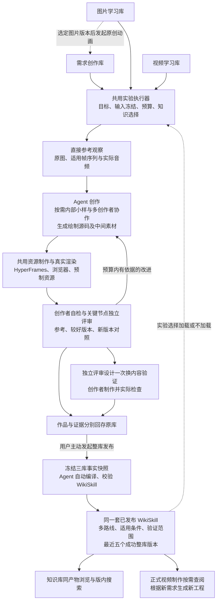

# 需求创作、图片学习与视频学习：三库目标设计

> 2026-11-25 默认调度变更：图片、视频学习只复现与优化，换内容验证改为用户认可具体已生成作品后的独立操作。下文旧设计中默认接续一次换内容的部分由[用户认可后再验证](user-approved-learning-transfer.md)替代；既有实验、失败和证据范围保留，不以模型评分代替认可，也不自动采用或发布知识。

> 2026-11-24 主线合并检查点：本次合入视频分支的学习实现及场景公共核心；当前源码包含 Canvas 场景宿主、学习／效果接入和共享 XYZ 几何辅助，详见[空间框架接入](scene-space-integration.md)、[共享几何说明](scene-shared-geometry.md)及各自实证。本次 Git 合并不触发部署、正式制作新队列启用、效果采用或 WikiSkill 发布，也不补签完整时序学习、长片和艺术验收。文末 2026-11-21 的“待实施／未合主线”是当时的历史状态。

2026-11-19 补充：[按需远程参考设计](remote-reference-learning.md)明确图片可从原站视频定点取帧，视频可按链接、片段与高清局部读取；不要求先上传或长期保存参考整片。现有文件上传仍保留，旧说明中的来源网址备注仅适用于上传来源；显式链接来源使用新的按需读取合同。是否上线及实际可用画质由独立验收记录说明。

2026-11-18，依据讨论确认，随后已转入实施并优先完成图片学习首版；视频已激活采样帧角色、运行 r5 executor／r6 lab，一个内部 6 秒参考已实际完成两轮复现与换内容作品，浏览器输入查看、刷新展开与播放等技术验收通过，见[精简证据](evidence/video-learning-20261118.json)。本文件保留完整目标与设计基线；实时实施边界见[当前架构](current-architecture.md)，图片使用见[网页与 API](picture-learning-library.md)，视频合同见[视频学习库](video-learning-library.md)，实际验证按独立回执判断。设计本身不代表所有能力已经上线或获得艺术认可，知识仍须开发者手动发版。

本文补充[统一设计](agent-creation-effect-library-plan.md)，沿用[从零重做与知识加载](fresh-rebuild-and-skill-loading-design.md)中已确认的归属、继承、技术重试和确切版本规则。有效规格与任务由根仓库 `.openspec-project.json` 指向的 OpenSpec 项目 `ec663f5a-53d3-4a0e-9037-933eb788d183` 管理，主要变更为 `evolve-video-agent-creation-and-effect-library`。文档中的工作包是依赖与验收说明，不另外维护一份实时完成计数。

## 当前实施检查点：2026-11-18

| 范围 | 已有事实 | 尚不能据此完成的目标 |
| --- | --- | --- |
| 图片学习 | 独立网页／API 已上线，实际参考、完整绘制源码、HyperFrames 单帧、独立比较和一次换内容作品有产品证据 | 图片 Manim、内部小样、自适应多人学习及图片转关联动画；水墨仍未获得用户艺术认可 |
| 视频学习代码与部署 | 首版 `0ae66695efd0b9e331aecedd16b58649c3181973`；后续协议／重试／构建修复、`55d081fe9ef9126f7d1c5eb35f1ab87dc3bc291d` 旧参考修复、`68795854120588e0cae8c787ad504ead850a7971` 新评审格式指导、`e269d4350b420120082efb316c1cef7e9a599572` 详情刷新 UI；最终 r5 executor／r6 lab 完整 Git 构建、离线 smoke、Ready 与运行源码核对通过 | r2 构建失败保留；原水墨 8 个作品／3 次实验／24 产物摘要保持。具体产品和浏览器证据见下行，不能由部署直接勾选 X.4／X.9 |
| 实际模型观察与角色准入 | `admission/final-admission-summary.json` 为 activated：作者实际 8 帧，评审实际 16 帧，真实 6 秒／144 帧 MP4；r3 control／worker 已激活，成功尝试 8 次请求、含两次失败共 16 次，原失败及全停清理保留 | 技术准入不替代业务闭环或艺术认可；仍为 `sampled_frames_only`、`continuous_motion_verified=false`、`audio_verified=false`，完整媒体、音轨或合成音效不证明连续观看与听审 |
| 视频有界产品实证 | 内部 6 秒历史动画实际独立分析 24 帧，再明确取 0–6 秒创建；原两轮／1,200 秒预算内 2 复现＋1 迁移，完成且全停；12 份产物下载摘要、6 模型操作的图像输入覆盖、3 类越权 404、三份 6 秒／144 帧 MP4 全解码通过 | 非最初 B 站原片、非真实长片；`analysis_selection=null`，未实际走候选身份绑定创建。56→85／86 是采样帧意见，非艺术认可、连续运动或音频验收 |
| 浏览器技术实证 | 已认证入口／表单／音频说明、0–2 秒候选预填、三作品／内部最佳／冻结需求、331,544 字符角色输入、刷新后展开与同步静音播放保持、切迁移复位和下载链接均通过 | 未从浏览器再上传或付费创建；下载摘要由结构化 HTTP 核对。播放技术检查不代替连续运动审美或音频听审 |
| WikiSkill | 视频隔离本地数据的 capture／snapshot／validate／build-input 兼容检查已有回执 | 本轮未编译、发布或激活视频学习知识，也未验证正式新内容消费；同一库、手动发布和最近五版的目标保持 |

新 review／transfer_plan 的 `constraints.output_contract` 只提供输出类型和输入摘要绑定，独立于创作意见 `feedback`，不预填实际评价；历史技术重试保留失败阶段原输入。两项定向 validator／旧输入恢复及视频服务 17 项回归通过，未增加模型调用；原终态丢失后明确重跑一次的事实保留。详情轮询打断展开／播放由 `e269d4350b420120082efb316c1cef7e9a599572` 仅修 UI，14 项检查、r6 lab 部署和实际浏览器复验通过，不重启 r5 executor 或重复制作。OpenSpec 仅按本轮首版范围新增 X.17–X.23 实证，原宽泛目标保持未完成，不能由上述检查扩大验收范围。

水墨后续有界优化实际生成三轮复现图及迁移图，但第三轮退步，迁移仅有局部技法成立；第三轮评审技术恢复没有逐字节恢复第二轮较好基线。保留原失败及技术恢复身份，不能用后续源码修复补签那次比较正确，也不以模型评分代替艺术认可。详细边界、归档及待补证据见[本轮验证记录](video-learning-validation-20261118.md)。下文完整设计和第 10 节基线中的旧状态按其提出时阅读，不覆盖本检查点，也不取消未完成目标。

## 1. 目标与三库边界

需求创作解决“希望预先探索某种表达效果”；图片学习与视频学习解决“已有实际参考，希望复现指定技法并学会制作方法”。三者分别拥有成果库、项目列表和实验历史，共用执行器、创作能力、资源生产、渲染、预算、证据与 WikiSkill 发布基础。

| 独立成果库 | 输入和目标 | 主要成果 | 判断依据 |
| --- | --- | --- | --- |
| 需求创作库 | 表达目标、允许能力、标准和可选参考；探索原创表达 | 完整动画作品、源码、资源及实验过程 | 本次表达目标与作品表现；Agent 可自主安排时长和节奏 |
| 图片学习库 | 实际参考图片，以及明确或由 Agent 提出的学习目标 | 实际渲染图片、可继续开发的绘制源码、素材、比较和方法证据 | 指定造型、笔触、材质、光影或构图技法是否得到复现 |
| 视频学习库 | 一个明确效果片段及目标；长视频先分析候选片段 | 完整可播放复现片段、相关音效、源码、素材、比较和方法证据 | 指定画面技法、运动机制、参考节奏与音画关系是否得到学习和复现 |

“学像”针对用户选定的技法与效果，不默认复制图片比例、字幕、水印、页面界面或全部物体位置。参考中的具体内容与制作技法分开识别；用户明确要求还原的部分进入本次约束。

参考复现优先学习参考如何形成目标效果，包括适用的动作先后、持续、蓄势和收束。它不受“Agent 可随意改变参考节奏”的默认解释支配。需求创作与自主探索可自由安排时长和节奏；明显偏离学习目标的改良另存，不能用“另一种效果也很好看”替代复现成功。

### 图片继续制作动画的归属

图片学习完成后，若没有参考视频，只要求“让这幅画动起来”，应新建关联的需求创作项目。它可沿用明确选定图片版本的源码、素材与已验证技法，动作和节奏独立创作、验证；原图片项目及验证范围继续保留。

若有明确参考视频及模仿目标，则进入视频学习库。视频学习内部的关键帧研究是该项目的过程，不自动生成一批图片学习项目；需要独立研究或保留为独立作品时，使用明确的关联操作。

## 2. 共同基础与正式制作的关系

图中节点表示本轮目标职责，不能据此认定三库、直接参考创作、音频观察或迁移闭环已经实现。预算不足、停止或未解决关键难点时，可以在迁移尚未进行的状态交付已有结果，见第 7 节。

画面创作沿用 HTML/CSS/SVG、Canvas 2D、Three.js、Manim 等平台实际准入的能力；原生 JavaScript、GSAP、Anime.js 属于动作编排。Manim 等需要提前生成的内容继续走共用资源制作层，再供 HyperFrames 消费。图片实验保留实际绘制源码与渲染回执，不能退化为只保留一张 PNG 的素材展示。

三库是独立产品入口与成果组织，不要求新建三个执行服务或三个渲染微服务。普通视频用户仍使用正式视频工作台；开发者在三库改进创作方法，正式 Agent 经已发布 WikiSkill 按目标借鉴方法，再创作适用于新需求的工程。参考原图或视频不是技能的运行依赖。

## 3. 学习项目、实验和产物

首页以学习项目为条目。一个明确学习目标可以有多次实验、不同有效路线及比较记录；每次委托冻结自己的输入与预算。换参考或核心目标时创建新的关联实验或项目，不能改写正在运行或已经完成的原输入，也不能用归组掩盖题材替换。

| 层级 | 应保存的内容 | 展示与身份规则 |
| --- | --- | --- |
| 项目 | 所属库、学习目标、参考身份、关联项目、默认作品选择 | 三库分别列表；图片到原创动画保留明确关联 |
| 实验委托 | 需求、标准及来源、能力范围、知识绑定、协作选择、预算、状态、停止原因 | 新建、继续、从零、技术重试保留各自语义；执行中不可改输入 |
| 内部尝试 | 技法小样、不同路线、局部问题、实际观察及对应源码 | 在项目内部展开，不逐条铺满库首页；消耗计入本次预算 |
| 复现作品 | 自身源码、资源、渲染结果、参考比较、版本和验证范围 | 明确标为“复现作品”，独立保存，不被迁移作品覆盖 |
| 迁移验证作品 | 新任务、出题依据、自身源码和资源、实际结果及验证结论 | 明确标为“迁移验证作品”，与复现作品收在同一项目详情 |
| 方法证据 | 观察事实、假设、局限、改善或退步、适用条件 | 不把作者意图或技术通过自动标成视觉、运动或音频已验证 |

默认复现与迁移不会自动增加两个内容相近的首页条目。用户可以将某份成果另存为独立作品，保留来源与关联。不同产物独立保存其源码和媒体，不因详情聚合而混成同一个版本。

内部最佳、用户选定的默认作品、开发者认可和知识发版分别记录。新候选不自动替换用户已采用作品；最新版不自动等于最佳版。发生局部改善、整体退步时，保留较好的版本和具体差异，允许继续研究、回退或在证据支持下整合改进。

## 4. 参考接入与实际观察

### 图片

参考以原始图片及明确的内容身份进入实验。保留来源、文件摘要、尺寸、裁切关系和观察记录；原始完整构图与局部细节可分别供创作和评审读取。详情裁切用于看清技法，不默认把裁切比例当作作品画幅要求。

创作 Agent 必须能够直接读取适用参考像素以及自己实际渲染的结果。研究 Agent 可以解释观察、建立索引，文字转述不能成为作者唯一的视觉输入。记录哪些文件或帧实际进入哪个角色的请求或读取结果；这证明材料到达角色，不证明模型理解正确。

### 视频与长视频候选

一次视频学习围绕一个明确效果片段。只提供长视频、没有明确范围时，先实际分析并给出候选片段的起止、可学习技法、主要难点和实际观察范围，由用户或调用 API 的外部 Agent 选定，再启动对应实验。候选分析也记录消耗与预算，不能把“尚未开始创作”解释成没有消耗；不自动把全部候选变成一批创作任务。

已经提供片段和明确目标时，直接进入该范围的学习，不增加重复选片或逐步确认。链接本身只表示来源；无法获取或尚未观察时，明确状态与缺失材料，不伪造全片分析。

观察按目标组织，而非固定只取几个截图：

- 先获得整体过程、关键阶段与事件的实际依据，再对动作密集、转场、遮挡或形变难点按需加密。
- 保留原始时间、实际解码帧的时间、请求与实际帧映射；重复解码到同一帧不增加观察覆盖。
- 画面质感难点可先做关键帧研究；群体运动、转场或节奏难点可直接创作连续片段。视频学习不强制先完成独立图片实验。
- 引用事实时指向实际画面、帧序列、时间或音频范围；参考与复现分别记录自己的媒体身份和观察覆盖。

### 连续运动、音效与证据范围

抽帧能帮助理解画面和关键状态，不能单独证明帧间流畅、整段播放、声音质量或音画同步。最终作品保留完整可播放片段，运动结论基于实际覆盖的连续过程；未观察部分保持“尚未验证”，不能由源码、缩略图或播放文件存在补签。

按目标学习有表达作用的音效及其时机，例如落笔、撞击、群体响应。原参考音轨的获取、分析范围及新作音轨分别记录；波形、文件存在、文字说明和静帧都不等于已经听到声音。旁白文案与背景音乐不默认照搬。没有音效表达需求时可以静音。

模型或工具暂不支持某类实际观察时，保留具体缺口和可播放产物，不能将准备好材料写成已经观察、将模型意见写成人工认可。接口与角色准入需要补齐，不以修改展示文案冒充直接多模态创作已经成立。

## 5. 创作方法与上下文

Agent 先把学习目标变成可观察标准，区分画面技法、连续运动和音频要求。用户可在提交前指定标准；留空时由 Agent 拟定、留档后继续，不增加等待确认。参考实际支持的特征与创作假设分开记录，用户指定目标优先。

遇到明显难点时，允许先做少量内部技法小样，例如先研究一块岩石的皴擦或一段墨迹扩散，再进入完整复现。小样是解决本次问题的手段，不是每次必跑的固定流水线，也不是逐项新增到库首页的能力回归模板。

创作者以参考、当前较好版本、新版本和适用细节对照判断差异。评审描述实际问题，创作者决定解决方法；造型逻辑错误时可以重构，不限制为增加笔数、调整参数或保持旧画法。工程提供能力、时间、资源和可执行合同，不手写每种风格的固定画法替代 Agent 创作。

### 中间素材

允许按需要制作纸纹、笔刷、烟雾贴图、预制几何等中间素材，与程序绘制组合。保留实际素材、生成源码或生成过程、参数、版本和引用关系，保证项目以后能重新渲染、修改及继续研究。参考材料用于观察与比较，作品及其素材由 Agent 重新制作；不能用参考截图作为交付成品来宣称学会绘制。

### 按需协作与信息加载

Agent 可按难点自主判断是否使用多个创作者，用户可明确禁止协作或限定能力。主创负责统一目标、构图、风格、坐标、时钟、共享资源及整合；专项创作者获得相关参考、整体必要信息和明确问题，不仅接收文本转述。

每个任务读取本次目标、适用原始参考、选定基线和待解决问题，历史记录与大文件按需读取，避免将全部实验史堆进一个 Prompt。拆分以难点和实际依赖为依据，不强制按固定图层、Canvas、固定角色或固定部件数量拆分。整合后仍要实际渲染检查整体风格、遮挡和节奏，多个 Agent 交付源码不是整体质量改善的证据。

所有任务计入同一委托预算。自主协作是新增目标规则；现有显式协作的任务数、轮数、能力和资源限制仍是旧合同现状，不能据此声称已开放 Manim 协作或所有组合。需要先建立新的实际准入和执行协议，再按真实能力提供。

### 继续、从零和知识选择

三库延续既有操作语义：继续优化可继承明确选定作品；从零重做仅保留目标、约束和精简可靠问题，不带回旧源码、布局、专用方法或分工；技术重试恢复失败环节，保持原需求、标准、知识绑定和有效方案，不暗改创作方向。

所有新创作保留独立的 WikiSkill 加载开关，默认加载，可显式关闭；从零不自动关闭。加载时冻结确切已发布整库版本，关闭时不给知识正文、默认方法或工作 Wiki，也不经子任务隐性回流。启用但尚无发布版与主动关闭分别记录。已选基线源码可能体现旧经验，不将“关闭知识”描述成来源完全清空。

目标是沿分层 WikiSkill 按需发现适用方法。当前实验室的同版整库 inline 输入只是已有适配方式，其“已提供原文”不冒称按需读取、已理解或已有效应用；新三库的任务上下文与工具接入需要据此补齐。

## 6. 独立评审与换内容验证

创作 Agent 自检，完整复现、重要改版和迁移验证等关键节点由独立评审对照实际材料。评审检查是否改善、哪里退步、哪些尚未确认；技术更复杂、代码更多、使用更多库或模型自述“更好”都不能代替实际效果。

判断分别记录，不以一个总分抵消未覆盖的关键要求：

| 维度 | 应回答的问题 |
| --- | --- |
| 参考复现 | 选定的造型、笔触、材质、运动或节奏是否接近参考，证据在哪里？ |
| 作品质量 | 画面、连续运动、相关音效与整体表达是否达到本次标准？ |
| 迁移验证 | 改变内容或结构后，所学方法是否仍在该条件下成立？ |

正常学习计划包含一次换内容验证。由独立评审依据学习目标设计任务，创作者完成，再检查实际结果。用户可以提交预先指定的验证要求。题目应改变影响实现的条件，例如山体结构、视角、前景关系，或群体的数量、布局和空间关系；只改标题、颜色或随机种子通常不足以证明复用能力。仍围绕同一技法，不强制跨到无关领域。

迁移单独冻结本次任务及允许读取的材料，可接收本次刚形成、尚待验证的确切方法和适用自制资源作为检验对象。这些是本次实验材料，不等于已发布 WikiSkill；关闭发布知识不禁止验证本次新方法，也不要求迁移必须打开整库知识。已有 v2 transfer 清空知识快照、禁止原参考、研究和旧源码的约束可作为去参考复用检验的基础，新角色或协议仍须明确材料边界，不能把原参考截图或完整基线伪装成通用资源带回。复现、迁移各自实际可见的材料与知识绑定都要留证。

复现成功不自动代表迁移通过；静态效果通过不自动代表运动通过；已验证音效存在不自动代表音画配合成立。每项保留具体范围与局限。

参考复现不错但迁移失败时，允许沉淀有实际证据支持的局部技法，明确适用条件和未通过范围，不宣称通用方法。迁移失败也不能直接推导为该方法普遍无效。主观意见、模型假设与已观察事实分别保存，不能为了更新知识编造原因。

## 7. 预算、停止与运行中操作

每次实验有明确总预算，涵盖参考分析、内部小样、协作、素材制作、真实渲染、评审和本次适用的验证。Agent 可在预算内自主迭代，不要求逐轮确认；效果库开发者可以持续发起新的有界实验，不受正片自动一轮、用户最多追加两轮的限制。

预算不足时优先攻克目标效果，不要求为了凑齐流程交付无效迁移结果。可以结束为“复现已有进展、迁移尚未验证”，保存最佳结果、已做尝试、剩余问题与停止原因。正常规划包含迁移，不把延期解释为默认取消。多种尝试仍无明显收益时可以提前停止，后续由开发者继续发起实验。

运行中只允许查看或停止，不接受意见改变同一委托的目标、标准或计划。新增意见用于下一次实验；停止时保存已完成产物、实际消耗和执行状态。停止请求与原任务实际停止分别记录，未知状态不冒称已经停止，也不因此自动重跑、移除记录或清零消耗。

查看、刷新、比较、复制输入与下载均为只读，不启动新模型任务。重新创作、继续、从零、重试、采用和发版使用明确动作与各自身份；提交未知时找回原操作，不能换幂等键重复消耗。

## 8. WikiSkill、证据与正式使用

三库共用一套已发布 WikiSkill。用户主动发起整库发布，冻结三库当前实验事实及其确切作品与证据，编译 Agent 自动提炼、校验和发布；新成果出现本身不触发发版。不新增直接编辑知识字段的人工维护线，也不要求用户逐条手写技法。

同类效果可保留多条有效路线，例如程序笔刷和自制笔刷纹理，各自说明目标、做法、条件、验证依据和限制；一次样片评分较高不自动淘汰另一条路线。WikiSkill 按层级组织，正式 Agent 按需选择方法，而非把全部实验史或完整源码一次注入上下文。

静态技法可以在尚未制作动画时发布，明确“画面效果已验证、运动尚未验证”。局部有效但迁移未通过的方法可按证据支持的窄范围提炼。不同路线、技术事实、艺术判断和未验证推测不能混写成普遍结论。

参考来源、原始研究内容和实验产物留在实验记录；发布技法必须内化为自包含的方法与检查指导，不将外部视频 URL、原视频内容搬进 Skill 充当运行依赖。源码和样片可作为确切证据或按需示例，不将整条作品代码变成所有新内容必须套用的固定模板。

知识库浏览、版内搜索与正式制作使用同一套发布产物，保留最近五个成功整库版本；用户可选历史版制作或恢复线上默认，新任务冻结所选版本，运行中的批次不跟随更新。退出最近五版选择窗口，不等于删除仍被历史任务引用的确切产物；底层存储与回收由共享框架生命周期承接。

源作品采用、知识编译通过、知识发布、正式 Agent 读取和新视频实际应用分别留证。静态方法用于新视频时，运动质量由新作品的实际检查负责，不补签来源图片已经验证过动态效果。

## 9. 网页与外部 Agent API 的同等语义

三库能力需要同时支持网页与结构化 API，外部 Agent 可直接提交规则化 JSON、参考资源和选定片段，无需模拟填写网页表单。图片已上线、视频代码已形成独立参考学习合同；本节保留完整目标语义，实际接受的字段分别以[图片](picture-learning-library.md)／[视频](video-learning-library.md)合同及对应上线回执为准，不能把目标表中的全部行为视为已部署。

| 契约方向 | 需要表达的内容 |
| --- | --- |
| 创建或分析输入 | 所属库、目标、参考文件及身份、已选片段或长视频候选分析请求、预算、标准及来源 |
| 创作选择 | 当前允许的画面创作和动作编排能力、用户明确约束、自主协作或明确禁用、知识加载及所选发布版本、继续或从零模式 |
| 状态输出 | 项目与实验身份、冻结需求、阶段、实际消耗、角色执行、停止请求与核验状态、当前最佳及未解决问题 |
| 作品输出 | 复现与迁移作品的独立身份、实际媒体、源码、资源与生成过程、父版本、比较和验证范围 |
| 长视频选择 | 候选片段身份、实际观察范围、目标和难点，选定后启动对应实验；不因 GET 状态而启动创作 |
| 只读检查 | 原提交、实际冻结输入、参考读取证据、角色输入、前后与参考对照、源码及素材下载 |
| 后续动作 | 停止、下一次继续或从零、技术重试、作品采用、另存关联作品；运行中不改原需求 |

沿用既有身份、归属、权限、幂等与并发校验，不通过新库绕开现有隔离。查询接口不隐式推进业务。API 的标准、参考观察、知识关闭和新意见处理与网页一致，不能只有网页正确、外部 Agent 仍沿旧表单语义执行。

## 10. 设计提出时的基础与差距

本表是 2026-11-18 设计提出时的只读核对和静帧研究基线，保留当时尚未产品化的状态，不作为此刻图片／视频代码的完成清单。后续图片首版和视频实现的变化以文首检查点及[当前架构](current-architecture.md)为准；原验收范围不随新设计扩大。

| 环节 | 已有基础 | 新目标仍需补齐 | 核对位置 |
| --- | --- | --- | --- |
| 库与项目 | 现有效果库、委托、候选、人工采用与谱系；已有迁移产物可依基线谱系归回原效果 | 三个独立成果库、学习项目及复现/迁移独立产物的统一契约与清楚的 UI/API 布局；不将已有迁移归组写成完全缺失 | `animation_method_service.py`、`animation_method_commissions.py`、`animation_lab_web/` |
| 图片渲染 | 本轮曾用 Agent 绘制源码，经真实 HyperFrames 定位输出一帧并归档 | 产品化参考接入、静态实验执行、源码/素材保存、局部和整体比较；已有归档不代表网页已提供图片库 | 现有 HyperFrames 渲染底座与静帧研究归档 |
| 作者直接看参考 | 视觉观察与独立评审角色可读取给定图片 | 当前 method-author v2 为文本/工具调用输入，`observation.frames` 要求为空，额外 PNG 不被接受；需要新版本角色与真实视觉输入，不以审阅角色的视觉能力替代作者能力 | `agent_service/profiles/video_animation_method.py`、`agent_service/deploy/animation_method_catalog.py` |
| 视频观察 | 有窗口抽帧及概览加重点加密，至多 24 帧；新路径保留实际 PTS、请求映射与重复帧别名 | 参考与新作两侧覆盖、按目标连续过程与实际音频观察、长视频候选及选定流程；单次抽帧不是全片观看 | `animation_observation.py`、`animation_review_gateway.py`、`agent_service/profiles/video_animation_review.py` |
| 前后比较 | 已有两候选播放器按共同原始秒数定位 | 图片整体/细节、参考/较好版本/新作的关联比较，以及视频关键事件与真实观察范围；不冒称已有语义或逐帧锁定对齐 | `animation_lab_web/method-comparison.mjs` |
| 技术证据 | 已有源码、实际库加载、渲染摘要和原始媒体留证 | 源码或运行库证据不能证明运动质量；需新参考学习证据链 | `animation_motion_evidence.py`、`animation_prompt_inspection.py` |
| 协作 | 已有与绘制技术无关的 DAG、预算和停止核心，浏览器能力适配 | 按难点自动判断、直接参考与精简上下文、内部小样和多轮学习整合；当前显式协作仍受一次制作和实际能力限制 | `creative_collaboration.py`、`animation_collaboration.py`、`animation_method_service.py` |
| 迁移与质量 | 既有标准、评审、比较及最佳候选；已有 transfer 请求冻结方法、基线及结构/内容变化，v2 要求实质变化并禁止旧源码作为迁移输入 | 独立评审自动出题、学习默认复现后一次迁移编排、三类验证结论、局部知识与停止优先级 | `animation_quality_policy.py`、`animation_method_service.py` |
| 活动任务反馈 | 已有冻结委托输入及停止机制 | 当前 `_document` 在 review 阶段、`_manim_iteration_context` 在资源迭代仍实时读取反馈；需冻结本次意见截止点，运行中新增意见不得进入活动任务，不能因已有 input 冻结就认定只读/停止目标已实现 | `animation_method_service.py` |
| 知识 | 已有手动整库快照、编译/校验/发布、五版、同产物浏览和正式版本冻结机制；快照采集已有 effect、commission、operation、demo、method、research、feedback | 新三库及验证维度的类型化采集、静态/动态/音频/迁移范围、多路线条件、按需方法读取及实际业务采用验证；保留既有真实编译失败与未验记录 | `animation_wikiskill_*`、`animation_laboratory_library.py`、`animation_knowledge.py` |

本轮静帧研究证明了“直接观察参考、真实渲染、对照较好基线、记录局部改善和退步”的可执行性；没有因此完成用户艺术认可、迁移验证、连续运动验收、实验室产品化或 WikiSkill 发布。不能用画家 Agent 的临时可读图能力证明现行生产作者协议已经支持图片。

## 11. 分阶段工作包与验收

以下是完整目标的工作拆分，不能将图片首版完成直接折算为所有工作包完成。服务端 OpenSpec 保留最终编号、状态和既有任务关联，本地按依赖说明划分；原有待办与完成证据不重置。

| OpenSpec 工作包 | 范围与依赖 | 主要验收 |
| --- | --- | --- |
| X.1 共同项目、参考和作品契约 | 先确定三库、项目/实验/产物、参考与片段身份、冻结需求、版本关联、能力及知识选择、预算与状态；作为后续并行工作公共接口 | 旧归属/继续/从零/技术重试语义保留；复现和迁移各自独立，不重复首页条目；幂等、越权和过期操作拒绝 |
| X.2 作者与评审的实际媒体输入 | X.1 后，可与三库页面并行；新版本角色、原始视觉和实际音频输入、读取回执、范围与限制 | 作者确实收到参考与输出像素；素材缺失/重复帧/音频未读如实记录；不改写冻结旧 profile 或旧任务 |
| X.3 图片学习闭环 | 依赖 X.1、X.2 和现有渲染资源基础；接入 X.5 的有界执行 | 参考原图/局部、内部小样、源码和中间素材、真实一帧、较好基线比较、预算停止、静态限定技法；产品入口可实际操作 |
| X.4 视频学习闭环 | 依赖 X.1、X.2；与图片页面可并行，复用已验证共同能力 | 长视频候选选择与已选片段直达；按目标先静帧或直接片段；完整媒体、适用音效、关键过程比较及未覆盖范围 |
| X.5 协作、自检与独立评审编排 | X.1 后可并行准备通用编排；复用 P/T 等既有能力，接入 X.2 的实际材料输入 | 按难点内部小样和自动分工、明确禁用、总预算；关键节点独立评审；冻结活动任务反馈截止点，运行中只读/停止，新增意见下一实验生效 |
| X.6 迁移任务、预算与验证范围 | 依赖 X.1、X.2、X.5，并分别接入 X.3/X.4 的实际作品 | 独立评审出题、一次实质迁移；复现优先、提前停止及迁移未完成如实留档；局部证据与有效多路线不冒称通用能力 |
| X.7 三库网页与结构化 API | X.1 确定后可分别并行；需要 X.3–X.6 提供真实状态和产物 | 三库分别浏览；一个项目收纳复现/迁移；输入及证据可查；API 与网页同语义；图片到无参考视频动画归需求创作库 |
| X.8 三库知识编译与正式消费 | X.1 后可准备快照和校验；真实验收依赖各库作品与 X.6 的范围证据 | 用户手动快照、自动编译与发布；静态/局部条件、有效多路线及无外链依赖；同产物浏览搜索、最近五版、冻结版本与关闭无回流；正式新内容实际读取和使用 |
| X.9 集成与有界真实验收 | 前述契约、执行、UI/API 和发布消费集成后；代码执行与发布需对应后续委托 | 图片复现、适用视频片段、按需音效和迁移各有实际证据；停止/恢复/技术重试/关闭知识场景；独立记录技术通过、模型结论、人工认可与发布 |

协议与界面行为可通过低成本夹具核验；必要的真实作品再以明确预算验证。一次静帧通过不能勾选视频闭环，模型收到图片不能勾选已理解参考，上传媒体不能勾选音画审阅，文档和 OpenSpec 同步也不能勾选应用实现或艺术提升。

可信用量、费用和全平台生产存储回收继续由共享框架任务承接，不因新增三库再创建 video-service 的重复业务任务。这里记录业务预算约束、作品依赖与验证证据要求；底层全平台治理沿既定归属处理。

## 2026-11-21 文档导入来源（历史）

以下保留 2026-11-21 文档整理提交的来源声明与设计补充。其中实施、主线和部署措辞仅描述当时的导入范围；合并后的源码状态按本文顶部检查点及当前实现／验收记录阅读。

> 主线文档集成（2026-11-21）：本文来自 `codex/organize-video-design-docs`，文档提交 `03369402067c5cc7fcd9571d3af7d9c81e4a39b2`，所述既有实现、历史执行和代码定位以视频分支 `faaa09affca3205ecfa46b2204f8d6aa2a017362` 为来源。
> 本次只合入设计与历史说明；该视频分支的新增运行实现未随文档并入当前主线 `4c322af063f442036961f776461d7616f5659e5c`。文中“当前”“已上线”等旧状态均按来源版本阅读，不能据此认定当前主线或部署具备相应能力；新的空间、分层和镜头学习方案仍待实施。

## 2026-11-21 设计补充：通用空间、分层与镜头（待实施）

新增目标见[通用场景空间、分层与镜头设计，以及渐进式参考学习](scene-space-layer-camera-design.md)；该设计不改变本文件的历史实施检查点，也不代表新能力已部署。
需求创作、图片学习、视频学习与效果库继续保留各自入口和成果归属，共用对象、锚点、尺度、深度、图层、遮挡与镜头的描述及证据语言。
学习按目标逐步形成结构观察、空间与分层假设、真实复现和迁移证据；内部小样、部件或短动画按需启用，仍共用本次预算，不强制增加生成阶段。
单图只能支持静态观察与有局限的空间推断；现有视频合同仍为 `sampled_frames_only`，真正增加时序观察或运动验证需要版本化合同与独立实证。
换内容验证不继承原参考、复现基线或原构图；继续优化、从零重做和技术重试仍遵守各自冻结与继承边界。
本轮只设计片内场景复用；好的效果另行留存，作品采用与显式整库 WikiSkill 发布保持独立，知识引用不自动扩大验证范围。
