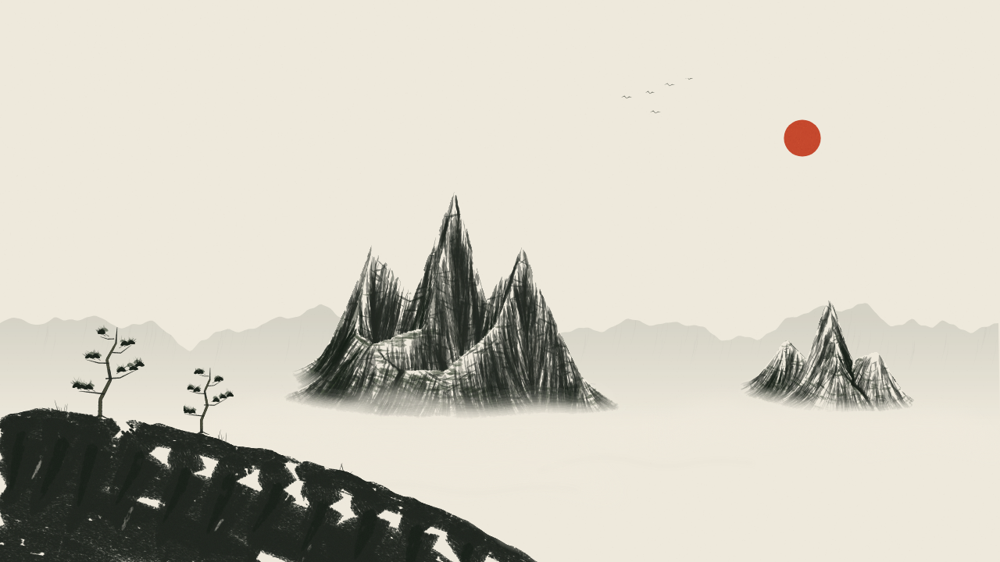

# 共享山体几何：实施与学习执行器验证

2026-11-23。实现提交 `bbb263faf64f79457b7afab8d8556205e8c34b86`，分支
`codex/scene-space-framework-20261122`，位于 `zmhhaha/panghu_agent`。
固定视角样例先组织共同基座、主脊、支脉、鞍部、坡肩和前脚，再用同一深度缓冲为
Canvas 笔触提供可见面位置与方向。[工具说明](scene-shared-geometry.md)及
[可运行样例](../examples/shared-mountain-study/README.md)保留具体接口和源文件。

## 实现与本地验证

新增 `tools.geometry`，提供索引三角网、连续高程网格、固定正交投影、深度/可见面/
位置/法线/方向采样、点可见性与覆盖。主峰群和右峰群各有一个连接分量，但不是
封闭体积。高程表面不提供悬挑，不宣称从参考图重建真实三维。

API3 将 helper 与 canonical 预算的字节固定到 capability、binding、request、挂载及
receipt。API1/2 历史 lookup 依照旧保存字段和字节恢复，不静默升级。公共图片学习、
抽帧视频学习、效果和正式绘画指导均已接入可选 API。严格 world/plan/method/source
字段未扩充；作者几何保存在 `scene.js`，旧任务及旧知识发布状态不改写。

几何 Node 14项、Python包装1项通过；渲染器37个不同测试覆盖合同/预算/恢复与真实
浏览器，浏览器共16个场景（13个输出、3个预期拒绝）。最近面遮挡正确，1.3倍密度与
小数位移时连续471个内部像素未见行缝；10个相同输入旧场景采样摘要不变。公共学习/
效果/制作48项回归通过。计数有包装与浏览器重叠，不相加为全库测试总数。

当前桌面旧源码 PNG 为 `4a10eb47c386fea97991d4ff787d560e9eb3340e61fb9f7a1dcbf79c9a8304e8`，
与同平台旧 baseline 相同。桌面与 ARM 的 PNG 编码/像素摘要不可互相替代；容器旧稿
另按其已保存的 ARM baseline 验证。真实浏览器批次记录见
[原生证据](evidence/scene-space-shared-geometry-native-20261123.json)及样例 `evidence.json`。

## ARM 三组验证与部署

从上述精确提交建立干净源码，构建并推送 executor 的 `latest`，离线检查后先完成
三组独立有界诊断，再更新学习 executor。镜像为：

`arm-cluster-master:5000/video-animation-creation:latest@sha256:a587a7f224d55e004d37f19c75b640371bf02b1f349deacc30a84a7a5b467d3d`

renderer 保持原固定 digest。每例最多180秒、总540秒；任务
`shared-mountain-fixed-view-20261123-api3-r1` 使用独立账本，不修改原 PictureRun。

| 条件 | 实际 PNG SHA256 | 控制器实测秒数 |
| --- | --- | ---: |
| legacy | `cf1d255a23e5f4267b6abdf44821e8cc22d920bd3c0dd89e1970daf1f16290b4` | 22.922 |
| clay | `088df7048adec2d479214fea4b045a8a25824ec1a72e4d46c1258abffc92a320` | 13.007 |
| ink | `4e6ebacdcc91b26081095080fdb3a860ab2bc0f537e6b98b16c8ff5c5a7b6f28` | 12.960 |

三组重复、逆序、重载及停止证明均通过。legacy 与既有 ARM baseline 完全相同，几何
调用与句柄为0；clay/ink实际调用同一共享网格和投影工具。三条预留全部结算，累计
控制器实测 `48.888402` 秒，整个study墙钟
`49.030954` 秒，二者范围不同，不重复累计。新增模型
调用和token均为0；未知历史基线未清零，不借诊断授权付费或完整长片。

最终 Ready、health 和在线 API3/源码字节核验通过。检查
89个部署，仅学习 executor 目标变化；
镜像及版本注解以外的目标配置保持一致。原12张表未改；
部署前后14张表一致（含本次独立study记录），无活动任务，
控制器容器已停止。正式制作新队列保持关闭，其他角色和renderer未变。

## 实际看图与边界

主峰、侧峰可以读到共同山腰、鞍部和前脚，前坡遮住后面的山面。粗模仅作独立结构
诊断，没有法线灰阶底稿混入墨稿。墨稿仍有密集交叉排线和偏亮阶梯状坡肩，近岸与
松树延用旧画，艺术质量尚未通过。

[主峰局部对照](../examples/shared-mountain-study/structure-comparison.png)使用上一版
桌面图和本次 ARM 的结构诊断/墨稿；源码、平台与多项笔墨参数不同，不是单参数消融。
几何数值预留3,798,576字节/4句柄，作者另有9,659,600字节typed arrays；这些不是
浏览器RSS实测。完整证据和来源摘要见
[发布证据](evidence/scene-space-shared-geometry-release-20261123.json)。

这轮完成固定视角的共享结构与绘画接口，并更新学习执行环境。未验证三维环绕镜头、
连续影片、音频或完整模型学习循环；未采用效果或发布WikiSkill，未声称用户艺术认可。
OpenSpec原9个待办继续保留，不能由本次静态技术验证代为完成。
