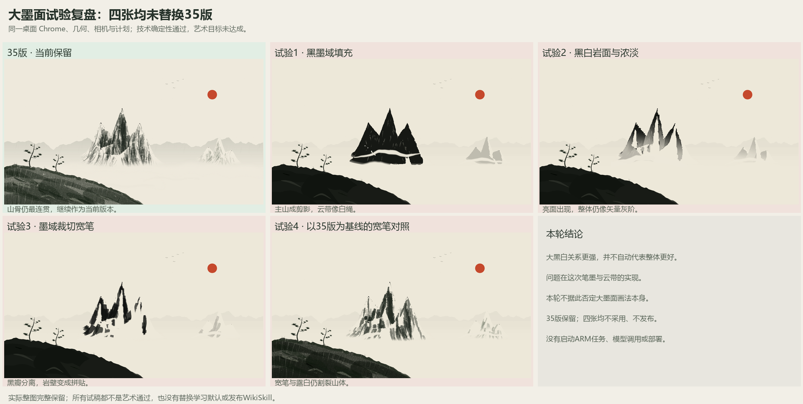

# 大墨面研究未达目标，保留35版

2026-11-23。在用户提出大墨面、强黑白、定向云海、浓近岸、淡远山及暖纸综合色调后，
做4次作者画法试验。结果是技术确定性通过、整体艺术效果未达目标；35版继续作为当前
人工研究参考稿，没有把新稿替换为默认、采用为效果或发布WikiSkill。

完整图、原生摘要、明确失败结论和可复现源码边界见
[四稿失败归档](../examples/shared-mountain-bold-experiment/README.md)。

前三张依次尝试黑域填充、主要岩面黑白与浓淡、黑域约束下的宽笔墨腹。它们减少碎笔并
增强对比，但出现剪影、矢量灰面或分离纸片。第四张回到35版既有笔路作收敛参数对照，
仍有宽笔块面、竖条与峰尖空壳。独立实际审看确认未优于35版，近岸虽更黑，却丢了
部分岩面与毛笔质感；云白尚未形成自然的云海。这轮不继续扩成十版批量试画。

几何顶点/高程/相机和原始投影depth/normal/position/flow、计划及运行时保持；field源码
及作者alpha有变化，旧 `H*.8` 屏幕Y淡出被去除、表面高度foot保留。新atlas在既有
mist-layer一次合成，常量通道暖色乘子也只是作者缓存与覆盖纸色的处理，没有新增后端
或multiply运行准入。前三张的黑域/连通筛选也仅为作者像素墨域，不是三维mesh连通性。

实际执行为4次桌面Chrome原生probe，重复/逆序/重载均通过。没有ARM作业、服务模型
调用、构建、部署或新study账本。原有实验与线上业务未改写。桌面完整控制器耗时未测，
不把未测成本记0。第三/四稿有已核SHA的独立源码快照；第一/二稿只有摘要和图片，
不能宣称完整重放全部试稿。

这些结果说明本轮实现没能把“大笔墨面”与已有山骨组织好，不能把局部对比增强当作
整体艺术提升，也不能据多变量失败否定该画法本身。OpenSpec仅追加失败研究历史，
原38条任务、29完成/9待办和原要求保持。
