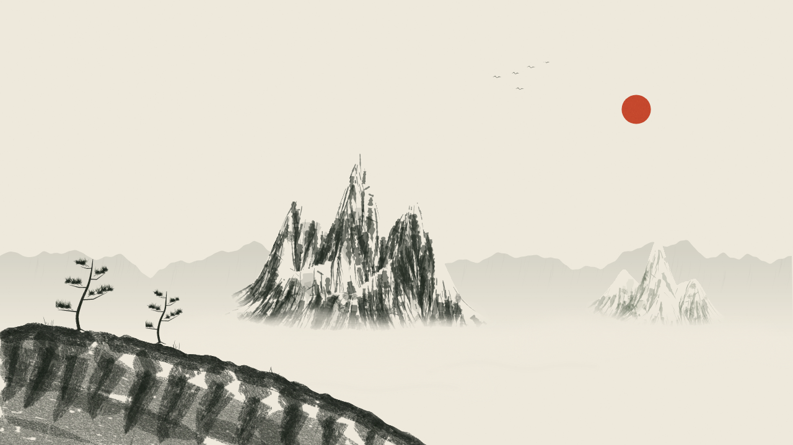

# 共同山体的笔墨疏密迭代

2026-11-23，在共享三维网格接入后，按用户提出的格栅感、阴阳留白、皴笔聚散、近岸
过饱和和配山退后问题进行作者画法迭代。新例见
[笔墨疏密试稿](../examples/shared-mountain-brush-study/README.md)，结构版原样保留。

实查并没有把三角网边直接画到墨稿。格栅来自宽长顺坡笔、近横向坡肩擦与细线的大量
重叠。最终稿减少全图排线，以可变间距采样组织墨簇，保留部分长皴的岩壁联系；在深度
邻域内平滑绘画方向，原始深度、可见位置、实体覆盖及跨面断笔的几何数据保持。
局部暗部湿笔与选定焦墨分开组织。宽粒子笔根据采样间距/落印面积换算透明度，减少
密集盖章带来的近岸过饱和。松干弯曲、枝根依附与针簇密度也作调整，右侧配山退淡。

未将“全图宣纸滤镜”视为修复结构的手段。这里只增加轻微局部纤维缺墨；前几张形成
碎点、硬色块或大灰底的试稿均淘汰。最终仍是程序化绘画近似，不等于真实毛笔物理。

## 验证范围

网格/高程/相机/原始投影场源码、实体覆盖源码及整个计划逐字节与旧稿相同，其摘要
保存在例内 `native-evidence.json`/`evidence.json`。宿主与全部 helper 字节不变，复用
既有运行时 `bbb263faf64f79457b7afab8d8556205e8c34b86` 与镜像 `arm-cluster-master:5000/video-animation-creation:latest@sha256:a587a7f224d55e004d37f19c75b640371bf02b1f349deacc30a84a7a5b467d3d`。
没有构建或部署镜像，也没有改公共学习默认。

桌面真实 Chrome 对最终稿重复、逆序与重载检查通过。随后同平台 ARM 两组实际出图，
两组都通过同样检查、绑定摘要与停止证明；旧稿强制匹配前次已保存的 ARM 像素摘要。

| 条件 | 实际 PNG SHA256 | 控制器实测秒 |
| --- | --- | ---: |
| old | `4e6ebacdcc91b26081095080fdb3a860ab2bc0f537e6b98b16c8ff5c5a7b6f28` | 13.533 |
| new | `7f4edb27fc9e3b4609b31262476861555a9b5bd6b66069110e804a1c63985f29` | 13.284 |

独立任务 `shared-mountain-brush-20261123-r1`，各180秒/总360秒上限，实际累计
`26.816264` 秒，study墙钟 `26.914306` 秒；
二者不重复累计。2条预留全部结算，新增模型调用/token均为0。原未知token基线保持
null，未借静态诊断授权付费或整片导出。

原14张保留表指纹一致，新增本次独立study两表，现共
16张；89个部署及能力均未改变，无活动
任务，控制器容器已停止。原图片学习、效果、WikiSkill及正式队列未改写。

## 实际看图

[同平台新旧对照](../examples/shared-mountain-brush-study/comparison.png)可见交叉格栅减弱，
留白与宽窄断续更清楚，近岸没有原来的整片死黑，右侧配山退后。独立审看认为可作为
新试稿交付比较，但木纹式排簇、槽带状亮肩、峰尖和轮廓断笔偏多仍未解决。
`artistic_acceptance=false`；多个笔墨变量同时变化，不能逐项归因于某一个参数。

本轮只有作者源码与静态图，不验证时间学习、镜头动画或长片。没有采用效果、发布
WikiSkill或取代默认画法。全部来源/实际消耗/资源与未测范围见例内 `evidence.json`。
OpenSpec已有38条任务与9个待办保持，艺术试稿不代为完成旧待办。
