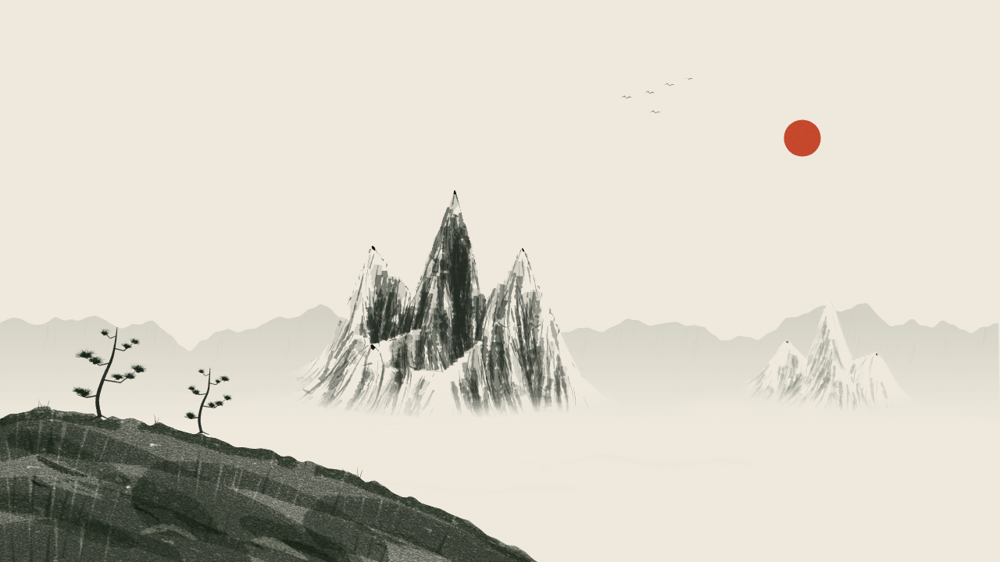

# 共同山体的统一墨团与勾骨迭代

2026-11-23，接续笔墨疏密稿，针对用户提出的整体阴阳、轮廓硬边、焦墨、近岸条码和
松针扁平感继续改作者画法。新例见
[统一墨团与勾骨试稿](../examples/shared-mountain-unity-study/README.md)，旧例完整保留。

## 改变与边界

上一稿已有法线点积与光向参数；随机感来自湿笔/宽皴/细皴分别选点，长笔只按起点
决定浓淡，焦墨还被凹谷条件排除了不少分叉和峰顶。本例让已有对象缓存里的湿笔、
皴擦和勾骨顺序共用结构墨团，并沿长笔路复核光向。`INK_DESIGN.lightDirection`
仍是右上山后红日的作者假设，不是完整自阴影或标定光照。少量焦墨锚定可见的脊路
分叉/局部高点，近岸改横斜相接墨体，针簇采用半球方向、后淡前浓。

原始网格/高程/相机/深度位置场源码和整个计划与上一稿逐字节相同。覆盖源码及部分
覆盖像素有意变化：原alpha副本只在选定轮廓处理1–2像素干/软边，内部实体保留；
相同alpha的扫描行并为Path2D填充。新增作者alpha数组235,600字节，另有JS墨簇对象
与Path2D/native分配；不计入helper数值额度，也不是浏览器RSS实测。

原有合成器已提供分层与对象缓存，本轮不增加框架字段、后端或新的全图灰阶底。
第一张近岸硬灰碎块/针簇偏小的失败试稿已淘汰，第二张保留为候选，未扩大试画。

## 实际验证

桌面真实 Chrome 的重复、逆序、重载检查通过。ARM 新旧两图固定使用运行时
`bbb263faf64f79457b7afab8d8556205e8c34b86`、镜像 `arm-cluster-master:5000/video-animation-creation:latest@sha256:a587a7f224d55e004d37f19c75b640371bf02b1f349deacc30a84a7a5b467d3d`，宿主与helper字节不变；
两组均通过绑定摘要、重复/逆序/重载与停止证明，旧图精确复现已保存的ARM基准。

| 条件 | 实际 PNG SHA256 | 控制器实测秒 |
| --- | --- | ---: |
| old | `7f4edb27fc9e3b4609b31262476861555a9b5bd6b66069110e804a1c63985f29` | 13.303 |
| new | `bf0c40b38a0629e723636748a72ccc48fa8a379534c4c59d6d90ab009bca2724` | 15.559 |

独立任务 `shared-mountain-unity-20261123-r1` 每例180秒/总360秒上限，实际累计
`28.861715` 秒，study墙钟 `28.969458` 秒；
范围不同不重复累计。2条预留全部结算，模型调用/token新增0，原未知token基线仍为
null，不借静态诊断授权付费或整片导出。

原16张保留表指纹不变，只新增本次study两表，现共
18张。89个部署和能力精确不变，无活动
任务，控制器容器已停止。构建/部署均为0，原PictureRun、效果、知识和队列不改。

## 看图结论

[同平台新旧对照](../examples/shared-mountain-unity-study/comparison.png)可见中央暗墨较稳，
近岸重复白槽减弱、针簇方向更分散。独立审看认为是有明确局部改善的候选；代价是
近岸石面分界弱化，仍有砂纸颗粒感、竖向削木纹、亮肩阶面、峰顶露纸空壳和孤立焦墨，
背光意境仍不完全自然，针簇大小/浓度也较接近。不能标为艺术通过。

多个画法变量同时改变，不是单参数消融；本轮仅有静态图，不验证时间学习、动画或
长片。未采用效果、发布WikiSkill或替换学习默认。来源、实际资源与消费见例内
`native-evidence.json`/`evidence.json`，OpenSpec原38条任务及9待办保留。
