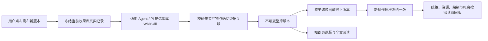

# 整库 WikiSkill：实施与验收记录（2026-11-16）

本记录对应 `evolve-video-agent-creation-and-effect-library` 的整库发布设计。首轮应用实现提交为 `ba6d4e5b8a2461237c2f1a580519b43b775b87ff`，修正编译提示后实际部署的提交为 `71128f66381da8eca4b47e8ada6434daa09389cb`，分支为 `codex/video-capability-experiment-redesign`；本地代码验证、隔离界面验证、角色准入、部署和生产知识发布分别记录，不以某一项通过代替其他项。

OpenSpec 映射使用仓库根 `.openspec-project.json`：`https://openspec.panghuer.top/mcp`、项目 `ec663f5a-53d3-4a0e-9037-933eb788d183`。本文件不代替服务端任务状态，也不自动勾选真实发布或正式新视频采用的任务。

本轮工程完成记录已同步至 OpenSpec 修订 `2cca2d60ff70aefd62263e880dfe551a849385c1`，只勾选 O.2–O.7；当前该变更为 70 项、44 完成、26 待办，服务端规格校验为 0 issues。其余业务待办未因本轮上线而代勾。

## 1. 实现范围

### 页面入口与操作

效果库顶部将两类页面放在导航中：**效果库／知识库**。进度文字和“手动刷新”归入当前页面的进度区，“新建实验”作为效果库的主要动作；知识库自己的主要动作为“发布新版本”。三个不同含义的入口不再作为同级操作并排。

知识库页面是正式 WikiSkill 产物的只读浏览器，包含整库版本选择、版内正文搜索、分层知识文件和发布任务状态，不再要求人工填写知识正文、来源字段或变更理由。效果的修改意见仍留在效果库。

效果详情中的方法发布入口统一指向知识库整库发布流程。旧的人工修改知识及逐方法发布 HTTP 写入口返回 `410`；旧记录仍可作为历史事实及原任务恢复依据，不能作为新的发布旁路。

### 发布链路



- 快照读取真实持久化需求、操作输入／输出、候选与源代码材料、方法及其关联研究、样片身份、意见与撤回记录、失败／停止信息。操作输入与结果分别成文件，不用展示层拼接文字代替原记录。
- 同一快照读取事务排除回收站、已隐藏旧实验及其他发布者内容；效果代表已被移除时，不通过效果描述泄露该代表的候选或媒体身份。
- 视频仅以已有身份、摘要及记录提供取材依据，不把 MP4 字节当作新增媒体观察。旧操作输入中嵌入的 Wiki 是历史输入，不能独立升级为当前正式知识。
- Agent 写出真正的 `SKILL.md` 及下层文件，工程只校验、计算包摘要和发布，不使用固定动画模板或手写知识正文替代提炼。
- 每份输入记录必须有确切引用或说明排除原因；整套包只有一个基础根、层级无环、内部引用存在、文件自包含，不依赖外部视频网址继续可用。
- 编译不渲染动画、不重跑样片、不新增运动／音频验证，也不产生人工认可。产物保留 `frozen_records_only_no_new_media_validation` 和明确的“本次未新增视频、运动或音频验证”局限。

### 耐久状态与版本边界

发布状态为 `queued → uploading → prepared → submitting → running → published`；异常提交可能进入 `submission_unknown`，失败为 `failed`。原请求在提交前持久化，未知提交只找回原任务，不以新请求身份自动重跑。

同一发布者的并发工作受耐久状态与租约约束；所有任务、快照、版本、线上指针及激活请求均按发布者隔离。整版校验通过后才在事务中新增版本并切换指针，失败保留此前线上版本。读取、刷新、搜索与实验结束不会启动编译或发布。

浏览和新制作选择保留最近 **5 个成功版本**；显式设置某个历史版本为线上默认不调用模型，也不改变该版本内容。五版之外的确切不可变产物仍供已冻结任务恢复使用，不能把浏览窗口当作物理删除策略。

容量采用明确上限并在超限时拒绝，不静默截断：清单 1 MiB、最多 2047 份记录、单份记录 4 MiB、快照 30 MiB、总输入 32 MiB、编译输出 16 MiB。整库 HTTP 响应有独立的 18 MiB 上限；中文以完整 UTF-8 传输，不被旧 2 MiB JSON 读取上限截断，也不递归改写包内原始 URL 字段。

## 2. 正式制作读取同一产物

新制作批次从整体统筹请求开始冻结 WikiSkill。默认使用当时线上版本，也可在统筹高级选项明确选择最近五版中的某一版本；浏览器不能指定任意其他发布者。读取侧使用配置的 `publisher_owner`，任务接收者仍是真实项目拥有者。

耐久绑定记录 `batch_id`、`release_id`、`release_sha256`、`publisher_owner`、`release_sequence`。该绑定沿统筹候选、整体采用、制作 run、模块初作／打磨、资源计划及预制作 Manim recipe 传递。内容生成仍由 Agent 自主完成，不将效果库样片直接拼入新片。

已冻结批次在当前线上版本变化、版本超出五版窗口或进程重启后，继续读原字节，不按镜头刷新技能。受内部鉴权保护的跨组件资源恢复按原绑定读取已归档版本并校验身份、摘要和序号，不能重新读取当下 active 代替原版本。

统筹 Agent 使用独立 `video.joint-plan.v2` 和原生 `skill_search`／`skill_read`，按需读取，而不是展开所有知识正文。目录交付、宿主取回、实际工具读取和 Agent 声明采用分别留证，不把其中任意一项冒充最终可见效果或人工审美认可。

没有线上 WikiSkill 时，新的制作批次冻结明确空目录，不回退旧逐方法发布。此前已经形成的耐久旧任务仅恢复自身原冻结内容；缺少新批次绑定的旧统筹方案需要明确重新统筹，不能在音频已启动后暗换知识版本。

## 3. 自动验证结果

以下分组存在重叠，**不累计为唯一测试总数**。

| 验证组 | 结果 | 证明范围 |
| --- | --- | --- |
| 根协调者的干净索引后端联合检查 | 165 passed | 整库合同、快照、耐久状态、HTTP、正式批次接入及相关回归；不等同真实模型运行 |
| 根协调者的构建／资源联合检查 | 160 passed，2 skipped | 构建上下文、固定资源、profile／工具合同及准入检查实现；跳过项不计通过 |
| 干净索引前端四组 | 93 passed | 效果库、知识页、统一发布入口、统筹版本选择等交互与错误边界 |
| 独立干净索引集成子集 | 29 passed，45.37 秒 | 真实持久化快照、Lab→Creation 两跳鉴权、完整中文响应、隔离 Worker 上下文与禁用候选准备 |
| 编译合同／状态机／网关定向组 | 41 passed | 冻结字节、证据成员、单次准入、未知提交恢复、停止及不可变交付验证 |
| 最终提示修正后构建／目录组 | 171 passed，2 skipped | 最终提交的构建资源、角色目录及相关合同；不累加早期重叠分组 |
| 最终编译／网关／目录／准入子集 | 105 passed | 最终固定边界句要求、严格校验及角色接入回归 |

独立干净索引集成实际执行：

```powershell
python -B -m pytest -q tests/video_workbench/test_animation_wikiskill_http.py tests/video_workbench/test_animation_wikiskill_capture.py tests/agent_service/test_wikiskill_catalog.py -p no:cacheprovider --basetemp D:/github/armbianbegin/.research-temp/video-agent-development-20261112/wikiskill-unified-r1/index-integration-tests-r1
```

前端实际执行：

```powershell
node --test tests/video_workbench/animation-method-gallery-ui.test.mjs tests/video_workbench/animation-knowledge-ui.test.mjs tests/video_workbench/skill-publication-ui.test.mjs tests/video_workbench/joint-plan-ui.test.mjs
```

其中专门覆盖：重复点击与未知回执不另开任务；会话存储失败在 POST 前阻止写入；旧账号迟到响应不进入新账号；读取与搜索保持只读；完整参考文件正文可搜索；版本内容不串用；失败保留原 active；超过五版后原冻结仍能恢复；不伪造旧方法审批字段；`starting` 期间可轮询及取消且不重复提交。

新增两个角色的 catalogue 准备是 additive 且默认 disabled：`video.animation-wikiskill-compile.v1`、`video.joint-plan.v2`。单元测试不分配生产 UID、不创建凭据、不代写真实接受证据、不启用路由。实际准入需核对新镜像下原始停止候选的完整输入、产物、工具回执与运行证据，不能借用旧方法作者或统筹 v1 的准入。

## 4. 隔离浏览器检查

浏览器使用从 Git 索引导出的独立源码目录，避开工作树原有未提交修改；所有数据库、脚本和测试输出位于 D 盘既有临时根。真实使用 `LabHTTPServer → MethodLabClient → CreationHTTPServer → WikiSkillCoordinator / AnimationWikiSkillStore`，只有文本编译器和来源记录为显式 mock。页面有“本地隔离夹具 · mock 编译器 · 不连接线上数据”标记。

| 隔离入口 | 准备及核对内容 |
| --- | --- |
| `http://127.0.0.1:18867/knowledge.html` | 初始为真实空版本表；可用一次明确点击演示持久化 queued 到 published，编译器为 mock |
| `http://127.0.0.1:18868/knowledge.html` | 隔离账本成功发布六版，实际目录为 `[6,5,4,3,2]`；三个知识包、四份文件，可选版、激活和搜索 |

根协调者已在隔离浏览器核对五版目录、选择第 5 版、搜索“临时空间避让”并命中 1/4 份知识文件中的参考正文，随后显式将第 5 版设为当前版本；服务端目录真实标记第 5 版为 current，原切换请求完成。空库页面实际单击一次发布，观察同一任务从 queued 到 published，并读取第 1 版完整产物。浏览器 console warning/error 均为空；截图 `browser-wiki-fixture.png` 已实际查看，布局可读。这些操作均只改变独立夹具数据库，不能据此声称已经在真实站点点击发布，或真实 Agent 已完成生产知识提炼。

夹具脚本为既有临时根下 `browser_fixture.py`，数据为 `browser-data-r1/`，索引源码为 `index-ui-fixture-r1/`。这些是可清理的操作材料，不是产品功能、效果库内容或生产发布证据。验收结束后已核对完整命令并停止确切夹具进程，关闭两个本地测试标签；生产页面保留。

## 5. 真实部署与业务边界

r2 镜像组合已实际部署到 Kubernetes，六个 Deployment 均 Ready，原始 Pod 的运行 imageID 与下表确切 digest 一致。部署源码为 `71128f66381da8eca4b47e8ada6434daa09389cb`，公共配置摘要为 `c26a3261638c2de7b0a38605c0a1722adc5287ec3ebe864580f19365284a7779`。容器统一构建、推送和部署 `latest`，以源码标签、部署 annotation 与不可变 digest 记录身份，不创建额外版本 tag。

首组五个镜像（r1）已从完整干净 Git 提交 `ba6d4e5b8a2461237c2f1a580519b43b775b87ff` 实际构建、推送，并核对源码 manifest `b819cf622d5337f0709d297dfb4875fbafd3fb515cc0e8815f34bcc468e457cc`。构建完成回执为既有操作根下 `wikiskill-unified-r1/build-r1/completed.json`，状态 `built_not_deployed`；构建自身 model requests／tasks／renders／deployments 均为 0。随后真实编译候选未通过，r1 未获准上线；r2 另行完成重新构建和独立核实，未借用 r1 的成功构建作为准入。

修正后的第二组镜像（r2）也已从完整干净提交 `71128f66381da8eca4b47e8ada6434daa09389cb` 实际构建并推送，源码 manifest 为 `3570d711b8e5c46c549bdd0de5cd41b7a8969dfcb95a77d267646df53f267e37`，构建回执为 `wikiskill-unified-r1/build-r2/completed.json`。该不可变构建回执的阶段状态保留为 `built_not_deployed`，随后两角色的独立准入和真实部署分别有自己的回执。以下为已准入及部署的 **r2** 镜像，不混用 r1 worker 的 bundle 或捕获记录。

| 镜像（均为 `arm-cluster-master:5000/<name>:latest@sha256:…`） | r2 实际运行 digest |
| --- | --- |
| `agent-service-control` | `158f844ebc0878fded251d6b895d94998e49b9a1cf94417412efa26d6d7902da` |
| `agent-service-pi` | `a0cc426b4413c3bd2fd736c20d423bae90ff4f1883a2833fc0999552ef6adf65` |
| `video-animation-creation` | `956bb8ec3ffd40d2d952ee2d1a17e39707328e629f82ef50ddb63d314bc16e97` |
| `video-workbench` | `83e333577cc8156298448a76429ec396b909d0ceaff71befdd29a3a0cfb5b4ca` |
| `video-animation-lab` | `69f1887300b2fda24491b2fae06c749296d762df8ee16b5bda9d619e8e1021ae` |

worker 镜像用于独立准入及按任务创建的 Worker。control 对应 API、dispatcher、model-proxy 三个 Deployment，另加执行器、工作台和实验室三个 Deployment；六个常驻目标均已逐一验证。

### r1 真实编译候选：未通过

根协调者授权的首次 compiler 隔离候选实际调用模型 **6 次**，Worker 以 `worker_output_invalid` 失败，具体合同原因为 `animation_wikiskill_observation_scope_required`。Agent 将必须独立逐字保留的观察边界句与下一句话合并；最终没有交付可接受的编译产物，没有形成该角色技术准入，也没有发布业务知识或部署新组合。原始停止候选及模型回执保留供核查，失败次数不被新准备目录覆盖。

处理方案是补清提示正文与对应 bundle pin，明确固定局限元素应独立保留，继续保持原有严格校验。OpenSpec 已整理历史冲突并验证为 0 issues，规格存储修订为 `b4309caa7050fe511d8b9f24dcfa899e17930ec1`；规格校验不代替 Worker 输出准入。

### r2 真实编译候选：独立核对通过

`candidate-wkc-r2` 在新的 r2 worker 镜像下实际执行，3 份操作员自写技术记录经 **7 次模型调用**得到 2 个知识包。原输入摘要为 `cd9978ae1c4d9e6c56e9b83e7fa90aa33aca54b5590e37a394f25c0f44ab97b8`，原始结果与规范化结果摘要均为 `68c127184fd4153d2a11a3cceb1283119e5a9dc4049f7cc1aa5798ccbfa68f04`。Worker、proxy 均有原始 Pod 身份及 exit 0 停止记录，过期 lease 实测返回 401；独立报告为 `compiler-r2-independent-report.json`，根协调者已复核并授权生成保持 disabled 的技术准入。

该候选的输入为隔离技术记录，未读取或发布真实业务效果库。报告明确保留 `frozen_records_only_no_new_media_validation`，没有生成视频／配音、没有观察动画效果，也没有形成用户审美认可。

### r2 真实统筹候选：独立核对通过

`candidate-wkp-r2` 以同一 r2 worker 的独立 planner 组合执行，私有候选输入包装上一段真实 compiler 产物，实际 **8 次模型调用（包含连通性核对）**后得到两个统筹片段。原输入摘要为 `1d26fd96061773502b0b8f369ccd66efa6037b89584b8afc642c05f4f29dfad2`，原始与规范化结果摘要均为 `d4a8eb83c884e3d9d31539d77ea24ae6635f797081cb328cfb799f5dd498b461`。目录摘要为 `9e6fe6b13b571ec3649d66dca77895c2566558c0c146eeb0e0dcf49b493f8656`；真实工具记录含两次 `skill_search`、两次根 `SKILL.md` 读取，所读包均由输出中的 `apply/adapt` 决策及实际片段编号覆盖，原文稿逐字保留。

Worker 与 proxy 均已凭原始 Pod 身份确认 exit 0，过期 lease 实测 401。根协调者核对 `planner-r2-independent-report.json` 和完整工具回执后，授权生成保持 disabled 的技术准入。候选目录内的知识包装只用于此次准入，不是业务整库发布；该技术统筹没有采用到用户项目，也没有合成语音、生成动画或替代正式新视频的实际效果验收。

### 上线计划与备份验证

根协调者审阅的操作器只改变两项新角色准入、两段各 65536 的永久 UID、三个不可变 ConfigMap 及六个 Deployment 的镜像／配置引用／发布标记；已有凭据、旧 host、绑定与准入保留。应用前使用 SQLite backup API 在只读源连接上备份三项应用组件发现的 SQLite 账本；不将运行中 WAL 数据库当普通文件直接复制。

首次只读 prepare 被完整 host catalogue 检查阻止，尚未生成 apply claim、分配 UID 或修改集群。修正操作器为先合并两项原准入，再给每个新 host 配置完整最终 catalogue，并重新验证其自身选中组合及原独立 acceptance 未变。真实前后 catalogue 的共享容量报告保留原始 `blocked / existing_caller_scope_changed`，此项源于 PPT 发布工具要求既有 caller 不变；本次两 caller 各追加一个确切 profile 由根协调者单独审核授权并逐字段核对。任何容量、host、绑定或其他历史保留原因仍阻止上线；不修改共享 preflight，不构造虚拟前置 catalogue。

修正后的实际只读 prepare 已完成，根协调者已复核 `apply-r2` 计划 SHA-256 `876fd2d99db2921493a36116cd279e9f71b83ff6acb7ec53fd3e2f07af1b471e`。计划使用公共 ConfigMap `agent-service-wikiskill-c26a3261638c2de7b0a3`，为 compiler／planner 分别规划从 `312082432`／`312147968` 开始的 65536 个 UID。该轮冻结操作器摘要为 `b2c7c6dcf409fe0e2667fdb3a059ce2a5236d06c7bfe171b5140f8420af1e489`。

`apply-r2` 在部署前备份阶段超时，未执行 UID 登记、ConfigMap 创建或 Deployment patch；原 apply claim、备份与失败记录保留。诊断发现操作器递归纳入了不会被本次升级修改的历史副本，其中一份旧备份在 SQLite backup 内重复读取却不写入目标。根协调者明确授权后，仅在核对完整命令及进程 starttime 后停止这个专用备份进程，未停止 Web 主进程、修改源数据库或删除旧备份。

下一轮 `apply-r3` 的操作器改为只备份已确认的活动账本，强制所需文件全部存在：executor 的 14 项已用账本及存在时的新 WikiSkill 账本、workbench 的 5 项账本、lab 的 2 项账本。源使用只读连接及固定读事务；每库记录 callback 的 status、remaining、total、进展与重启次数，10 秒无进展或总计 60 秒时失败，另有 Pod 内的 60 秒 watchdog 防止外层连接超时后留下备份进程。冻结摘要为 `0b940457d88b82fc5100fadf90b6496d2d746eb1381a874b2769ddd7a8da110d`，离线操作器检查 8 项通过。

单个真实活动 `workbench.db` 的一致备份已完成并另行通过 `quick_check=ok`，93,167,616 字节，摘要 `aa7647f754f33c22570e66a6889ef47f1240a1fb971f54fc5d7c3390f8065ab8`，没有遗留对应备份进程。该探测的独立包装程序未保留首轮 progress 输出，恢复回执明确记录此局限，不能拿它代替 `apply-r3` 逐库完整进度回执。上述只证明备份准备与定向探测，仍不将 UID 规划或 prepare 写成部署成功。

根协调者已独立复核新的实际 `apply-r3` 计划 `6a647ca05ff3f1a3e22bf0f05aa06952c2613a3837fb2fa6a9b056d987b847e0`：源提交、五镜像、公共 catalogue 摘要及两段 UID 与 `apply-r2` 一致，活动账本确为 14＋5＋2 项；部署前窄只读查询的 active jobs／UID conflict 均为 0。该计划已执行完成，`apply-r3/apply-complete.json` 的真实状态为 `six_reviewed_deployments_ready`。

实际备份共 **21 项、222,806,016 字节**，每项均固定只读事务并完成 SQLite backup、`quick_check=ok` 和完整 progress 回执；所有最终回调均为 `status=101 / remaining=0 / event=completed`。这证明各账本分别获得一致快照，不声称跨数据库存在统一事务。两段规划 UID 已正式登记为永久且不可复用，`uid-reservation-proof.json` 分别确认 compiler 的 `312082432`／65536、planner 的 `312147968`／65536，节点均为 `arm-cluster-master`。

### 真实只读 smoke 与浏览器验收

`smoke-r3/smoke-complete.json` 实际为 `passed`：六组件的实际镜像、就绪状态及既有健康探针均通过；dispatcher 按真实 Ready Pod／进程检查，未虚构 HTTP 健康接口。三个 control 进程挂载的公共配置摘要一致。使用工作台与执行器中既有 token 文件认证，仅执行 catalogue／active／capabilities 的 GET；compiler、planner v2 均为 configured／ready，开发者与生产知识发布者均为 `27714443`。

实际生产知识库此时为 **releases 0、jobs 0、active null**。隔离 mock 的六个版本没有搬入生产；真实 Agent 的两次成功技术候选也没有包装成业务发布。

根协调者在真实已登录站点完成以下只读检查，三个页面的 console warning／error 均为空：

- 知识库显示真实空状态，“发布新版本”按钮可用；刷新后仍无发布任务，截图保存为既有操作根下 `wikiskill-unified-r1/browser-wiki-production-r3.png`。
- 效果库仍为 7 条，Anime.js 详情仅提供“打开知识库”入口，未保留逐效果发布旁路。
- 正式工作台可见 14 个项目，已打开一项两镜、16 秒的旧项目；高级版本选项默认“当前正式版”，页面明确策划、绘制、打磨固定使用同一版。此次打开旧项目不等同于发起新视频或验证真实知识采用。

以上操作未调用生产发布、生成新片、合成语音或执行新的动画渲染。最终样片的表现力与用户认可仍需独立评价。

可核对的实际操作回执均位于服务器既有操作根 `wikiskill-unified-r1/`：

| 回执 | SHA-256 |
| --- | --- |
| `apply-r3/apply-complete.json` | `ca5540bcd21f1c697ffef6dfde20d36e758539855531ce6672e4618dcae5f895` |
| `apply-r3/database-backups.json` | `28c1cbdac4932b443cefc3e958aa4e87395128de72896d979ebd11a2041d431d` |
| `smoke-r3/smoke-complete.json` | `6c99aa20ad928aadbaae12b610905fa434684f4bf7d785d7c75c3aa3e4ed3d82` |

| 组件／环节 | 状态 | 核对依据与剩余边界 |
| --- | --- | --- |
| Git 远端同步 | 已同步并从确切干净提交构建 | 服务器完整源码提交及构建 manifest 均已核对 |
| Agent control | 已上线 | API／dispatcher／model-proxy 的运行 digest、Ready 与完整配置均匹配 |
| Agent Pi worker | r2 compiler／planner 均独立通过 | 两项固定 role bundle、确切新镜像、真实候选及停止／lease 回执已核对 |
| 动画私有执行器 | 已上线 | 运行 digest、原挂载／凭据保留、实际鉴权 library GET 与 compiler readiness 通过 |
| 视频工作台 | 已上线；历史项目可读 | 统筹 v2 configured／ready，版本入口及两镜旧项目可读；新视频实际采用另行验证 |
| 动画实验室前端 | 已上线并浏览器验收 | 7 条效果保留、统一知识库入口、真实空版本页及 GET 刷新均核对 |
| 新角色准入与激活 | 已独立准入并激活 | 两角色确切技术准入、永久 UID、公共配置、既有 caller 权限及实际 authenticated readiness 已核对 |
| 真实整库业务发布 | 本轮未发起 | 需实际用户可见发布请求、真实快照、Agent 产物及原子切换回执 |
| 正式新视频实际采用 | 本轮未发起 | 同版真实工具读取、生成源码及最终媒体仍需独立证据；技术候选和打开旧项目不足以完成 |

本轮没有把本地六个 mock `published` 版本写入生产库，也没有发起真实效果库的生产编译发布、新视频、语音合成或动画渲染，没有代填人工观看／试听认可或合入主线。界面、真实技术候选、线上部署与只读验收已完成；真实整库发布和正式新视频采用仍明确保留为后续业务操作。

相关设计：[知识库与整库发布](animation-knowledge-workbench.md)、[Agent 动画统一设计](agent-creation-effect-library-plan.md)。平台可信用量、费用、生产存储回收及跨服务整体清理继续归共享框架，不因本次五版浏览窗口新增业务回收待办。
