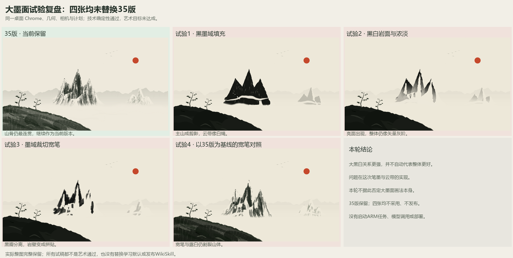

# 大墨面试验：四稿均未采用

2026-11-23。用户希望减少碎毛刷式细纹、增强大黑白墨面、重构定向云海、加重近岸并
退淡远山。本轮做4次桌面 Chrome 完整试稿，**均没有达到优于35版的整体效果**。
[统一墨团与勾骨稿](../shared-mountain-unity-study/README.md)继续作为当前研究参考稿，
本目录是失败研究归档，不是已采用效果、生产模板或新的学习默认。

## 四次试验

1. **黑墨域填充**：在可见共享表面按阴阳和墨团生成少量连通黑域，减少细纹。
   黑白更强，但过度覆盖后主山成为剪影，云带像白绳。
2. **黑白岩面与浓淡**：调整作者光向，给主要岩面留白并增加纵向浓淡。
   画面仍像矢量灰阶岩面，毛笔接触与山骨弱化。
3. **墨域裁切宽笔**：黑域只作落笔约束，实际墨由少量平滑宽笔腹叠成。
   黑瓣、方块和纸白仍割裂山体，右侧配山像漂浮纸片，近岸过平。
4. **回到35版的收敛对照**：沿用原绘画与近岸代码，仅减少细皴、加宽湿笔、加深已有
   墨腹，并保留云带/远山/暖纸色处理。宽笔块面、竖条和峰尖空壳仍偏多，未超越基线。

所有试稿保留相同几何顶点/高程/相机、原始投影depth/normal/position/flow及同一计划；
作者alpha移除了旧屏幕Y约 `H*.8` 的山脚淡出，表面高度foot仍保留。定向cloud atlas
在现有mist-layer一次合成，没有在coverage里再次乘同一雾alpha。试稿的常量暖色乘子
应用到对象缓存及覆盖纸色，近似轻multiply（有8-bit舍入），未增加运行时混合能力。

减少碎笔、加深近岸、退淡远山在局部实现了，但没有自动获得整体性。问题在这次墨面、
笔腹与云白的组织；这些多变量失败不能证明大墨面画法本身或综合色调无效。暖色也不能
修复已经割裂的山骨。后续不应把“更黑、更宽、更少线”直接当成艺术优化通过。

## 证据与复现边界

`baseline-35.png` 与 `trials/01.png`–`04.png` 都是实际桌面输出，完整取景无裁切。
四次的重复、逆序、重载检查均通过，但艺术结论全部未通过。原生摘要、真实像素SHA、
可复现源码范围和运行字节见 `evidence.json`。没有ARM容器复验、模型调用、镜像构建、
部署或新study账本；桌面渲染有成本，未测完整控制器耗时，不记为0秒。

`sources/03-source.json`、`04-source.json` 保存与相应原生摘要完全匹配的源码快照，
`plan.json` 由宿主独立读取。前两张没有保存独立源码快照，仅留真实图片和原生摘要，
不能据此声称四稿均可完整重放。当前原有场景源码、效果、WikiSkill和学习默认没有被替换。

源码快照保留原可变宽笔路的 MIT 声明：小规模移植 Lingdong Huang
[{Shan, Shui}*](https://github.com/LingDong-/shan-shui-inf) `stroke()` 思路，
上游 `9f754d2b2e73495db7883d4d4055a7b0903b0454`；ink-landscape 原许可与准入保持。
